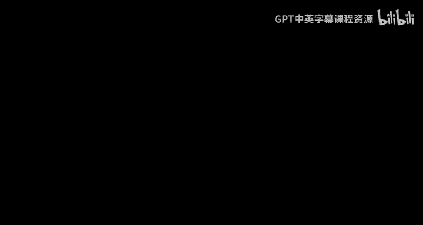

# 生成式AI与学术诚信：P22：版权归属：生成内容的剽窃与溯源

在本节课中，我们将探讨使用生成式AI（如ChatGPT）时可能涉及的学术剽窃问题，以及如何正确地进行溯源和归属。我们将厘清剽窃的定义，分析AI生成内容的性质，并讨论在学术工作中建立关于AI引用的规范。

我是杰克·伯纳德，是密歇根大学总法律顾问办公室的一名律师。我同时在法学院、教育学院、公共政策学院和信息学院任教。自从大约八个月前首次听说ChatGPT以来，我一直在思考它，并回应了我们社区中许多人关于其工作原理及其带来的影响的疑问。

## 使用AI是否必然构成剽窃？

首先，使用ChatGPT或任何其他类型的AI并不必然导致剽窃。这类技术为我们带来了惊人的机遇。人们可以利用这些AI技术完成大量工作，而这些工作本身并不涉及任何学术不端或虚假陈述。

我们总是在工作中使用各种技术。这类AI技术带来的挑战在于，它们能为我们完成大量工作。正因如此，人们可能会倾向于在不给予其认可或承认工作非己所为的情况下使用它们。然而，在学术界，认可与归属是核心价值。由于界限目前尚不明确，我们可能会与这项新技术产生摩擦。

## 界定可接受的协助与剽窃

例如，学生可能会请朋友帮忙：“你能读一下这段文字，告诉我它是否合理吗？”我们通常不会特别感谢这种帮助。现在许多学生使用诸如Word软件中的建议或Grammarly这类技术，我认为这些通常也无需特别致谢。

当然，上述工具还**不具备撰写整篇论文或完整回答问题的能力**。因此，人们担心像ChatGPT这样的产品可能会取代学生甚至教师自己的思考。所以，确实存在许多使用ChatGPT和其他AI技术而无需涉及剽窃的方法。但我认为，滑入剽窃的境地也并不困难。当你时间紧迫时，依赖其他来源是很容易的，因为我们知道学生已经会这样做——他们会上维基百科或别人的文章，直接截取部分内容放入自己的作品而不注明出处。

## 什么是剽窃？

有必要说明一下什么是剽窃。剽窃**不是法律违规，而是对学术规范的违反**。当某人剽窃时，意味着他/她没有承认特定语言甚至思想的来源，或者将其错误地归功于他人（例如为了吸引更多读者而在论文上添加他人的名字）。

我认为在使用ChatGPT这类技术时，没有必要隐瞒这些事实。事实上，我预计学生会说：“我撰写了这篇论文，并使用了ChatGPT来帮助我。”这只是一种可能性。教师将如何回应则是另一个全新的问题。

## AI生成内容的性质

仅仅因为ChatGPT通过扫描大量信息库，并基于其阅读众多材料的“经验”来生成针对查询的、个性化的独立回应，这并不使其构成剽窃。这就像我现在所说的每一句话，都是基于我一生的经验组合而成，但这并非剽窃。

我认为ChatGPT本质上在做与人相似的事情——也许方式不完全相同，但非常类似——即它**模拟知识，并基于其AI模型整合出一个观点**。它可能尚未具备意识，但这很像向另一个做同样事情的人获取信息。因此，ChatGPT在接触大量信息后创造新的表达，其本身并不构成剽窃。

当然，理论上ChatGPT有可能在用户不知情的情况下引用第三方内容。在这种情况下，可能涉及剽窃。但据我所知，这种情况不太可能发生，因为存在一些安全防护措施（尽管这些措施可能以某种方式被绕过，我们尚未可知）。总的来说，仅仅整合其接触过的信息并创造原创性表达，这本身不是剽窃。这只是来自一项技术的沟通。

## 建立AI引用规范

我认为，很难预测我们将围绕这些智能AI技术建立怎样的引用文化。目前，我们不知道该如何做。学生、教师、出版商可能都会对如何承认其材料是否部分通过与某种AI协作完成感到困惑。我认为我们还没有这个问题的答案。

如果是我，我会倾向于让人们知道我使用了AI，因为这与诚信有关。特别是在学术界，我们希望确保我们引用了来源。因此，我认为学生和教师应尽最大努力建立规范标准，明确人们可以使用和不能使用的内容。当然，在一些课堂中，教师可能会将使用ChatGPT作为教学模式的一部分，那么这可能已被纳入作业要求，学生就无需特别提及。

但我认为，如果学生或教师（例如在发表作品时）使用了ChatGPT，承认它是一个好主意，尤其是在早期阶段。因为这能引发讨论，促使我们思考未来关于引用AI的文化将如何形成。

## 总结

本节课中，我们一起学习了生成式AI与学术诚信的关键问题。我们明确了使用AI工具本身不构成剽窃，但**不恰当地隐瞒AI的贡献则可能违反学术规范**。我们探讨了剽窃的本质是对来源的不当归属，并分析了AI生成内容类似于人类整合知识的过程。最重要的是，我们认识到当前正处于建立AI引用规范的初期，主动、透明地披露AI的使用是维护学术诚信和推动相关文化形成的关键一步。