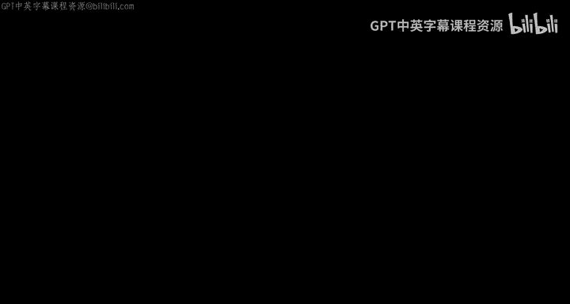

# 生成式 AI 示教：27：深度伪造技术

在本节课中，我们将要学习深度伪造技术。这是一种利用生成式人工智能来制作看似真实、实则从未发生过的图像、视频或音频的技术。我们将探讨其本质、带来的挑战以及社会可能的应对方式。

## 什么是深度伪造？🤔

深度伪造本质上是生成式人工智能的一种应用，用于生成看起来像是真实人物的图像、视频或音频，但这些内容实际上从未发生过。

## 深度伪造的挑战 ⚠️

上一节我们介绍了深度伪造的定义，本节中我们来看看它带来的挑战。深度伪造显然对任何重视现实和真相的行业都构成了巨大挑战。深度伪造的许多问题通常涉及制作内容，例如，制作关于从未发生过的新闻事件的视频，但视频看起来却像真实发生过一样。

## 应对深度伪造的两种思路 💡

面对深度伪造的问题，我们可以从两种不同的思路来回应。第一种思路是认识到，从历史角度看，只要存在记录，人们就有能力伪造记录的问题就一直存在。例如，书面记录显然很容易伪造。即使是像照片这样的东西，从最早的摄影开始，就有人试图伪造根本不存在的照片。深度伪造基本上是这个问题的最新迭代。

但是，深度伪造的根本不同之处在于，技术变得对任何人都如此容易，可以生成**假图像**、**假视频**和**假音频**。由此带来的挑战是：我们将在多大程度上继续相信图像是某事发生的证据？我猜想，就像我们已经愿意怀疑一张可能是假的照片一样，我们最终也会意识到，即使是视频也可能是假的，音频也可能是假的，等等。

## 对依赖真相的体系的影响 ⚖️

然而，这确实给任何依赖真相和证据的体系（如我们的法律体系）带来了压力。问题在于我们应如何应对。我认为最重要的事情之一是对这些工具的使用进行足够的监管，同时也要建立关于我们愿意接受他人如何使用这些工具的社会规范。

以下是可能采取的一些具体措施：

*   我们可能只想取缔某些类型的深度伪造用途。例如，在政治广告中，也许永远不应该使用非实际拍摄录制的影像。
*   在某些情况下，我们必须事先声明某物是否是伪造的。
*   其中一些措施可能需要法律和执法来支持。

## 总结与展望 📝

无论如何，我确实认为，尽管目前的挑战似乎很严峻，但最终作为一个社会，我们将克服它，就像我们克服了（例如）照片伪造的问题一样。

本节课中我们一起学习了深度伪造技术。我们了解了它是生成式AI的一种应用，能制造以假乱真的媒体内容。我们探讨了它对真相和证据体系的挑战，并分析了从历史视角、技术易用性以及社会监管与规范等角度应对这一问题的思路。