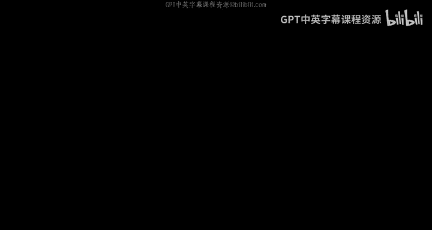

# 生成式 AI 示教：28：AI与艺术创作 🎨

在本节课中，我们将探讨生成式AI输出与人类艺术创作之间的关系，并讨论为何对AI生成内容进行明确标注至关重要。

上一节我们讨论了标注的重要性，本节中我们来看看这种标注如何具体影响创意产业。

生成式AI的输出，与社会中创作者的创意产出——例如书籍作者、画家、音乐家和作曲家——存在一种关系。存在一个问题：像我这样的读者，可能会发现一本由生成式AI系统撰写的书引人入胜。我可能会选择阅读这样一本书。然而，我非常希望在我这样做的时候，能够知道我阅读的是一本由GAI系统撰写的书，而不是由我最喜爱的人类作者撰写的书。

我认为，我对这些事情的预期，也很可能影响我愿意为人类作者的努力支付多少费用，相对于GAI而言。拥有正确的标注，我认为将帮助我们克服市场上已经出现的许多困难。在这些市场上，我们的一些书店，至少是网络上的电子书店，已经被生成式AI内容淹没。真实的人类作者不得不与之竞争，至少在某些类型的创意作品上是如此。

类似地，几个月前，我们有一位艺术家提交了一幅由生成式AI系统创作的画作，并赢得了一场艺术比赛。这引发了大量的辩论和焦虑。这表明，GAI系统生成的艺术质量，至少与参与比赛的人类艺术家创作的艺术质量相当。然而，有一件特定的艺术品是由AI系统生成的这一事实，对评审团、公众以及其他参赛艺术家来说很重要。因此，我认为，明确披露这一点符合所有人的利益。

以下是关于AI生成内容标注重要性的几个关键点：

*   **保护消费者知情权**：读者或观众有权知道他们消费的内容来源。
*   **维护市场公平**：明确的标注有助于人类创作者在市场上与AI生成内容进行公平竞争。
*   **界定价值与伦理**：标注有助于社会区分人类创意劳动的价值，并围绕AI创作引发伦理讨论。

本节课中我们一起学习了AI生成内容在艺术与创意领域的应用，以及对其进行明确标注的必要性。这关系到消费者权益、市场公平以及我们对创意本身的理解。