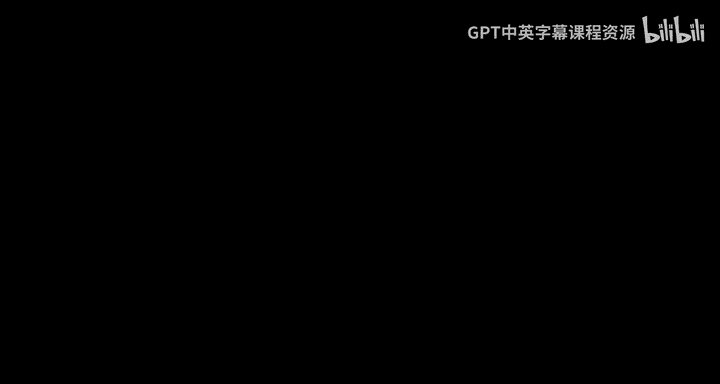

# 生成式AI示教：P31：生成内容的版权与商业化

在本节课中，我们将探讨生成式AI（如ChatGPT）所产生内容的版权归属与商业化问题。我们将分析当前法律框架下的挑战，并讨论相关的伦理考量。

---

## 版权归属：一个开放性问题

ChatGPT输出的内容归谁所有，这是一个有趣且尚未有定论的问题。

从版权视角来看，根据美国现行版权法，任何非由人类创作的作品都无法获得版权保护。因此，ChatGPT生成的内容是否拥有版权尚不明确。当然，ChatGPT软件本身的版权由OpenAI持有，其他用于创作艺术、音乐等内容的AI软件也是如此，其代码的版权归开发者所有。

但AI生成的作品输出则不同。美国版权局不会认可由非人类作者创作的作品具有可版权性。

---

## 核心挑战：人类与AI贡献的区分

我们在深入探讨这一问题时面临的一个核心挑战是：如何判断一部作品中哪些部分由AI生成，哪些部分由人类创作？目前这很难界定。

**类比**：如果我将颜料涂在猫爪上，让猫在画布上抓挠。如果作品是猫完成的，那么它就没有版权。但如果我不说明这是猫的作品，并假装是我画的，美国版权局很难判断这是否属于可受版权保护的作品。这对我们构成了挑战。

---

## 商业化前景与限制

关于将ChatGPT生成的内容进行商业化，目前我并未意识到存在明确的禁止使用这些材料的法规。不过，查阅服务条款是必要的，因为其中可能包含禁止商业化的条款。

OpenAI绝对会找到将其商业化的途径。他们拥有投资者，微软已向其投入了数十亿美元。因此，毫无疑问，他们将找到市场来将这些技术变现以产生收入。

至于个人能否将AI输出内容商业化，这很难断言。在使用这些技术时（我体验过多种），它们能创造出独特而有趣的内容。例如，我前几天让ChatGPT为托尔金的《霍比特人》增写一章，讲述比尔博回家后、甘道夫多年后再次来访之间发生的故事。我要求它“以托尔金的风格”创作，结果它写出了一段精彩的叙事。这很有趣。

---

## 伦理问题：署名与真实性

关于ChatGPT输出内容商业化的伦理问题，总的来说，我们需要**引用来源**并**承认来源**。风险在于，有人可能不这样做——他们可能将ChatGPT生成的内容当作自己的作品发布。

目前，这样做不一定违法。该领域的法律将如何发展，我们还需观察。我预计围绕这些问题将出现大量法律进展和潜在担忧。但这确实涉及作品的**诚信问题**和**真实性问题**，我们一直对此有所顾虑。

在某些方面，使用ChatGPT很像咨询他人。它能以类似人类的方式产生信息，其输出看起来与人类所言（或艺术AI所创作）极为相似。因此，如果人们将AI生成的作品归功于自己，并因此获得赞誉、名声、机会或资源，我认为这为社会带来了一些值得关注的担忧，是我们应该思考的问题。

但我并不认为天会塌下来。现实中本就存在代笔作家、代画画师，我们的许多想法也来自与他人的交流，甚至不记得某个好点子的具体来源。ChatGPT有趣的一点在于，它本身并不独立产生想法——但或许，我们人类有时也是如此。

---

## 总结

本节课中，我们一起学习了生成式AI输出内容的版权现状、商业化可能性及相关的伦理挑战。我们了解到，当前法律尚未明确AI生成作品的版权归属，商业化路径虽存在但需关注服务条款。同时，我们必须重视在使用AI生成内容时的诚信与真实性问题，思考如何在社会层面妥善处理署名与归属的伦理困境。