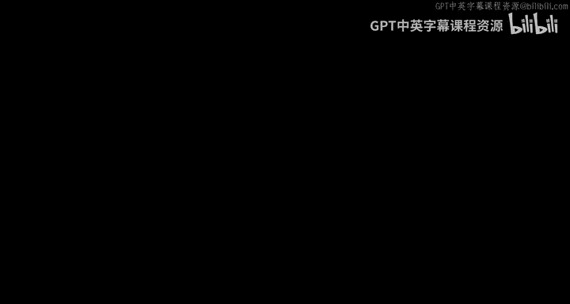

# 生成式 AI 示教：32：AI生成艺术品的所有权 🎨

在本节课中，我们将探讨一个核心问题：由生成式AI模型创作的图像或媒体，其所有权究竟归属于谁？这是一个涉及法律、伦理和技术的复杂议题。

## 所有权声明的现状

上一节我们引出了所有权问题，本节中我们来看看当前业界的普遍做法。大多数开发生成式AI工具的公司，都在其服务条款中明确了生成内容的归属。

以下是这些条款中常见的声明要点：
*   **共享所有权**：提供软件或生成模型的**公司**，与**生成图像的用户**共同拥有生成作品的权利。
*   **双方使用权**：这意味着，公司可以按自身意愿使用你生成的图像，而你作为生成者，同样拥有使用它的权利。

目前，这种所有权分割的模式被广泛采用。

## 艺术家的质疑与“影响”的边界

了解了现有规则后，一个自然的反驳随之而来：艺术家们认为，AI之所以能生成图像，是因为其训练数据中包含了他们的作品。

这是一个非常微妙的地带。关键在于，生成模型产生的结果**并非**对数据中某位艺术家作品的直接复制。因此，艺术家很难据此提起诉讼。

这引出了一个有趣的类比：每一位艺术家都受到前人的影响。生成式AI的学习与创作过程，在某种程度上与此相似。AI生成的图像可能让你联想到某位特定艺术家的风格，但这类似于一位艺术家模仿另一位艺术家。

在现实世界中，当模仿发生时，人们可能会评价说“这只是在模仿，缺乏原创性”，但通常不会引发法律诉讼——除非涉及伪造签名或制作赝品。这正是当前生成式AI图像所处的状况：它们不是复制品，也没有伪造艺术家的签名。

## 技术原理与“复制”的争议

为了更深入理解为何AI生成物不构成“复制”，我们需要审视其技术起点。所有图像生成式AI模型，其生成过程的起点都是一张**随机噪声图像**。

这为“非复制”提供了另一个论据：模型是从一个随机的、无意义的起点，通过一系列复杂的迭代过程，最终转化成一幅可理解的图像。用公式化的语言描述，其过程可概括为：

**输出图像 = 扩散模型（随机噪声， 文本提示）**

因此，从技术层面看，很难将最终输出直接等同于训练数据中的任何特定作品。

## 对所有权与作者概念的深层思考

关于所有权的讨论可能引向一个更根本的、有趣的辩论：它开始质疑**作者身份**和**所有权**这些概念本身。

什么是能动性？什么是作者？这些都是紧迫的问题。我们或许正接近一个转折点，开始意识到传统的“作者”观念可能已经过时。

---

**本节课总结**：我们一起探讨了AI生成艺术品的所有权问题。目前，所有权通常在用户与平台间共享；由于AI从随机噪声生成而非直接复制，艺术家很难主张权利；这一争议最终促使我们反思“作者”与“所有权”等根本概念在未来数字创作中的意义。