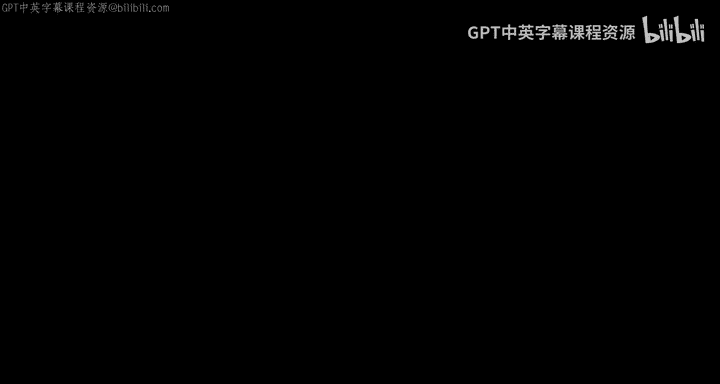

# 生成式 AI 示教：33：不同形式AI的应用影响

## 📖 概述
在本节课中，我们将探讨不同形式的生成式AI（如聊天机器人、图像生成器、音乐创作AI）在法律、社会和教育层面的应用影响。我们将分析它们之间的共性，并思考这些技术如何改变我们的工作、学习和创造方式。

---

## 🤖 不同形式AI的共性
上一节我们讨论了生成式AI的多种形态。本节中我们来看看这些不同形式AI的核心共同点。

从法律和创作本质的角度来看，目前各类生成式AI技术之间并无根本差异。它们都属于同一范畴的技术，即**能够生成本应受版权保护的作品，但由于并非由人类直接创作，因此目前这些AI生成物无法获得版权**。

虽然我们使用图像、音乐或文本AI的方式可能千差万别，但其底层逻辑和法律地位在当前阶段是相似的。例如，一个人使用AI生成的音乐段落，与使用AI生成的文字段落，所面临的诱惑和伦理考量在本质上是相通的。

---

## 🏛️ 技术融入社会的模式
当一项新技术融入社会时，它通常会改变我们的工作模式。这是一个历史规律。

以下是技术影响社会的几个典型例子：
*   **室内管道系统**：我们不再需要外出取水或洗涤。
*   **智能手机**：口袋中的设备让我们能即时访问人类积累的大部分书面知识。

生成式AI很可能遵循相同的路径，成为下一个“减少人类重复性劳动”的工具。

---

## 🎓 对教育领域的变革
这种“工作减少”的效应将深刻改变我们的教学方式。以历史教学为例，事实性知识将变得触手可及。

因此，教学的重点可以发生转移：
*   **从记忆事实转向批判性思维**：教师可以更专注于教授如何批判性地思考历史。
*   **聚焦信息处理能力**：教学重点将放在如何获取信息、如何分析不同叙事（例如战争胜利者与失败者的叙述差异）上。

我们不再仅仅考核学生记住了哪些事实，因为事实本身已易于获取。这将促使我们重新思考在学术领域**衡量什么**以及**如何衡量**。

---

## 🔢 历史参照：计算器的启示
我们可以从计算器的普及过程中看到类似的适应过程。

过去，学生参加标准化考试时不允许使用计算器。如今，在考试中使用计算器已非常普遍。我们的观念随之改变：我们不再要求人们进行枯燥的算术运算，而是允许机器代劳。这被视为一种有效的工作节省方式。

---

## ✍️ 对创作未来的展望
同理，生成式AI可能在未来承担我们创作过程中的“繁重工作”。

创作模式可能演变为：
1.  **AI承担基础工作**：由类似ChatGPT的软件完成初稿或基础框架的生成。
2.  **人类进行精加工**：人类作者在此基础上进行润色、深化和赋予灵魂，这可能成为未来创作中**最具价值的部分**。

这种模式可能扩展到绘画、音乐、诗歌等所有人类创造性领域。机器完成大量基础性产出，而人类负责赋予其深度和意义。机器已经为我们承担了许多工作，我们总能找到适应之道，生成式AI很可能也是如此。

---

## 📝 总结
本节课中我们一起学习了不同形式生成式AI的应用影响。我们认识到，尽管AI生成文本、图像、音乐的媒介不同，但其核心的法律与社会挑战是相似的。回顾历史，从室内管道到计算器，技术不断替代人类的重复性劳动，改变我们的工作与学习方式。生成式AI有望将我们从基础性的创作劳动中解放出来，使教育更注重批判性思维，让创作更聚焦于核心的创意与精炼。目前，我们对待不同AI形式的方式尚未表现出显著差异，但如何适应并善用这些工具，将是社会面临的重要课题。