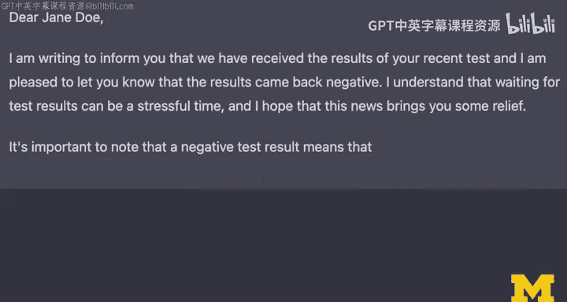

# 生成式AI示教：P34：数据隐私保护 🔒

在本节课中，我们将探讨生成式AI技术中的数据隐私问题。我们将了解用户在与AI交互时可能无意中泄露私人信息的风险，并学习如何在利用AI强大功能的同时，保护个人及他人的敏感数据。

---

## 概述

生成式AI技术带来了诸多隐私问题。人们为了节省工作量，可能会在向ChatGPT等工具提交的查询中包含信息。这些信息中可能包含通常被视为私密的内容。用户可能没有意识到，将信息输入软件时，可能会暴露本不应公开的信息。

## 隐私泄露的风险

上一节我们概述了隐私问题的存在，本节中我们来看看具体的风险场景。

例如，一名医生为了让ChatGPT撰写一封信件或记录与患者的经历，可能需要描述患者姓名和医疗信息。在这种情况下，医生在描述时或许不应使用患者的真实姓名。然而，随着我们习惯使用这些技术，人们可能不会时刻保持警惕，可能不会想起我们在共享信息时通常采取的预防措施。

这主要是因为当你独自在家与一台机器互动时，感觉非常私密。这种感觉让人觉得信息不一定会传播出去。

## 使用AI时的注意事项

认识到风险后，我们需要了解如何安全地使用AI。以下是使用AI助手时应遵循的核心原则：

*   **保持谨慎**：即使希望获得ChatGPT或其他AI机器人的帮助，也应对提供的信息保持谨慎。
*   **利用技术**：使用这些技术非常有帮助，但你可能不希望包含通常属于私密的信息。
*   **安全提问**：可以询问敏感问题，但重要的是省略那些会被你所用技术数据库吸收的信息。

## 信息如何被吸收与使用

那么，具体有哪些信息需要警惕呢？如果你能够提供大量关于一个可识别个人的信息，这些信息可能会融入AI提取信息的背景数据中。

这可能包括：
*   一张照片
*   他人创作的音乐
*   对某个个体的描述

因此，你需要谨慎分享此类信息，因为你不知道它将如何被使用，以及这些信息是否会被暴露。

## 平衡使用与保护

关键在于以这样的理念使用这些技术：你可能会暴露通常不愿暴露的信息。同时，你可以在不暴露信息的情况下讨论非常敏感的话题。

以下是几种可行的做法：
*   **使用化名**：如果需要谈论某个个体，可以为其创建化名。
*   **置于虚构语境**：如果愿意，可以将讨论置于虚构的语境中。
*   **谨慎互动**：你可以以谨慎的方式互动，同时仍然讨论有争议或困难的话题。

实际上，AI技术可能使某些类型的对话对人们来说变得更容易，特别是敏感对话。因为有些人如果是在与一项技术互动，而不是与另一个人，可能会感到更舒适、更诚实。世界上有很多内向的人可能会觉得这样更舒服，可能不只是内向的人，任何只是更习惯于与技术互动的人都可能如此，就像他们可能对狗、婴儿或植物说话一样。

## 技术提供方的挑战与现状

我们作为用户需要谨慎，那么技术公司能做什么呢？我不确定像OpenAI这样的公司能做什么来保护私人信息不被AI暴露。我不确定是否会有一个简单的方法来区分事实与虚构。

也就是说，我不确定他们是否能够判定，当某人试图让AI续写一本书的章节时输入的名字，是否会被视为可识别的个人。如果有人让ChatGPT写一篇小说，那么“小说”这个概念可能会永远与后续的角色绑定。我不确定这是否可能，也许可能，但我不确定他们将如何做到这一点。

他们已经做到的已经非常了不起。当人们与这些技术互动时，体验是产生一个人能产生的东西，或是产生一段看似对话的内容，这些都是惊人的成就。因此，我不想说不可能筛选出事实与虚构，但我认为这将很困难。所以，我不确定他们能做到什么程度。

---

## 总结

本节课中我们一起学习了生成式AI中的数据隐私保护。核心要点是：**AI工具虽强大，但输入即可能暴露**。用户必须对输入的内容保持高度警惕，避免分享可识别个人身份的私密信息。同时，可以通过使用化名、构建虚构场景等方式，在讨论敏感话题时保护隐私。虽然技术公司面临区分事实与虚构的挑战，但用户自身的谨慎是保护隐私的第一道防线。