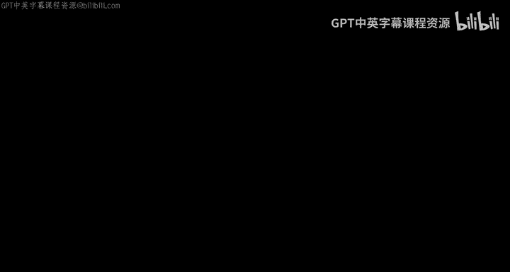
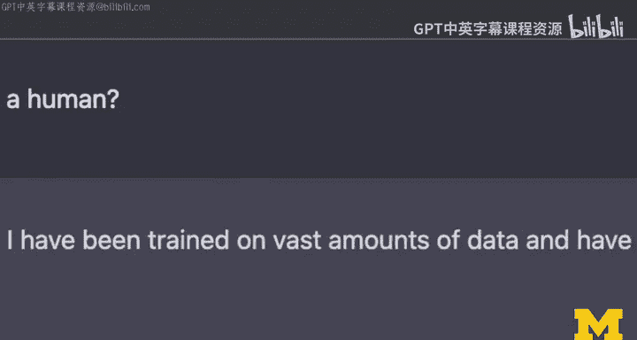

# 生成式 AI 示教：P35：人工智能监管体系

## 概述 📋

在本节课中，我们将探讨当前社会面临的一项重大挑战：如何监管人工智能。我们将分析监管的必要性、潜在的具体措施，以及这项强大技术可能带来的深远社会影响。

---

## 监管的必要性与紧迫性 ⚠️

我认为，我们社会目前面临的最具挑战性的事情之一就是如何监管人工智能。我认为我们无法很快做到这一点。技术已经存在。一些较负面的影响已经被预见。

因此，首要任务是我们确实需要对人工智能进行非常完善的监管。我将这一代人工智能的潜在力量和潜在危害比作核能。就像受到极其严格监管的核能一样，我们也需要以类似的方式思考人工智能的监管。

## 具体的监管措施建议 🛡️

我认为，我们可以立即采取一些措施来改善现状。以下是几个关键方向：

上一节我们讨论了监管的紧迫性，本节中我们来看看一些可以立即着手的具体监管措施。

**明确责任归属**
例如，目前存在一些模糊性：如果一个实体发布的人工智能系统做出了某些行为，比如像我之前提到的失控行为，但该个人或组织并非有意造成这种情况，他们应承担多少责任？我们基本上需要堵住这个漏洞。发布失控人工智能系统的个人或组织需要为此承担全部责任。当然，这会立即减缓个人或公司发布这项技术的热情。事实上，我们已经看到了这样的例子。我们希望确保这些系统不会进行可能让人感到特别糟糕的对话，或者偶尔意外地理解你邮件中非常敏感的内容，并以你不希望的方式意外地将其公开。理论上，即使是今天的技术，所有这些事情都有可能发生。因此，我认为系统做出非预期且负面行为的后果必须是重大的。这些后果需要明确地与发布该技术的个人或组织挂钩。

**建立审计追踪机制**
对于像ChatGPT这样的技术，另一件事是我们可能建议任何此类系统都保留其进行的每一次对话、生成的每一段文本的完整记录，这有多种原因。这样，如果出现问题，我们实际上可以回溯并检查可能出了什么问题。作为一名教师，我也可以说，这将非常有帮助，例如，能够检测我的学生提交的作业是否由ChatGPT撰写。因此，我认为能够检查系统输出了什么的能力至关重要。

**采取保守的监管立场**
还有其他一系列事情。但总体而言，我认为重要的是监管要稍微保守一些，即将责任放在技术的创造者身上，让他们感受和承担技术出问题时的法律责任。

## 监管面临的深层挑战 🤔

上一节我们介绍了一些具体的监管措施，本节中我们来探讨一些更难以约束或监管的深层挑战。

我认为，对于即将到来的一些人工智能技术，更难约束或监管的事情首先是：我们是否准备好让它取代工作岗位？如果是，围绕这一点需要什么样的政策？这些事情的发生将是不可避免的。我们没有试图阻止这种情况发生，比如在制造业机器人方面，尽管它们在某些情况下已经取代了工作岗位。到目前为止，我们还没有讨论过，也许我们不想要自动驾驶卡车，因为这仅在美国就可能消除300万卡车司机的工作岗位。但这些是值得进行的、有意义的对话。

我认为，一些更难监管和调整的事情，因为它们会悄然融入我们的社会，是当我们开始使用这些技术并变得如此习惯，以至于我们甚至没有意识到它们对我们的影响时所产生的效应。我认为，我们已经在社交媒体等技术上看到了类似的情况，我们某种程度上感觉到它正在侵蚀我们的民主，然而却没有尝试去监管，因为我们甚至不确定要监管什么。但我认为，对于人工智能，我们越早进行这些对话越好。我怀疑这类问题只会越来越严重，因为我们将越来越多地面临与技术互动方式转变的挑战，当然，还有我们彼此互动方式的转变。我们是否希望这些转变发生？我认为我们作为一个社会需要更多的讨论，并对此保持清醒的认识。

## 人工智能的“奇点”与未来展望 🔮

我认为ChatGPT代表某种阈值已经达到。人们谈论“奇点”，即人工智能等于人类智能的时刻。从那时起，它会变得越来越聪明。我们还没有完全达到那个点，但我认为我们惊人地接近。如果你想一想，这是人类从未经历过的事情，即存在一种非人类的实体比我们更聪明的情况。因此，我认为这再次表明，它蕴含着巨大的力量——技术力量。任何时候存在巨大的技术力量，它都可以帮助我们实现想要发生的事情，但也可能带来巨大的危险。所以在这种情况下，我确实相信人工智能技术是我们必须极其谨慎对待的，以确保我们的文明真正远离它可能带来的一些最黑暗的潜在影响。

## 总结 ✨

本节课中我们一起学习了人工智能监管的复杂图景。我们认识到监管的紧迫性，探讨了明确责任、建立审计机制等具体措施，也深入分析了监管在就业、社会习惯等层面面临的深层挑战。最后，我们触及了人工智能接近“奇点”所带来的根本性变革与风险。核心在于，面对这项强大技术，社会需要积极、审慎地讨论和制定规则，将责任置于创造者肩上，以引导其远离潜在危害，造福人类文明。