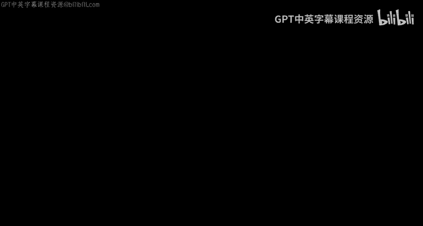

# 生成式 AI 示教：40：对人力资本的影响 💼

在本节课中，我们将探讨生成式人工智能（AI）对人力资本的影响，特别是它在替代与补充人类工作方面的双重作用。我们将通过具体例子，如软件工程领域，来理解AI如何改变知识工作者的任务和所需技能。

---

上一节我们讨论了AI的宏观影响，本节中我们来看看它对具体人力资本的作用。AI对人力资本的影响，很大程度上取决于**替代效应**与**补充效应**之间的平衡。

当AI能够完全执行人类创意知识工作者此前的工作时，可能会造成一定程度的岗位替代。或者，它也可能改变人类与AI之间的任务分配格局。

而当AI与人类的工作形成互补时，它则能显著增强内容创造者的效能。一个贴近我们领域的创造性活动是计算机编程。我是一名计算机科学教授，我们培养软件工程师。这无疑是一个蓬勃发展的知识工作领域，并且通常极具创造性。

像ChatGPT这样的技术可以应用于编程。此外，还有类似GitHub Copilot的相关技术，它已问世一段时间，同样利用机器学习研究大量代码，并能根据提示生成代码。

以下是许多软件工程师发现其有用的几个方面，它并非完全取代人类的工作（至少目前如此），而是作为一种增效工具：

*   它帮助他们快速为面临的任务起草解决方案。
*   它可能最终提高他们的生产力和产出质量。

这改变了他们的工作方式。他们可能需要掌握新技能，以学会如何与AI良好协作。

因此，我认为这也为我们教育工作者提出了新的问题：我们应如何培养知识工作者，使其能在创意流程中与AI技术协同工作？这是我们目前尚未完全掌握如何做好的事情。因此，我们也将围绕此不断学习并发展相应的教学方法。

---

本节课中，我们一起学习了生成式AI对人力资本的双重影响。关键在于理解AI既能替代部分人类任务，也能作为强大的补充工具增强人类能力。这种变化要求知识工作者，特别是像软件工程师这样的创意工作者，发展出与AI协作的新技能。同时，这也对教育体系提出了新的挑战和机遇，促使我们探索如何更好地培养适应未来工作模式的人才。