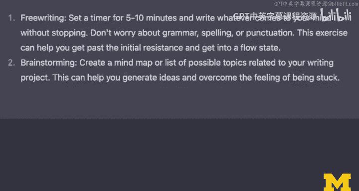

# 生成式 AI 示教：45：利用ChatGPT提升技能水平 📝

在本节课中，我们将探讨ChatGPT在技能发展，特别是写作技能提升方面的潜在作用与争议。我们将分析其与计算器等工具的类比，并思考如何有效利用AI辅助工具，而非完全依赖它们。

---

很多人将ChatGPT与计算器这类工具进行比较。计算器刚出现时，许多数学老师担心学生不再学习数学，他们只会学习如何输入算式，然后由计算器输出答案。但一些人认为，计算器处理了低层次的计算，从而释放了大量精力用于学习更高层次的数学。

在某种程度上，我认为这是正确的。但我不太确定同样的情况是否适用于ChatGPT。例如，如果一个学生输入一个查询：“为我写一篇关于密歇根州树木的历史”，他们可能直接提交这个答案，而不理解其背后的修辞手法、文章结构、如何选择融入的情感，以及如何选词。而这些方面对写作技能和沟通能力的发展至关重要。

通过移除这些过程，尚不清楚ChatGPT是否真的在支持写作。因此，我认为需要更多研究来理解这一点。

---

上一节我们讨论了ChatGPT可能带来的“替代”风险，本节中我们来看看它作为辅助工具的积极潜力。我认为AI在支持写作技能方面存在许多有趣的机会。甚至在ChatGPT出现之前，你就能看到像Grammarly这样的工具，或者在Gmail中，它们会显示你的语气、内容是否过长，以及如何编辑使其更易于消化。

但现在，我想每个人都对理解ChatGPT在写作领域的角色非常感兴趣。我个人感兴趣的一点是：

**支持写作起步过程的工具**。许多其他工具，如Grammarly或评估邮件的工具，要求你先写出初稿，然后另一个工具再来评估其好坏。但许多写作者在起步阶段就遇到困难。我认为ChatGPT的很多价值在于，它能帮你克服对空白页的恐惧——当我们第一次必须写论文时，我们都有些害怕。它直接开始为你写作，我认为这正是让人们感到兴奋的地方：他们可以看到这个过程被完成了。

我认为可以进行更多研究，来理解阅读ChatGPT生成的内容会如何影响你自己的写作。但我知道，有很多讨论是关于人们是否真的在阅读它写的内容，他们是否理解ChatGPT在写什么。因此，有机会去探究这种写作是否可以作为教育模型。

---

本节课中我们一起学习了ChatGPT在技能提升中的双重性。它既可能因替代关键思考过程而阻碍深层技能发展，也可能作为强大的辅助工具，帮助克服写作起步障碍，并提供可分析的学习模型。关键在于如何有意识地将其用作“脚手架”而非“替代品”，并持续研究其对学生实际能力发展的长期影响。