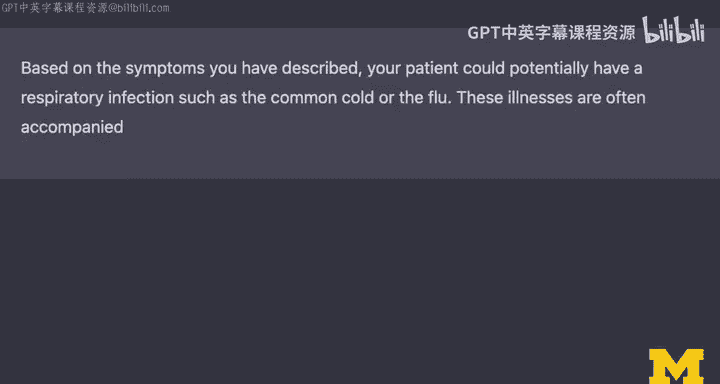

# 生成式 AI 示教：48：AI在医疗实践与教育中的应用 🏥

在本节课中，我们将探讨人工智能在医疗实践与教育领域应用的必要条件、当前影响以及未来展望。我们将了解临床医生和患者参与的重要性，并分析AI在诊断、治疗、预后及医学教育中的潜在角色。

---

当我们思考临床医生在开发旨在影响临床护理的人工智能或程序时，其必要参与至关重要。这不仅仅是临床医生，我甚至认为当涉及到理解真实的临床实践或患者家庭情况时，也应将患者纳入该群体。

如果开发这些技术时，房间里只有开发者，你可以想象，尽管他们可能怀着最大的善意，但缺乏真实的临床经验和/或患者经历特定合并症或健康状况的体验，可能会导致这些技术的使用方式、人与技术的互动方式以及实施方式上存在某种程度的脱节。

我们经常关注的一个问题是，这些技术将如何影响临床医生的工作流程。因此，需要临床医生的输入来确定或告知开发者工作流程的具体样貌，并帮助决定在实践中最合适或最有效地部署人工智能或机器学习模型的位置。对于患者而言，在人工智能和机器学习对临床护理或临床实践的影响方面，情况也是如此。

我敢说，人工智能将以某种方式、形态或形式影响临床实践的方方面面。医学教育也是如此。

---

上一节我们讨论了多方参与的重要性，本节中我们来看看AI在医疗领域的具体应用现状与未来方向。

当我们审视现状时，目前影响最大的领域主要是诊断，特别是基于影像的诊断。考虑到这些技术的性质，这是可以理解的。但最终，我认为它将影响治疗和预后判断。

它将对诊断产生影响，这也是我目前正在研究的领域。而在医学教育方面，在评估、辅导或教学方面，医学生能够与一个非人类、但在某些方面与教师一样知识渊博的“导师”进行互动、交流或双向对话，这种可能性正在显现。

以下是AI在医学教育中的具体应用场景：
*   学生可以与人工智能代理就医学教育中的特定问题、主题或科目进行提问。
*   这种互动可以发生在家庭等非传统课堂环境中，而非必须坐在教室里。

---

本节课中，我们一起学习了临床医生和患者参与AI医疗工具开发的必要性，了解了当前AI在医疗影像诊断中的主导影响，并展望了AI未来在治疗、预后及提供个性化医学教育辅导方面的广阔前景。核心在于，只有结合真实的临床洞察与患者体验，才能确保技术有效、贴合实际地融入医疗工作流与教育体系。