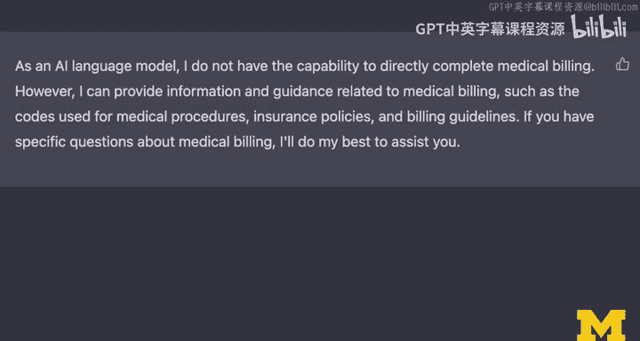

# 生成式 AI 示教：49：ChatGPT通过专业认证考试的影响 🧑‍⚕️🤖

在本节课中，我们将探讨ChatGPT等生成式AI通过专业考试（如美国医师执照考试、律师资格考试等）所引发的讨论与影响。我们将分析这些现象背后的含义，并思考在专业领域，尤其是医疗领域，人类应如何与AI协作。

---

关于ChatGPT通过美国医师执照考试、律师资格考试以及顶尖商学院考试等话题，目前存在许多讨论。我们必须重视这一现象，但同时也需要在一定程度上调整预期，并认识到何时需要审慎看待这些进展。

媒体和技术领域存在过度炒作新技术的倾向，这可以理解。但这种倾向有时会引起相关从业者的担忧或恐慌。例如，临床医生可能会想：“这是否意味着这些技术将取代我？” 病人也可能会担心：“这是否意味着AI将完全取代我的医生？”

从表面上看，事情很容易被理解为AI将取代人类。然而，我通常建议从**任务特定**的视角来看待人工智能和机器学习。这回到了我之前的观点：我们需要将AI视为团队的一员。

我们必须承认一个事实：ChatGPT通过了美国医师执照考试。那么，这对临床医生意味着什么？这意味着临床护理中可能存在一些我们未来不再需要亲自完成的任务。

这里会听到一个术语叫“**去技能化**”。这不一定是一件坏事，因为它可能为临床医生打开新的机会，让他们能更专注于那些本应投入更多精力的任务。例如，提供更富同情心的护理、花更多时间与病人相处，而不是处理那些繁琐的、甚至可以说他们当初选择学医并非为了从事的工作，比如文书工作和账单处理。

如果我们有一个AI助手能替我们处理这些事务，它就可能让我们更专注于以患者为中心的沟通、共同决策、展现同情心，以及与病人进行更有意义的对话。

这并不意味着我们将不再需要医学知识。我们现在需要认真思考的是：从**概念层面**上，我们需要知道什么？我认为，医学教育正在从要求学生成为信息的源头，转向培养他们成为信息的管理者。未来的医疗专业人员需要能够定位、综合信息，并以有效的方式将信息传达给患者。

因此，我们必须从概念层面思考：为了提供有效的护理，医学生、住院医师和医疗保健专业人员需要知道什么？

接下来，我们需要结合思考：作为队友或工具，人工智能和机器学习能做些什么来帮助我们更好地工作？或者说，AI将如何**增强**我们的工作？反过来，我们又将如何**增强**AI的能力？

这正是为什么当我们从团队的角度思考时，能更容易地看到：AI未必会取代医生，我相信这永远不会发生。你可能会听到这样一种说法：AI不会取代所有医生，但它很可能会取代那些无法与AI有效协作或将其作为工具有效使用的医生。

---

**本节课总结**

本节课我们一起探讨了ChatGPT通过专业考试的现象及其影响。核心观点是，我们应将AI视为增强人类能力的**工具**和**队友**，而非替代者。关键在于人类需要提升**信息管理**和**综合应用**的能力，并与AI协作，共同提供更高质量的专业服务，尤其是在需要同理心和复杂决策的领域。