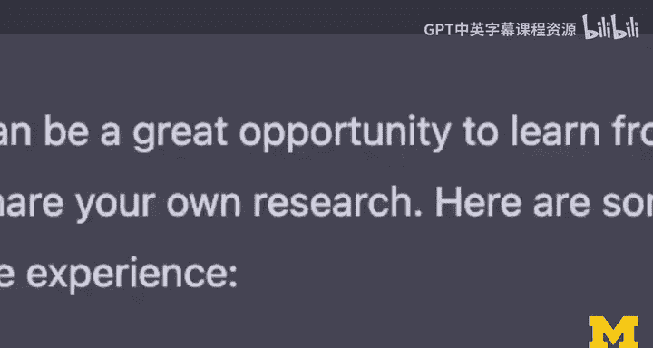

# 生成式 AI 示教：P52：AI在日常咨询与自助指导中的应用

## 概述
在本节课中，我们将探讨生成式人工智能（如ChatGPT）如何应用于日常咨询与自助指导场景。我们将分析其工作原理、优势、潜在影响，并思考如何以建设性的方式利用这项技术。

---

## 技术的社会影响与极化担忧
任何新技术出现时，人们都会感到担忧。以Facebook和Twitter为例，人们最初并未预料到它们会变得如此两极分化。在这些社交平台上，用户倾向于追求关注度和粉丝量，这导致我们更容易被持有极端立场的人所吸引。

Phil Tetlock在其著作《专家政治判断》中发现，在预测准确性方面，持极端立场者的表现甚至不如随机猜测。这意味着，如果你只听极左或极右的意见，其效果可能还不如向靶盘投掷飞镖随机选择。

---

## ChatGPT的“中间道路”特性
ChatGPT的一个有趣之处在于，你可以要求它提供自由派或保守派的观点，但它通常会给出一种相对“中间道路”的回应。这背后存在“人类反馈”机制。在训练过程中，人类参与了检查与调整，旨在引导算法给出更合理的回答。

**核心机制**：`人类反馈强化学习 (RLHF)` 等技术被用于对齐模型输出与人类价值观。

---

## 基础咨询建议的实用性
ChatGPT非常擅长提供基础性建议。例如，当被问及“我是一名二年级研究生，即将参加第一次学术会议，我的策略应该是什么？”时，它给出了清晰、实用的回答。

以下是它可能提供的建议要点：

*   **充分准备**：确保你的演示文稿准备就绪，着装得体，并在台上表现出色。
*   **明确学习目标**：思考你想学习的新知识，并据此选择要参加的会议环节。
*   **保持谦逊**：即使遇到领域内的知名学者感到兴奋，也不要贸然上前谈论自己的研究（毕竟你只是二年级学生），保持冷静。
*   **建立同龄人网络**：这是一个结识其他年轻学者的机会。参加小组讨论，向同龄人介绍自己，因为他们可能与你处境相似。
*   **合理安排日程**：不要过度安排，或许只计划60%的时间，以便灵活调整，并避免精神过度疲劳。
*   **了解自身精力模式**：认清自己在这些场合中是会精力充沛还是感到疲惫，并相应调整日程。

这是一个非常出色的回答，甚至可能比许多人经过长时间思考后给出的建议更好。它的优势在于，它从网络上汇总了人们长期积累的大量建议。

---

## 与传统搜索的对比
通过谷歌等传统搜索引擎，你可能会找到40篇观点各异的文章，且常包含极端意见。而ChatGPT则能产生更具“中间道路”效应的综合回答。因此，它可能在一定程度上起到缓和极端观点的作用。

但关键问题是：人们会使用它吗？例如，人们是否会转向这个“奇怪的人工智能”，咨询买车、购房、与子女谈论遗嘱订立等事宜？目前尚不确定，但它在这些方面确实表现优异。

---

## 理解AI的本质：集体智慧的聚合
ChatGPT的强大有时令人惊叹，但本质上并不神秘。我们可以将其理解为对人类集体智慧的“平均”或“聚合”。

这类似于**集体智能**的概念。以蚂蚁为例：单只蚂蚁并不特别聪明，它们通过留下化学痕迹或触碰触角进行交流。但蚁群却能快速找到食物源并规划出最佳路径，这正是通过聚合信息实现的。

因此，我们不应将AI视为拥有神秘或邪恶目标的“超级大脑”，而应将其看作**人类已有思想的聚合体**。从这个角度出发，我们可以用它来辅助思考各种人生决策。

---

## 作为思维伙伴的价值
当你面临诸如“我应该退休吗？”、“我应该转行吗？”、“我是否应该搬到离成年子女更近的地方？”或“如何与休学一年的孩子沟通？”等问题时，你可以像审问一个知识渊博的伙伴一样与AI对话。例如，你可以说“告诉我更多关于第一点的信息”或“我不同意这一点，因为……”。

这种方式之所以有价值，是因为接触新的想法或知识会促使我们思考。与一个**非常聪明、知识渊博的实体**进行对话，而不仅仅是搜索，能够以我们未曾有过的方式激发思考，这是令人兴奋的。

---

## 总结与积极展望
本节课中，我们一起学习了生成式AI在日常咨询中的应用。我们探讨了其缓解信息极化的潜力、提供实用建议的能力，以及其作为人类集体智慧聚合体的本质。

虽然人们很容易关注这项技术的负面影响，但我们有理由保持乐观。就像电灯、汽车等新技术一样，大多数人最终会利用它们来努力改善生活，而不仅仅是用于聊天。

许多人已经从DALL-E等图像生成工具或音乐生成软件中获得了巨大的乐趣和生产力。看到人们从中获得如此多的快乐，并创造出如此多的价值，是令人鼓舞的。关键在于我们如何以建设性和批判性的方式去使用它。