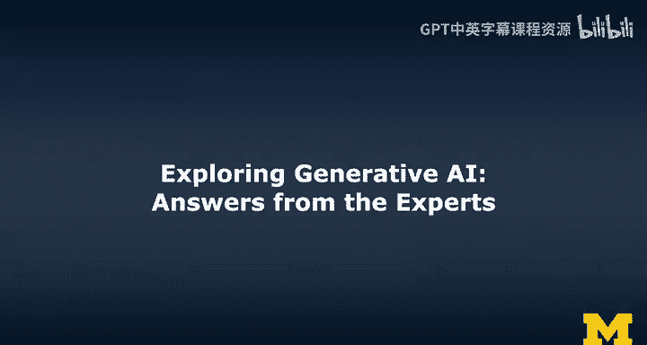

# 生成式人工智能示教课程：P57：实时问答研讨：2023年8月23日

## 概述

在本节课程中，我们将回顾密歇根大学《生成式 AI 示教》课程于2023年8月23日举办的实时问答研讨会的核心内容。本次研讨会汇集了来自创业、建筑、教育及计算机科学领域的四位专家，共同探讨生成式人工智能的现状、应用、挑战及未来展望。我们将学习生成式AI的基本工作原理、其在各领域的实际应用、以及如何负责任地使用这项技术。

---

## 专家介绍

以下是参与本次研讨会的四位专家及其研究背景。

*   **库尔特·西夫萨德博士**：密歇根大学创业中心主任。他的研究兴趣在于生成式AI的商业化，以及它将如何改变商业运作和协作方式。
*   **马蒂亚斯·德尔坎波博士**：密歇根大学陶布曼建筑与城市规划学院副教授。他领导着建筑人工智能实验室（AR2IL），致力于结合计算机科学、数据科学、机器人技术与建筑学，为从自动化制图到文化意义探索等建筑问题寻找创新解决方案。
*   **应祖博士**：密歇根大学马歇尔家族教育学院学习科学与技术助理教授。她的研究专注于利用AI促进教学，特别是开发作为儿童对话伙伴的AI，以探索儿童如何通过与AI的互动进行学习。
*   **安洪国博士**：密歇根大学电气工程与计算机科学学院及信息学院助理教授。他的工作主要涉及两个方向：一是利用AI和生成式AI技术为视障人士等提升可访问性；二是探索如何利用新工具在虚拟现实环境中进行沉浸式创作。

---

## 生成式AI基础

上一节我们认识了各位专家，本节中我们来看看生成式人工智能的基本概念。

### 生成式AI是什么？

生成式人工智能是一种能够根据用户提示创建新内容的技术。它与传统的分析型AI（如医疗诊断、路径规划）不同，其核心在于“创造”。你可以将其理解为一种非常复杂的自动完成功能，但它能在概念层面进行高度精细的操作。例如，它可以：
*   生成莎士比亚风格的散文。
*   编写Python代码。
*   根据简单文本提示创作俳句、音乐或图像（如DALL-E、Midjourney）。

### 生成式AI如何训练？

生成式AI系统的能力很大程度上源于其训练过程。训练依赖于互联网上**海量的、带有标签的数据**，如博客文章、新闻、图片标签等。系统通过这些数据学习概念之间的关联，构建出极其复杂的模型。这个模型能够在高维空间中决策，预测并生成下一个信息单元，无论是图像中的像素、音乐中的音符，还是诗歌中的短语。

**核心公式**可以简化为：`生成内容 = 模型(用户提示)`，其中“模型”是通过**海量数据**训练得到的。

---

## 生成式AI在各领域的应用与挑战

了解了生成式AI的基础后，本节我们将探讨它在不同领域的具体应用及伴随的挑战。

### 艺术与建筑：个性与真实性

当每个人开始使用AI增强工作时，如何保持作品的个性和真实性？

马蒂亚斯博士指出，这并非新问题，任何新工具出现时都会面临。AI的关键不同在于其**学习能力**。艺术家可以通过**训练自己的数据集和神经网络**来利用这一点，有意识地创造独特的美学形式，从而扩展艺术表达能力。安博士补充道，OpenAI等平台推出的**微调（fine-tuning）** 功能，让个人用户定制模型成为可能，这预示着创造力的爆发而非消亡。

### 教育：技能教学的变革

生成式AI工具将如何改变我们在课堂中试图传授的技能？

应博士认为，关键在于平衡**基础技能**的培养与**AI素养**的提升。
1.  **基础技能不可替代**：如同计算器时代算术依然重要一样，分析思维、组织能力、适应不同受众等技能，是学生批判和优化AI产出的基础。
2.  **教授AI应用与理解**：我们需要教学生如何利用AI增强其技能应用。例如，**提示（Prompting）** 的质量直接影响ChatGPT的输出。但教学重点不应是记忆固定提示，而是提供对AI底层逻辑的**更广泛理解**，以帮助学生适应AI快速演变的动态本质。

### 可访问性：机遇与风险

生成式AI如何影响残障人士？

安博士指出，其影响具有两面性：
*   **积极面**：有巨大潜力让世界更可及。例如，通过AI描述图像、视频内容，或像Be My Eyes公司那样，让视障用户上传照片并与AI对话询问内容。
*   **风险与挑战**：
    *   **幻觉（Hallucination）**：模型可能生成听起来合理但完全错误的信息，这对依赖其进行环境感知的视障用户可能构成危险。
    *   **描述偏见**：模型可能使用刻板语言描述残障人士。
    *   **过度过滤**：安全过滤器可能无意中阻止了残障用户的合理请求（如ALS患者询问香烟）。
    *   **技术本身的可访问性**：当前的图像生成模型对视障用户并不友好。

应对策略包括：结合其他可解释的计算机视觉模型进行交叉验证、采用**人在回路（Human-in-the-loop）** 的方法（如在教育中让家长/老师参与过滤）、以及通过技术设计和评估来使系统适应人类需求，而非让人去适应技术。

---

## 现场问答精选

在研讨会的现场问答环节，与会者提出了许多深刻的问题，以下是部分精彩问答。

### 如何在课堂中引入生成式AI？

库尔特博士认为，学生已经在使用这些技术，教育者的责任是将其融入教学，并思考在生成式AI时代如何定义和评估学生对核心概念的掌握。马蒂亚斯博士强调**去神秘化**，向学生展示AI并非魔法，而是有特定工作原理的技术，从而培养批判性地使用工具的能力，并思考其文化影响。

### 生成式AI与预测式AI有何区别？

库尔特博士认为这更多是语义上的区分。马蒂亚斯博士则从功能角度解释：AI擅长**优化**和**预测**。当前生成式AI工具主要是优化器，它们针对特定提示优化输出链，但这不总是产生“最佳”结果，可能涉及非逻辑的权衡。应博士以教育研究为例：**预测式AI**可用于根据学生当前表现预测其能力发展；**生成式AI**则用于创建能动态生成问题和反馈的聊天机器人。

### 除了ChatGPT，还有哪些工具适用于大学课堂？

应博士指出，ChatGPT让AI对师生而言变得具体可感。虽然存在许多针对特定教学场景的研究型AI工具，但目前很少有工具能像生成式AI这样引发广泛讨论。马蒂亚斯博士提醒，生成式AI只是AI能力的很小一部分，过度聚焦可能忽略其他更有用的可能性。此外，**预训练（pretrained）** 模型可能隐含审查，限制创作自由，而学习构建自己的模型能带来更大自由度。

### 生成式AI在金融科技（Fintech）中的影响？

库尔特博士指出，金融业长期使用AI（尤其是预测模型）。任何拥有大量信息流和历史数据用于训练的领域，都有机会利用生成式AI获得洞察并产生有趣的结果，这是一个备受关注且可能产生高价值的领域。

### 生成式AI的未来会怎样？

专家们普遍认为：
*   **深度集成**：这些工具将更自然地融入我们的生活和工作，未来我们可能不再特意称其为“AI”。
*   **实时与高效学习**：克服当前预训练模型的限制，实现**实时训练**或开发能用更小数据集快速学习的**数据饥渴型神经网络**，将是重要方向。
*   **个性化与应用化**：像Apple的“个人语音”功能一样，生成个性化模型的能力将增强。最终，生成式AI能力将与解决具体问题的应用程序深度融合，成为我们日常工具的一部分。

### 如何继续学习生成式AI？

专家们给出了不同路径的建议：
*   **作为用户**：直接开始使用，许多工具的界面非常直观。关键在于运用你的语言直觉和批判性思维。
*   **作为开发者或爱好者**：可以从学习**Python**、了解背后的**数学原理**开始。YouTube等平台有大量优质入门教程（如Justin Johnson的系列视频）。
*   **利用社交媒体**：在Twitter/X等平台关注领域内的思想领袖和公司，通过他们分享的链接和技术讨论快速学习。
*   **警告**：这可能会是一个“兔子洞”，但也充满乐趣。

---

## 总结

在本节课中，我们一起学习了生成式人工智能的核心概念、其跨领域（商业、艺术、教育、可访问性）的应用与挑战，并展望了其未来发展趋势。关键要点包括：生成式AI的核心是创造而非分析，其力量源于海量数据训练；在使用时，需平衡工具效率与人类创造力、基础技能与AI素养；我们必须警惕其风险，如幻觉、偏见和可访问性壁垒；未来，AI将更深度地融入生活，而持续学习的最佳途径是结合实践、理论探索和社区交流。