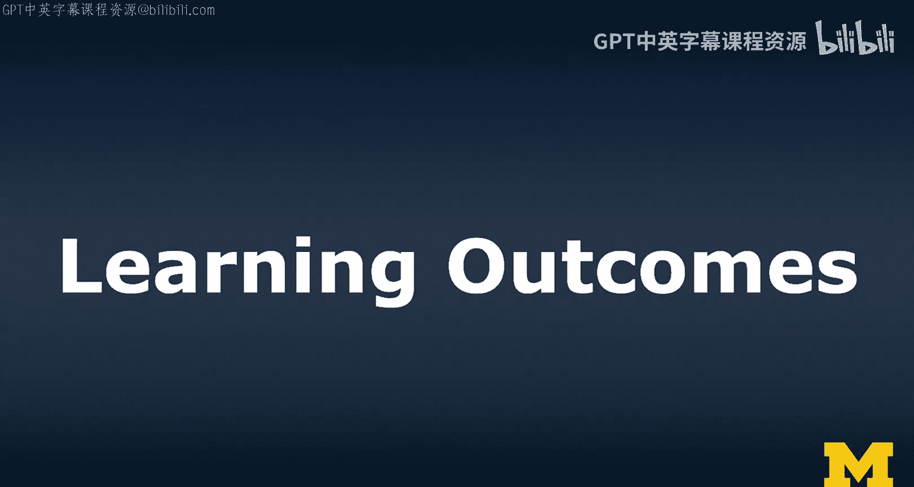
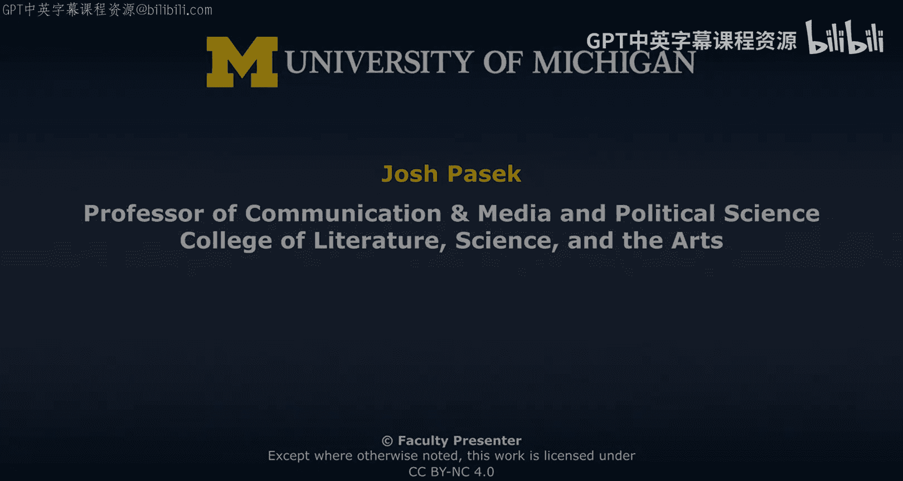

# 应对颠覆：工作场所的生成式人工智能：1：0_系列概述课程简介

大家好，我是乔希·帕索克，是密歇根大学传播、媒体与政治学教授。

欢迎来到《生成式人工智能预测颠覆》。这是四门系列课程中的第一门课程。

本系列课程名为《应对颠覆：工作场所的生成式人工智能》。在本课程中，我们将探讨生成式人工智能的工作原理，以及人工智能如何可能成为一种颠覆性技术。

在开始之前，我先简单介绍一下自己。

我的背景是传播学研究员，我的学术研究围绕人们如何理解新闻中的话题展开。

我使用多种数据科学和机器学习技术来理解公众舆论的状况，以及人们如何利用信息做出社会和政治决策。

我研究中使用的一些数据分析方法，构成了现代人工智能系统的核心。

从技术视角及其作为信息与通信技术的角色来理解人工智能，能为我们提供宝贵的见解，帮助我们认识人工智能的**功能**或**能力**将如何与社会世界互动。

确实，在社会科学与数据科学的交叉领域工作，以及曾担任密歇根数据与人工智能社会研究所的副所长，使我处于关于人工智能可能产生的社会影响讨论的中心。

在这个短期系列课程中，我们将探讨人工智能将如何影响当代工作场所。

考虑到人工智能可能带来的变革规模，以及关于人工智能未来和我们如何应对它的不确定性，我设计本课程时着眼于过去的信息和通信技术如何塑造了其时代的社会和工作环境。

这些历史案例的经验教训，为我们思考人工智能的影响提供了背景。

要理解人工智能将对工作场所产生何种影响，以及它可能在何处带来意想不到的障碍，需要理解四个关键领域，这也是本短期系列课程的**核心**。

以下是这四个关键领域：

首先，评估人工智能的影响需要我们理解当代人工智能究竟是什么。

本系列的第一门课程聚焦于生成式人工智能，名为《生成式人工智能预测颠覆》。它将人工智能置于早期颠覆性技术的背景下进行考察，探讨人工智能的工作原理，并解析不同的使用方式如何产生不同的结果。

理解人工智能影响的第二个支柱，源于关注人工智能将如何改变构成当代工作场所的各类任务。

第二门课程名为《生成式人工智能塑造工作与任务》，重点介绍了来自各类工作场所的一系列工作岗位。

该课程探讨了哪些工作任务更容易或更不容易被人工智能替代或增强，以及人工智能的整合可能如何改变人们的工作内容。

接下来，我们将视角放大，思考角色和职责的转变将如何更广泛地改变知识工作，以及在企业、员工和客户之间，人工智能整合后，互动关系可能发生怎样的变化。

本系列的第三门课程《生成式人工智能整合：对劳动力和劳动力的影响》，将探讨这些问题以及企业应如何准备。

最后，本系列课程将以探讨当代及近期人工智能系统在工作场所实施中可能带来的诸多挑战作为结束。

在《工作场所中的生成式人工智能：政策、伦理与风险》这门课中，我们将研究关于何种人工智能使用可能被认为是合适或可接受的问题，公共政策如何处理人工智能，以及该技术似乎正朝着哪个方向发展。

虽然你可以选择性地学习这些课程，但我认为按照这个顺序学习，你将获得最大的价值。

理解生成式人工智能的工作原理，是理解它可能对员工任务产生何种影响的重要基础，而这本身对于理解即将到来的颠覆对工作场所更广泛的影响也很有价值。识别可能发生的变化，有助于你为思考何时何地可能出现问题做好准备。

在第一门课程《生成式人工智能预测颠覆》中，我们将首先回顾过去的颠覆性技术，并思考人工智能如何带来相似及全新的挑战。

然后，我们将深入了解生成式人工智能的本质，解析其工作原理，提供一些使用生成式人工智能时改善结果的技巧，并认识人工智能能够和不能完成的任务。

学习完本课程后，你应该能够做到以下几点：

*   在基础层面解释生成式人工智能工具的工作原理。
*   将生成式人工智能的影响与早期技术进步的影响进行比较。
*   识别人工智能工具目前能够完成的任务。
*   认识人工智能的关键局限性，例如**幻觉**和**重复性**。
*   认识大型语言模型的**功能**和**缺点**。
*   认识到人工智能使用的质量取决于提示，并能实施一些基本的**提示工程**策略。

非常高兴你能加入我们的课程，希望你觉得它有价值。

