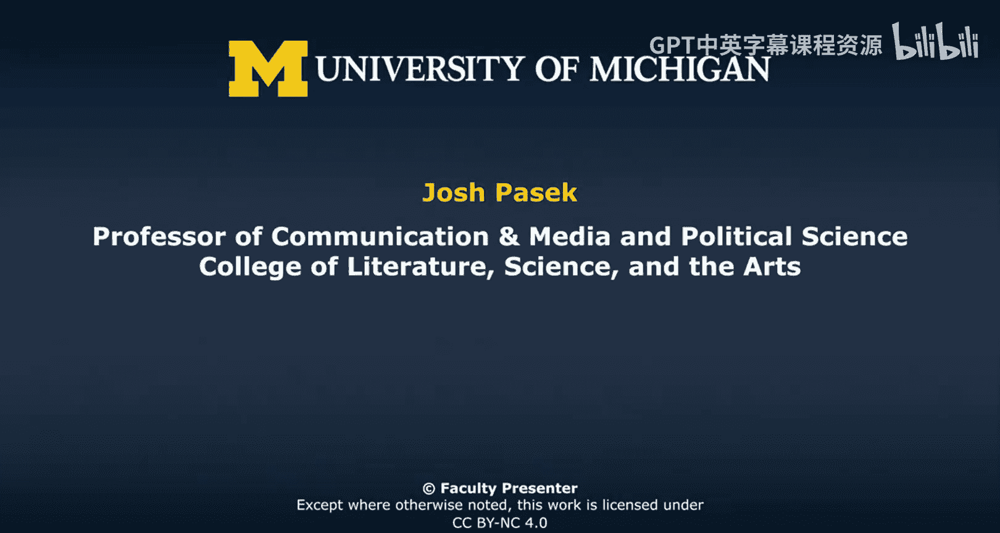

# 应对颠覆：工作场所的生成式人工智能：P2：1_人工智能与印刷术

在本节课中，我们将通过回顾历史上的一项颠覆性技术——印刷术，来理解技术变革的普遍规律，并以此为镜，探讨人工智能可能带来的影响与变革节奏。

## 印刷术：一项千年的颠覆

欢迎来到德国美因茨。这座城市位于莱茵河畔，是德国莱茵兰-普法尔茨州的首府。

我们将颠覆性技术的探索之旅起点设在这里，是因为美因茨或许是过去一千年里最具颠覆性的技术发明的故乡。

在我身后的这个地方，15世纪30至40年代，约翰内斯·古腾堡组装了第一台活字印刷机，并建立了他的作坊。

这项发展使他能够以人类文明史上前所未有的速度和一致性生产印刷页面。

## 印刷术前的世界：知识与劳动的形态

在古腾堡时代之前，如果你想获得一本书，你需要雇佣一位抄写员。

抄写员是专家，其工作是仔细地将手稿旧版本中的每个字母誊抄到新版本上。

抄写员一次只能制作一本书，他们的作品非常珍贵。他们创造的书籍稀有且昂贵。其中包含的知识本身就是一种珍贵的商品。

只有极少数人能识字，并进入那个能够接触这些智慧的小圈子。

## 颠覆的发生：从稀缺到普及

发生在美因茨的这一切将改变人类文明的轨迹。

在相对较短的时期内，抄写员变得不再必要，书籍变得普及，识字开始渗透到大众之中。

但印刷机引发的革命并非一夜之间发生。

相反，一系列渐进的变化改变了信息在社会中的角色以及社会本身的组织形式，这些变化最初并不明显，只有在随后的几十年和几个世纪里才变得清晰。

## 适应的过程：技术与社会的协同演进

事实上，在早期，抄写员制作的手稿仍然被认为比印刷品更有价值。

印刷商努力生产看起来像由抄写员誊抄的印刷书籍。

直到后来，他们才开始利用印刷页面的独特优势，例如**标准化格式**。

印刷机的全部影响直到社会准备好接受它们时才会显现。

在没有广泛识字率的情况下，书籍和小册子只对少数人有用。

信息传播的规范对于印刷机革新科学和文学是必要的。

新的宗教、政治和社会结构只有在人们清楚如何利用印刷文字公开流行辩论时才出现。

## 深远影响：连锁反应与长期效应

以下是印刷术引发的一系列连锁发展：

*   报纸的发展
*   宗教改革
*   古代文本的广泛再流通
*   启蒙运动
*   科学革命的开始

这些都是古腾堡发明的逻辑产物。但其中最早的影响直到15世纪末才显现出来。

## 历史中的其他信息革命

印刷术的颠覆远非唯一改变信息传播方式以及人类劳动如何塑造这种传播的技术。

在19世纪上半叶，电报的普及使得发送信息的速度超过了人类旅行的速度。

19世纪90年代，无线电通信引入了将信息广播给广大受众的可能性。

20世纪上半叶，新媒体使得不仅可以传递文本和声音，还可以传递图像。

而在20世纪下半叶，个人电脑的发展再次革新了捕获和传播信息的方法。

## 对技术影响的预测与反思

这些技术中的每一项都产生了深远的影响，引入了新的做事方式，并促进了后续改变人们生活方式的发展。

这些技术引发的转变也引发了关于其累积影响的广泛猜测。

有些人预测外国政府之间的即时电报连接将带来世界和平。

另一些人则认为电影将削弱父母和老师的权威。

这些关于技术影响的乌托邦和反乌托邦愿景常常很普遍。

尽管每一项技术在其时代都可能看起来像一个美丽新世界，但最终的影响并不那么泾渭分明。

## 人工智能：新的颠覆与历史的启示

人工智能显然有潜力对未来做事方式引入重大颠覆。其影响确实深远。

但从过去的这些颠覆中，我们可以学到很多。

尽管某些做事方式可能会改变，但大多数工作和职场也很可能适应这些变化中的绝大部分。

变化本身可能需要时间。事实上，即使在古腾堡发明之后，其工作最明显过时的抄写员也又坚持了几十年。

最大的影响可能只有在技术有时间成熟，并且我们在社会上已经找到如何适应它之后，才会对我们所有人变得清晰。

当我们探索人工智能如何工作以及它对各个领域有何种影响时，我们需要同时认识到人工智能可能具有的革命性潜力，以及这场革命可能发生的漫长时间跨度。

## 总结与前瞻

本节课在约翰内斯·古腾堡的出生地显得尤为贴切。当然，我们越是深入思考下一次伟大革命的技术及其影响，我们就越能做好准备并主动应对。

