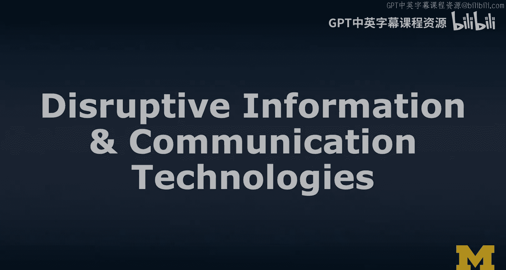
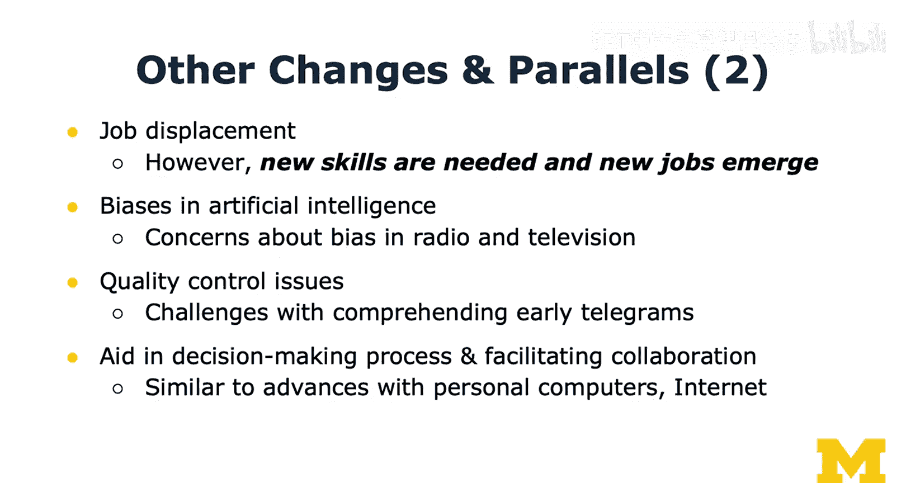
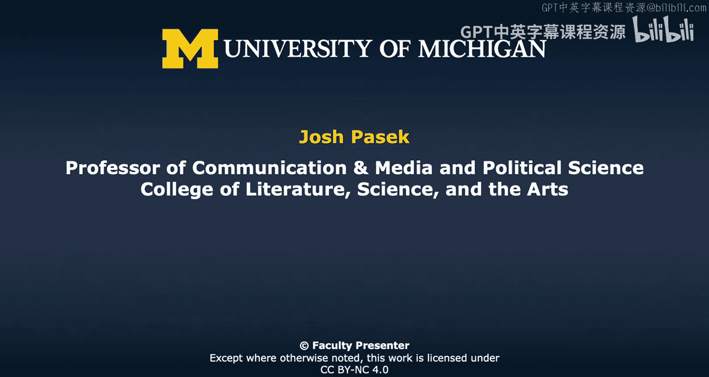

# 应对颠覆：工作场所的生成式人工智能：3：2_颠覆性信息与通信技术

在本节课中，我们将探讨人工智能作为一种颠覆性技术，如何改变人们的工作方式和社会运作方式。我们将通过将其与历史上的颠覆性技术进行对比，来理解这些变化的本质及其对社会可能产生的影响。

从许多方面来看，人工智能的新颖性使我们难以看清它与过去颠覆性技术之间的相似之处。

作为一种颠覆性技术，人工智能将改变人们的工作方式以及社会的运作方式。

它将改变信息的流动方式。审视人工智能可能引发的具体颠覆，并将其与历史上的颠覆联系起来，有助于我们理解这些变化的本质及其对社会可能意味着什么。

上一节我们讨论了人工智能作为颠覆性技术的宏观影响，本节中我们来看看人工智能可能引发哪些具体类型的变化。

我们能否在这些变化与过去的颠覆性技术之间找到相似之处？

人工智能使人们能够完成一系列常规任务，甚至创造性任务。

没有受过艺术训练的人现在可以生成艺术作品，对作曲知之甚少的人现在可以创作音乐。

这让人联想到印刷术带来的影响。

那时，个人能够将原本需要大量专业知识和繁琐重复的过程自动化。

人工智能工具也有潜力简化内容创作过程中的某些环节。

这在很多方面类似于装配线如何改变制造效率，并允许更高效地生产更多产品。

人工智能有潜力生成个性化内容。

允许信息更直接地针对特定人群。

这呼应了当代广告的出现。

广告商越来越能够针对公众中的特定细分市场进行营销。

广告的运作方式必须改变，但广告作为一个过程保留了下来，并且这个细分市场的规模甚至扩大了。

人工智能将创造新的工作岗位。

当个人电脑普及时，技术图纸由平面设计师而非手工绘图技术员制作。

计算机化数据库的出现意味着需要的数据录入员减少，而数据分析师的市场则迅速扩大。

目前已经很清楚，人工智能将需要新的角色，例如**AI训练师**和**提示工程师**。

人工智能将导致许多职位所需技能的转变。

就像印刷术出现后我们需要学习新的读写技能一样，现在数字素养技能将变得更加重要。

以及如何有效与人工智能互动的技能。

人工智能将加速信息共享。

这类似于电报、广播和互联网各自迅速提高通信速度的方式。

人工智能将降低生产新颖内容的成本。

这呼应了印刷术发明后手稿成本急剧下降的情况。

随着过去可能备受重视的职位现在价值降低，也会出现工作岗位的替代。

随着大规模制造业的发展，对体力劳动者和工匠的需求减少了，因为这些技能变得不那么必要。

但同时，新的技能过去和现在都是需要的。

人工智能中的偏见反映了人们对广播和电视可能传播宣传的普遍担忧。

当时和现在一样，需要新的制度结构来解决这些问题。

我们需要规范如何应对人工智能中的不准确性，以及如何定期检查它。

将会出现需要处理的质量控制问题。

我们如何确保从人工智能系统中获得的内容是高质量的？

早期电报也需要新的工程师来确保接收信息的人能够理解电报内容。

利用人工智能通过数据分析辅助决策，带来了新的能力。

这在某种程度上与计算机本身如何彻底改变我们处理和分析数据的方式并非完全不同。

人工智能将非常有效地促进大型社会团队和组织之间的协作。

这呼应了互联网实现全球连接的能力。

并且很可能出现许多我们希望促进的创新应用。

了解了人工智能可能带来的各种具体变化后，我们来看看它在不同领域的实际应用。

人工智能正在帮助医疗保健领域发现新药。

它在金融行业提出最大化收入的策略。

并且为教育领域提供了整合实时信息的机会。

这些与电力如何改变各种新工业部门有相似之处。

我们需要理解如何应对这些技术发展，但重要的是，我们以前做过这件事。

我们不仅为印刷术这样做过，也为个人电脑和许多其他技术这样做过。

人工智能变革的长期社会影响，我们可能暂时无法知晓，并且过程可能充满波折。

但认识到可能发生的变化并为之制定计划将非常重要。

从过去通信和生产技术的革命中得到的教训是，我们能够并且将会适应。

本节课中我们一起学习了人工智能作为颠覆性技术的具体表现，并将其与历史上的印刷术、电报、计算机等技术进行了类比。我们探讨了人工智能在自动化任务、创造新岗位、改变技能需求、加速信息流动、降低成本、引发偏见和质量控制问题等方面的潜在影响，并认识到尽管前路可能充满挑战，但借鉴历史经验，人类社会有能力适应并规划好应对之策。