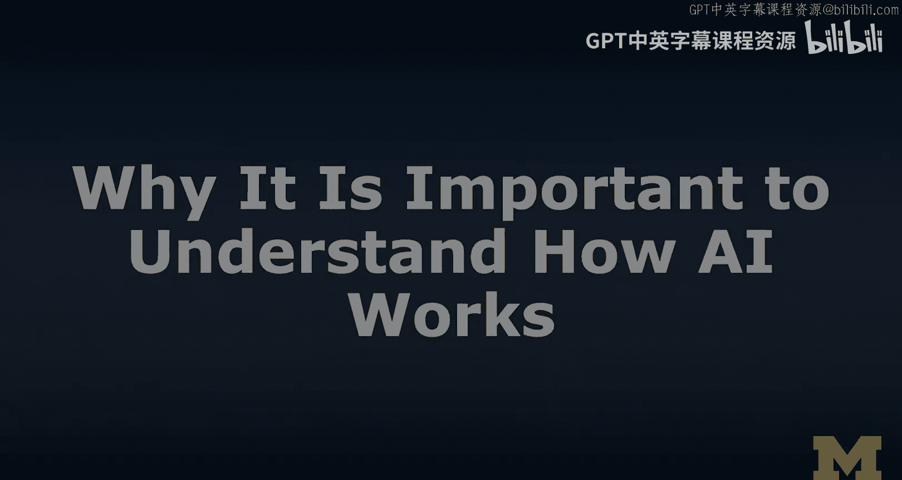
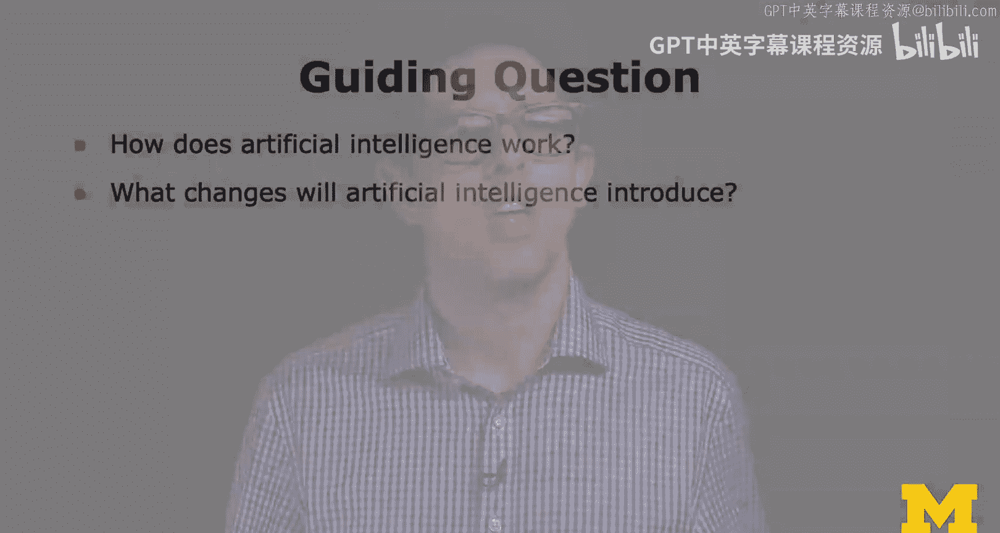
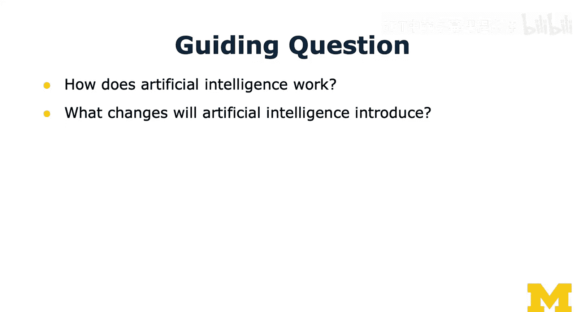
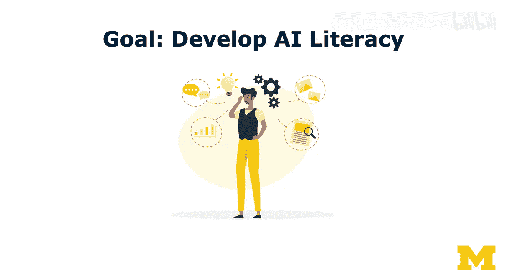
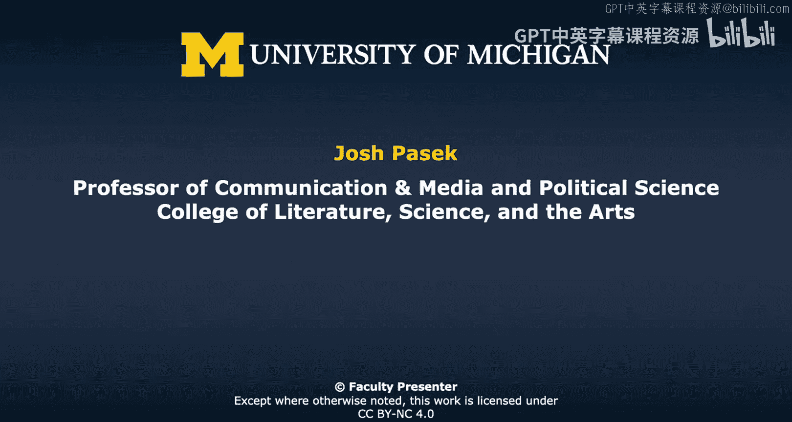

# 应对颠覆：工作场所的生成式人工智能：4：理解人工智能工作原理的重要性 🤖

在本节课中，我们将要学习人工智能的基本概念、其发展历程、广泛应用以及伴随而来的机遇与风险。理解人工智能的工作原理，是评估其潜在颠覆性影响并负责任地使用它的关键。

---

上一节我们讨论了颠覆性技术的本质，以及人工智能如何有望成为其中之一。为了理解人工智能可能带来的潜在颠覆，我们需要了解人工智能的工作原理以及它将引入何种变革。

人工智能指的是任何能够复制我们认为是人类特有过程的计算机化系统。它已经渗透到我们日常生活的方方面面，嵌入在社交媒体算法、虚拟助手和制造流程等各个层面。认识到人工智能在这些不同环境中的作用，以及生成式人工智能这一特别重要的应用（我们稍后会讨论）所扮演的新兴角色，有助于我们理解这些影响可能是什么。

从历史上看，人工智能的概念出现在20世纪中叶。当时有一种观点认为，随着计算机能力越来越强，它们将接近我们认为是人类特有的那种智能。

---

这个想法催生了图灵测试，最初被称为“模仿游戏”。该测试旨在检验计算机是否能在特定领域表现出与人类产出无法区分的行为。随着新技术的发展，人工智能的定义和目的也发生了变化。人工智能的首次应用是针对金融等行业中的特定后台任务，以及手写检测等领域，这些应用通常旨在基于预设标准执行特定任务。

随着时间的推移，人工智能已经发展成为一套可供所有人用于各种目的的工具，范围从语音助手到各种人工智能驱动的应用。随着这种广泛的普及使人工智能民主化，它日益成为个人和专业活动中不可或缺的一部分。

---

人工智能之所以获得广泛使用，是因为它有助于提高生产力、提供娱乐以及完成许多其他日常任务。以下是人工智能的一些关键应用领域：

*   **在线视频提供商**：其核心是人工智能驱动的推荐系统。
*   **智能家居设备**：实现设备间的相互交互。
*   **语言翻译工具**：让国际旅行变得更加容易。
*   **其他无数应用**：涵盖了日常生活的各个方面。

对于组织而言，人工智能也越来越多地用于决策、简化流程以及通过预测分析、自动化客户服务和供应链优化等服务推动各种形式的创新。

---

然而，人工智能在个人和社会层面也带来了一系列风险和弊端。对于个人而言，人工智能带来了隐私问题，因为它可以收集并可能滥用个人数据。它也可能延续社会偏见，放大歧视，因为人工智能是从可能带有偏见的数据中学习的。我们将在未来的讲座中深入讨论这类挑战。

还存在社会风险，包括自动化导致的失业。此外，还可能存在伦理困境，因为人工智能的决策可能不透明并引发道德问题。

---

与人工智能协作要求我们具备人工智能素养。人工智能素养包括理解人工智能如何运作、如何赋能个人，以及个人如何负责任且有效地使用这些工具。人工智能素养帮助我们识别和减轻潜在风险。正因如此，本课程的一个目标是提供对人工智能的基本理解，以便在了解其能力和局限性的基础上，在个人和职业环境中做出更好的决策。

---

随着我们继续学习本课程，我们将强调理解人工智能对于利用其好处和减轻其风险的重要性。未来，及时了解人工智能的新发展将非常重要。理解支撑人工智能系统的机制，对于负责任地参与关于人工智能适当与不适当使用的讨论，以及理解人工智能如何才能真正造福人类，都至关重要。

---

本节课中，我们一起学习了人工智能的定义、历史演变、广泛的应用场景以及伴随的机遇与挑战。理解其工作原理是驾驭这场技术变革、最大化其益处并最小化其风险的第一步。在接下来的课程中，我们将更深入地探讨生成式人工智能等具体应用及其对工作场所的影响。