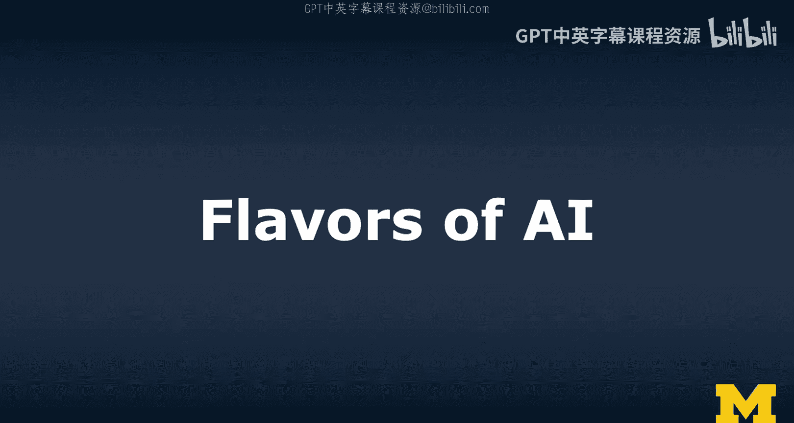
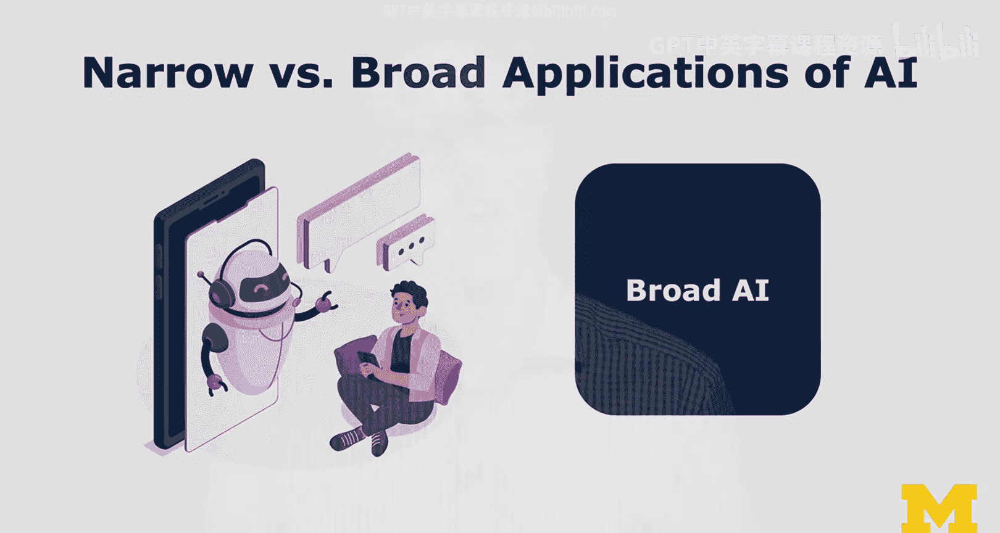
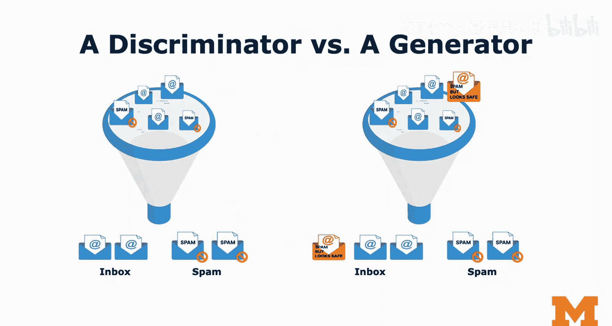
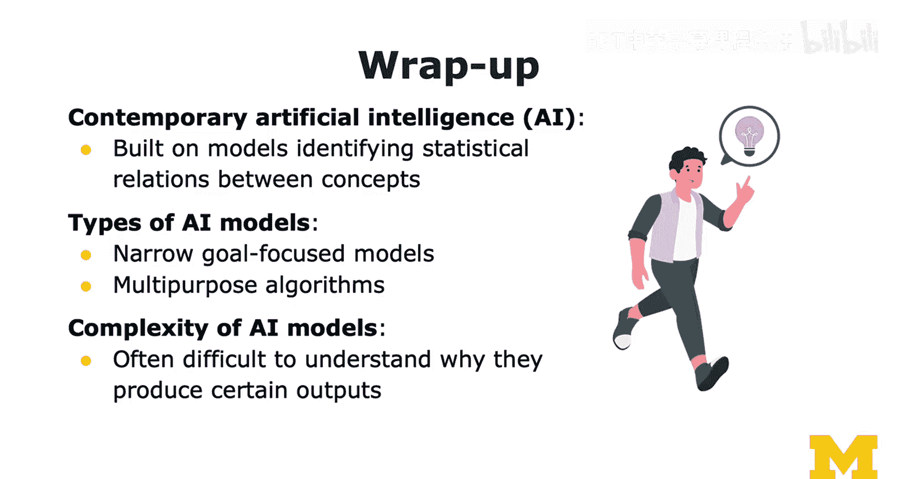
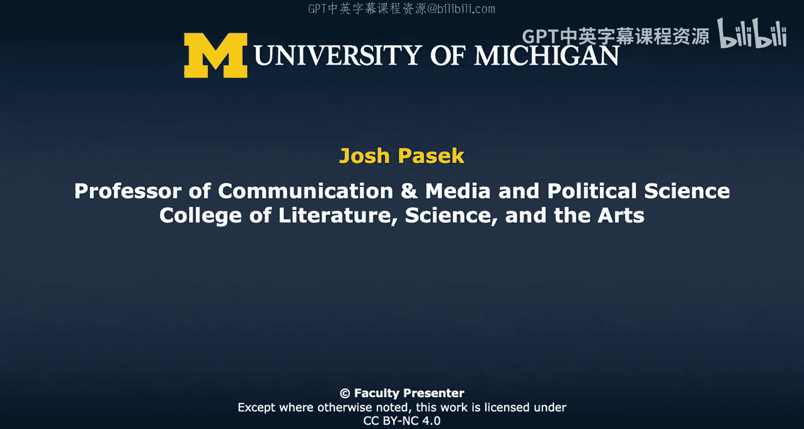
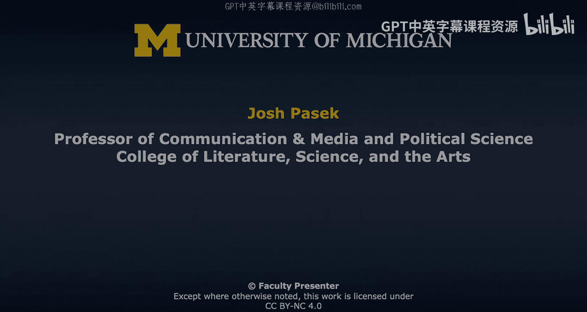

# 应对颠覆：工作场所的生成式人工智能：P5：人工智能的不同类型 🤖

在本节课中，我们将要学习人工智能（AI）的不同类型及其演变过程。我们将从基本概念入手，探讨人工智能如何从简单的分类系统发展到复杂的生成模型，并理解其核心工作原理。

---

人工智能的含义多样，并随着时间不断演变。它包含一系列技术，从简单的分类策略到复杂的生成模型。人工智能应用之间最大的区别在于其是狭义还是广义的。

## 狭义与广义人工智能 🎯

上一节我们提到了人工智能的演变，本节中我们来看看其两大主要范畴。

**狭义人工智能**被设计用于在有限领域内完成特定任务。例如，一个旨在判断特定邮件是否为垃圾邮件的邮件过滤器就是狭义AI，它只执行那一个特定任务。

**广义人工智能**则涉及能够跨多个领域执行多种任务的系统。例如，可以处理各种查询和任务的虚拟助手，或能根据人类输入生成新文本的生成式算法。

## 人工智能的工具箱：从分类到学习 📊

随着技术发展，人工智能应用日益复杂。早期的人工智能应用与我们如今所认知的AI已大不相同。

今天，人工智能使用的工具箱与许多其他统计应用有所不同。一些演变为当今人工智能的早期方法是分类系统，即将输入数据分类到预定义类别的系统。

以下是分类系统的一个例子：
*   **信用风险评估**：可以使用相对基础的统计程序，基于个人财务风险方面来预测其贷款违约的可能性。

随着模型变得更加复杂，现在的信用风险评估使用AI工具来分析数据模式，并从现实生活中的贷款违约案例中学习，从而更准确、更细致地评估财务风险。

## 模型如何学习：统计学习与复杂性 🔍

人工智能模型使用统计学习技术进行学习。它们从相对简单的基础模型开始，利用这些模型识别模式并进行预测。

为了说明这个过程，想象你从事冰淇淋销售业务。你很快会发现，温度越高，特定日期的冰淇淋销量可能就越大。**统计回归**是一个可以帮助你根据温度预测需要制作多少冰淇淋的工具。

但许多问题比温度与冰淇淋销量之间的直接关系更为复杂。例如，预测天气需要大量信息，并且同一因素在不同情况下可能产生不同的预测结果。

随着输入和输出之间的关系变得越来越复杂，两件事开始发生：
1.  需要越来越多的数据来弄清楚模型的各个部分如何相互关联。
2.  模型的预测过程变得越来越不透明。

这个过程产生了一个可以生成优秀预测的模型，但它在功能上是一个**黑箱**。我们可能不知道模型为何做出那样的预测。

## 深度学习与生成对抗网络 🧠

为了处理复杂模型的预测因子和结果，计算机科学家开发了一系列统称为**深度学习**的方法。

其中一个常见策略叫做**生成对抗网络**。GANs通过涉及两个模型来训练人工智能：一个**生成器**和一个**判别器**。

以下是GANs的工作原理：
*   **判别器**试图对事物进行分类（例如，判断一封邮件是垃圾邮件还是应进入收件箱）。
*   **生成器**试图创建新内容来欺骗判别器。

随着判别器在确定哪些邮件应被筛除方面不断改进，生成器模型会生成新内容，目标是愚弄判别器模型。当判别器在预测特定类别方面有所提高时，生成器同时也在提高其欺骗判别器的能力。

随着时间的推移，这种竞争使两个模型都得到改进，直到判别器无需常规人工输入就能达到或超过人类的分类水平。随着这个过程推进，模型在其目标上变得越来越好，但它们也变得越来越复杂，所涉及的众多因素使其相对不透明。

## 基础模型与当代应用 🏗️

像ChatGPT或其谷歌、Meta、Anthropic等公司的同类产品，都属于一类被称为**基础模型**的AI产品。这些是通用算法，可处理广泛的自然语言、视觉或听觉输入，并针对大量不同问题产生输出。

基础模型随后可以被精炼以实现特定目标。AI的一个主要发展是认识到，后期针对特定目的进行调整的基础模型，其性能往往优于仅在其他类似问题数据上训练的模型。因此，当代许多AI应用涉及将基础模型应用于特定问题，而非开发新的AI模型。

---

本节课中，我们一起学习了人工智能的不同类型。我们了解到，当代人工智能建立在试图识别概念间统计关系的模型之上。这些模型有时被设计和构建用于实现狭义目标，有时则涉及多用途算法，既可作为通用助手，也可为特定用例进行精炼。许多模型的构建方式可能相当复杂，以至于常常难以理解它们为何产生特定的输出。