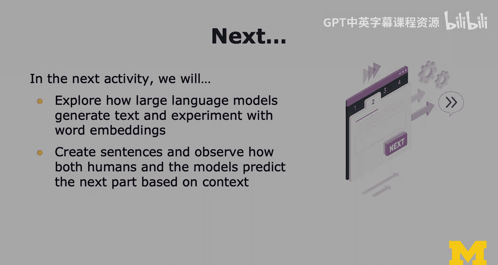
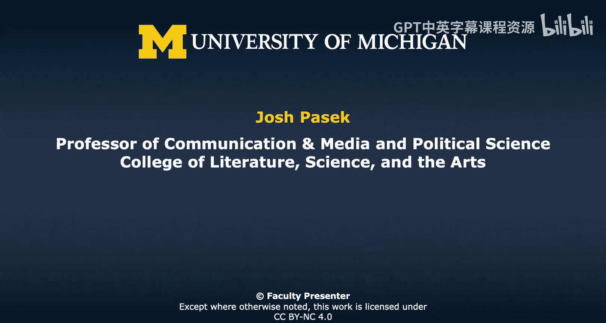

# 应对颠覆：工作场所的生成式人工智能：P6：理解大型语言模型

在本节课中，我们将要学习大型语言模型的基本工作原理。我们将探讨它们如何通过预测下一个词来生成文本，以及它们理解语言的核心概念——词嵌入。

## 概述

许多我们今天使用的最复杂的人工智能模型，最初都是作为大型语言模型被创建的。大型语言模型整合了大量来自互联网等来源的人类语言语料库，旨在执行一个相对简单的任务：预测序列中的下一个词。其核心理念是，通过反复预测下一个词，最终可以生成句子、段落乃至整篇文档，以响应给定的提示。

## 词嵌入：语言在数学空间中的表示

为了实现预测下一个词的目标，大型语言模型需要消化海量数据，以学习语言模式并理解每个词与其他词的关系。这个过程使模型能够生成类似自然语言的文本，并完成回答问题或讲述故事等任务。

由于这些任务涉及识别和放置能够完成叙述的词语，大型语言模型基于一个称为“词嵌入”的概念。在词嵌入中，词语被表示为高维数学空间中的向量。这些向量捕捉了词语的各种含义以及词与词之间的关系。

例如，给定一个句子“John went to the”，我们可以预测下一个词可能是“office”或“store”，但不太可能是“cup”，因为“John went to the cup”不合逻辑。我们对词语关系的理解很大程度上源于基于上下文的人类直觉。

同样，如果我给出一个句子的开头，比如“Jane went swimming at the”，你可能会想到一系列能完成这个句子的词，如“pool”、“beach”或“lake”。同时，也有很多词你会认为不太可能出现在这个句子之后。例如，“Jane went swimming at the telephone”就不合逻辑，因为词语的上下文包含一系列规则、传统和其他方面，限制了接下来可能出现的内容。

## 语言的规则与模式

人类语言遵循公式，并有关于何时可能出现何种词语的附加规则。事实上，这些规则在不同语言和不同语境中可能有所不同。

例如，在英语中，形容词通常出现在名词之前，比如“a red apple”。实际上，对于哪种形容词应该出现在另一种形容词之前也有规则。我们可以说“the big red apple”，但对英语母语者来说，“the red big apple”听起来很奇怪。

在西班牙语中，形容词通常跟在对应的名词后面，我们会说“la manzana roja”，相当于“the apple red”。在德语中，一些动词出现在句末，形成的句子结构在英语中类似于“John is with his friends at the store shopping”。

这些语言模式帮助我们理解某些词在句子中可能出现的位置。词语本身和上下文的其他线索也帮助我们思考接下来可能出现什么类型的内容。当然，你可以通过插入一个意想不到的词来让人惊讶，但通常下一个词在某种程度上是可预测的。

## 计算机如何理解词语关系

这意味着，计算机程序可以通过理解现有词语的网络以及它们在位置和上下文中如何相互关联，来理解词嵌入。例如，在之前的例子中，“swimming”在向量空间里会更接近“pool”，而不是“mountain”。我们可以利用这一点来确定不同词语可能出现的概率。

即使句子可以有无限种可能的词语组合，并且其中许多组合可能是新颖的、前所未见的，但围绕句子结构的实际约束使得对内容和形式进行可靠的估计成为可能。

在实践中，这意味着随着我们更好地理解特定词语在序列中接下来出现的概率，我们可以以一种合理的方式延续该序列。这正是大型语言模型所做的事情。

## 大型语言模型如何工作

大型语言模型利用这些概率的估计来预测接下来可能出现的合理词语。例如，给定“Jane went swimming at the”，模型很可能会提供像“pool”或“beach”这样的答案，并且它会根据上下文填入一个看起来合理且概率高的词。

为了生成这些估计，大型语言模型和其他生成式人工智能模型使用一种称为“神经网络”的系统。这基本上是一系列预测，允许所有词语以几种不同的方式与其他所有词建立关系。它们有些难以理解，但你不需要完全理解它们就能明白发生了什么。

在实践中发生的情况是，你有一系列基于你刚刚观察到的词语来预测每个词出现概率的模型。然后你重复这一系列预测几次，以在你观察到的词语集和你最终输出的词语之间进行预测。虽然我们无法将特定含义归因于该网络中不同部分的作用，但我们最终能得到一个相当好的近似，模拟人类会如何思考接下来可能出现什么词。

## 核心要点：模型不是基于记忆

那么，这意味着什么？重要的是，这意味着当你处理大型语言模型和其他类型的生成式人工智能模型时，它们并非基于我们通常认为的计算机所拥有的、记录在缓存中的信息那种“记忆”。

相反，它们基于一个关于不同词语、概念，甚至在当代案例中，图像和声音如何相互关联的可推广的理论。理解这些基本关系使得计算机化模型能够生成连贯的句子，其中可能包含前所未有的新颖词语组合。计算机正在编码一系列可能的关系，并试图从中选择出一些合理且有意义的内容。在这个过程中，它预测的是下一个词可能是什么的一个合理近似值。

## 总结

本节课中，我们一起学习了大型语言模型的基础。我们了解到，LLM的核心任务是预测序列中的下一个词，它们通过“词嵌入”技术将词语表示为数学向量来理解语言关系。模型并非基于死记硬背的信息，而是通过学习词语和概念之间的概率关系来生成新颖且连贯的文本。在接下来的实践活动中，你将亲身体验大型语言模型如何生成文本，并通过自己构造句子来实验词嵌入，观察上下文如何引导人类和模型对后续文本产生相似的理解。