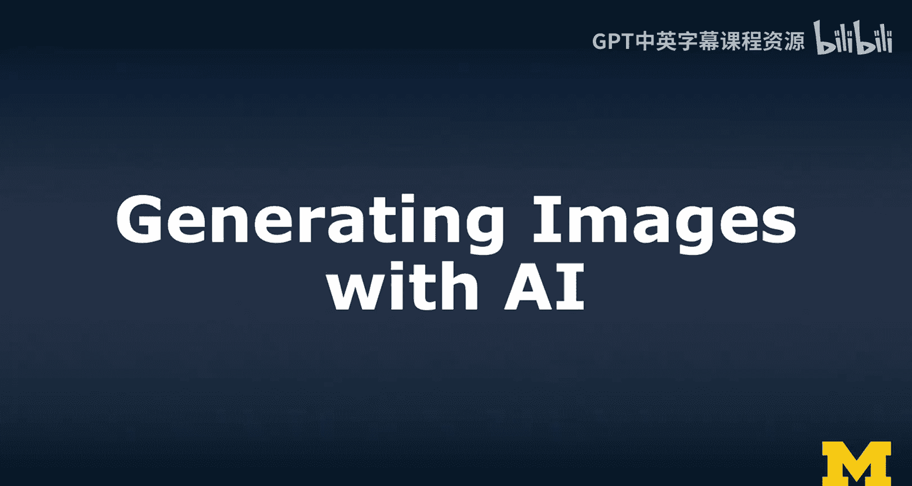
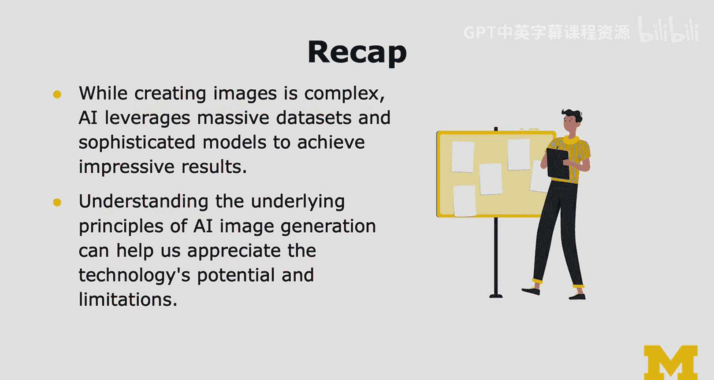
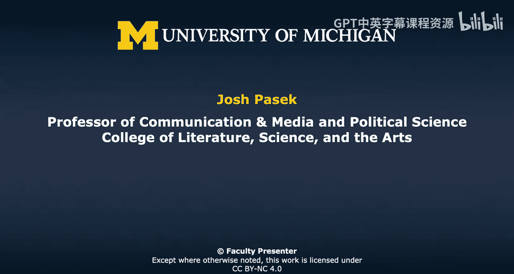

# 应对颠覆：工作场所的生成式人工智能：7：使用人工智能生成图像 🖼️

在本节课中，我们将要学习人工智能如何理解并生成图像。我们将探讨计算机视觉的基本原理，以及生成式AI如何从海量图片数据中学习，最终创造出全新的视觉内容。

---

上一节我们介绍了大型语言模型如何预测词语。本节中，我们来看看人工智能如何处理图像。

在许多方面，人工智能处理图像所面临的挑战远大于处理文字。这源于问题的复杂性，以及缺乏理解特定物体（如运动或距离）的清晰线索。

要理解计算机如何开始理解图像，再次观察人类如何做到这一点是有帮助的。

## 人类如何识别图像？ 👶

我们如何判断一只狗是狗？想象一下，你是一个婴儿，第一次接触到“狗”这个词。你应该把这个词与什么联系起来？“狗”这个词可能指所有动物、这只特定的动物、这只动物的颜色，或者狗正在做的某件事。如果我们只听过“狗”这个词一次，我们根本无法确定。

作为人类，我们通过多次听到同一个词，并识别出在使用这些词时我们所看到事物的共同点，来理解哪些词对应哪些概念。也就是说，我们开始看到足够多的例子，将它们归类到“狗”这个概念中，然后学会识别它。识别相似性的模式帮助我们判断所看到的是否是狗，以及这个词是否适用。通过将特定的特征（如形状、颜色和行为）与“狗”这个词联系起来，我们逐渐对该词所描述的事物形成了更好的视觉感知。

## 人工智能如何理解图像？ 🤖

当人工智能试图理解图像时，它的做法与人类有些不同。首先，人工智能能获取不同的信息。用于训练计算机的大部分内容是静态图像，其中一些有标签，一些没有。它所拥有的相关信息仅仅是图像中各个像素的颜色。

这与人类的经验不同，人类之所以能识别不同的物体，部分原因在于我们的深度感知能力，也因为我们和我们观察的物体都能够移动。由于我们可能随后从不同角度看到狗的头部和尾巴，我们拥有额外的工具来识别这些部分属于同一个物体，而不是两个完全不同的生物。人类的经验带来了一些直接优势。

那么，AI如何判断图像中什么是狗、什么不是狗呢？计算机科学家们再次开发了一系列巧妙的方法。但基本的答案是，计算机可以被给予多得多的例子来完成学习。

以下是计算机识别图像的核心过程：

1.  **模式识别**：如果计算机接触到足够多的狗图片，共同的模式就会开始浮现。随着数据集变得足够大，计算机识别出的倾向于聚集在一起的特征模式，会与人类观察到的模式相似。
2.  **使用卷积神经网络**：这是一种允许生成式AI理解图像内容的计算机算法。它利用不同像素之间的一系列关系来识别图像中事物如何相互关联，并将这些像素与其他数据集进行比较。
    *   `卷积核（Kernel）` 在图像上滑动，计算局部区域的加权和，用于检测边缘、纹理等特征。
3.  **特征提取**：这种做法让人工智能能够识别图像中的边缘、形状和纹理。此外，通过以不同方式过滤图像，不同的模式集会变得更加明显。这使得AI识别边缘、纹理和形状等事物变得相对简单。
4.  **理解像素关系**：通过使用这些不同的过滤器检查像素之间的关系，神经网络可以理解图像中这些像素之间存在的关联。
5.  **对象分组与分类**：通过这个过程，图像片段可以被视为不同的物体，并聚类成出现在多张图像中的组。然后，计算机可以使用带标签的数据集，通过观察“狗”这个词与某些物体组相关联而与其他组无关，来理解词语和物体之间的关系。AI从而能正确分类哪些物体是狗，哪些不是。

通过这种方式，分配给像素间不同关系的值最终可以为特定图像提供实质性的含义。

## 从理解到生成与创造 🎨

随着我们对图像了解得越来越多，我们可以开始预测无法直接观察到的事物的信息。

例如，这是一张被遮挡的海滩照片。根据我们作为人类所知道的信息以及算法也能推断出的信息，我们可以想象，如果海滩没有被遮挡，它的底部将由浅色沙子构成，顶部是水。如果我们指示AI算法填充物体后面的空间，它也会以大致相同的方式完成。

这个过程让人工智能能够，例如，填补照片中的错误或从图像中移除一个人。当这些过程与外部数据结合时，就允许创造新颖的视觉内容。

以下是AI生成图像的关键步骤：

1.  **基于提示生成**：利用提示中提供的上下文信息，AI可以填充像素关系，进而生成整个物体以匹配现有场景。
2.  **从无到有创造**：从这个过程出发，到通过放置几个像素、预测其他像素并优化它们来生成全新的图像，并不是一个巨大的飞跃。通过这种方式，AI能够生成类似于真实场景或模仿艺术家风格的新图像。

---

本节课中我们一起学习了人工智能理解与生成图像的原理。我们了解到，尽管创建图像是一项需要足够数据和强大处理能力的复杂任务，但计算机能够开始理解图像背后的一系列关系，并生成符合用户提示的全新图像。这些就是用于各种图像生成算法的工具。