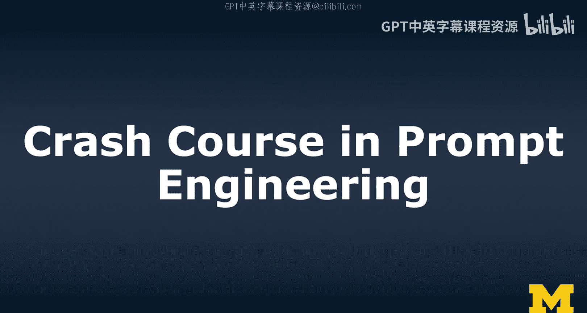
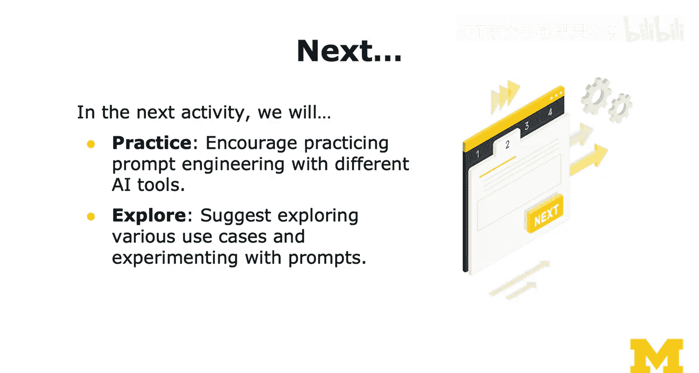
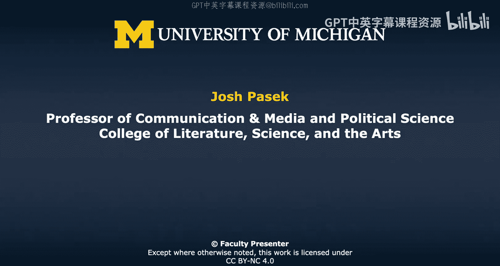

# 应对颠覆：工作场所的生成式人工智能：P8：提示词工程学速成 🚀

在本节课中，我们将要学习如何与生成式人工智能进行有效沟通，这一技能被称为“提示词工程学”。我们将探讨其核心概念、基本原则以及如何通过优化提问来获得更准确、更有用的AI输出。

---

随着人工智能算法获得生成新颖文本、图像等输出的能力，一个问题开始浮现：我们如何才能让这些算法在响应用户查询时产生最佳结果？

这个过程的一部分涉及通过设计和训练人工智能模型本身来完善用于回答用户查询的算法。另一部分则来自于提升我们向人工智能系统准确表达需求的能力。

这种向人工智能提出优质问题以获得期望结果的新兴技巧，已成为一个被称为“提示词工程学”的领域，并正成为各类工作者的一项重要技能。

## 什么是提示词工程学？🤔

上一节我们提到了与AI有效沟通的重要性，本节中我们来看看提示词工程学的具体定义。

当我们谈论提示词工程学时，我们指的是设计和优化提示词，以有效地与人工智能模型（特别是生成式人工智能模型）进行交互的实践。

提示词工程学之所以重要，是因为高质量的提示词通常能产生更准确的人工智能输出，从而使人工智能更有用、更高效。

## 理解核心概念 🧠

为了理解如何为AI系统创建理想的输入提示，我们需要掌握几个关键点。

正如我们已经讨论过的，AI模型是在大型数据集上训练的。理解它们如何解释和响应语言，是改进我们给出的提示词（从而改进我们收到的输出）的关键。

查询的结构会影响AI的回应。所使用的术语等组成部分可能导致略有不同的结果。

同样值得注意的是，因为AI基于概率模型而非预先编码的答案，所以每次向人工智能系统提出相同的问题，你都会得到略有不同的响应。

## 如何构建优质提示词？🔧

那么，如何构建一个能产生你想要的输出的提示词呢？以下是几个关键要素。

首先，你希望每个提示词都尽可能清晰。不清晰的提示词很可能收到意义不大且相对笼统的输出。

其次，上下文非常重要。如果你能向AI模型解释你为何以及出于何种目的询问某件事，该模型将能更好地提供符合你需求的回应版本。例如，如果你只想要关于某个主题的100字内容，说明这一点会很有帮助。

第三，具体性有助于AI模型的提示词。提示词越详细，回应就越会遵循这些细节。

最后，如果你有希望针对特定查询收到的回应类型的示例，你可以将这些示例提供给模型，作为一种精炼训练。这样，当模型为特定目的运行时，它就能达到预期的结果。

## 实践原则与技巧 🛠️

重要的是，没有所谓的完美提示词。找到向人工智能模型请求你想要内容的方法，涉及一定程度的试错。

然而，理解一般原则会有所帮助。如果你不完全确定自己要找什么，可以从一个宽泛的提示词开始，然后根据AI生成的输出逐步缩小范围并使其更具体。本质上，这涉及基于现在更清晰的提示词，要求算法重新生成新的内容。

你还可以在反馈循环中使用AI的回应。例如，你可以要求AI程序建议可能有助于优化你的提示词并获得更好答案的相关问题。

用于此目的的提示词可能是：“我想为一名新程序员设计一份招聘广告，你需要了解这个职位的哪些信息才能创建最好的广告？”

在某些情况下，其他有效的技巧包括为人工智能代理分配一个特定的角色。例如，如果你要求AI扮演历史学家来解释某事，它提供的答案将与简单询问“那是什么？”不同。

如果你需要特定阅读水平的更简单版本，你也可以要求AI为儿童生成对某事的解释。

如果你对模型的期望输出有特定的限制，明确这些限制和条件会很有帮助。明确文档的字数、演讲的时间或图像使用的颜色数量，可能会使模型的输出更有用。

此外，将复杂的请求分解为一系列更小、更易管理的部分，可以产生更高质量的结果。例如，与其要求人工智能写一篇10页的论文，不如在提供整个项目背景的同时，要求它对小部分内容提供协助，这通常能带来更好的结果，避免重复性和其他可能由AI产生的问题（我们稍后将讨论其中许多问题）。

## 从实践中学习 📈

但学习构建优质提示词的最佳方法可能就是实践经验。如果你还没有机会使用AI模型，可以从相对简单的问题开始，以了解人工智能会给出什么样的回应。

当你收到回应后，尝试修改你的查询，增加具体性并提供上下文。这个试错过程将有助于明确你需要和不需要指定什么。

随着你对AI越来越熟悉，你可以转向越来越复杂的提示词，甚至可以通过包含大量文本和附加文档作为上下文。

过去几年人工智能算法的进步，使得模型在生成新输出时可以使用的上下文信息量得以大幅增加。这意味着，如果你想得到具体的东西，提供越来越多的细节会很有帮助，并将使模型更清楚地了解你希望输出的确切内容。

这可以包括关于输出风格、形式或功能的信息，以及可能的示例。当你这样做时，请注意不要过度依赖AI模型的输出。由于多种原因，模型可能会产生不符合要求的内容。这可能是因为提示词不佳，也可能是因为模型本身的局限性。

虽然AI可以帮助生成草稿和完善现有文本，但当人类审阅AI输出并完善AI生成的内容时，最终产品往往会好得多。

## 挑战与应对策略 ⚠️

此外，存在一些特定的挑战，可能导致提示词产生不理想的结果。但也有方法可以应对这些挑战。

如果提示词相对模糊，它们很可能导致不清晰的输出，因此提供具体和详细的语言将有助于获得更好的结果。

正如我们稍后将讨论的，人工智能模型由于其训练数据的问题，具有相当大的展现偏见的能力。如果一个人工智能模型只遇到过某些类型的数据，那么它很可能只给出这些数据。因此，在构建提示词时，你可能需要考虑该模型可能学到了哪些类型的偏见，以及如何确保这些偏见不会反映在最终产品中。

## 总结与展望 📝

总而言之，提示词工程学需要明确期望的输出，并且尽可能提供可行的上下文、你希望输出的具体性，并迭代检查和优化人工智能的输出。

再次强调，没有完美的人工智能提示词。AI提示词会改变我们得到的输出。每次人工智能模型被其软件团队更新时，它们也会根据用户与它们的交互方式，以及你在特定交互过程中告诉它们的内容，持续响应变化。

这意味着，优化、实验和进行一点试错，对于提高AI输出的智能程度大有帮助。这也意味着，你从人工智能那里得到的东西不能直接使用，而是需要检查。你需要确保它提供的内容正确合理，并且没有AI结果中可能出现的常见错误。

简而言之，AI可以完成大量工作，但它不能完全取代人类，至少目前还不能。在接下来的活动中，我们将为你提供一些示例提示词，供你与人工智能一起尝试，并要求你尝试如何使用不同的人工智能工具修改这些提示词，并将你在迭代过程中学到的反馈上传到讨论提示中。