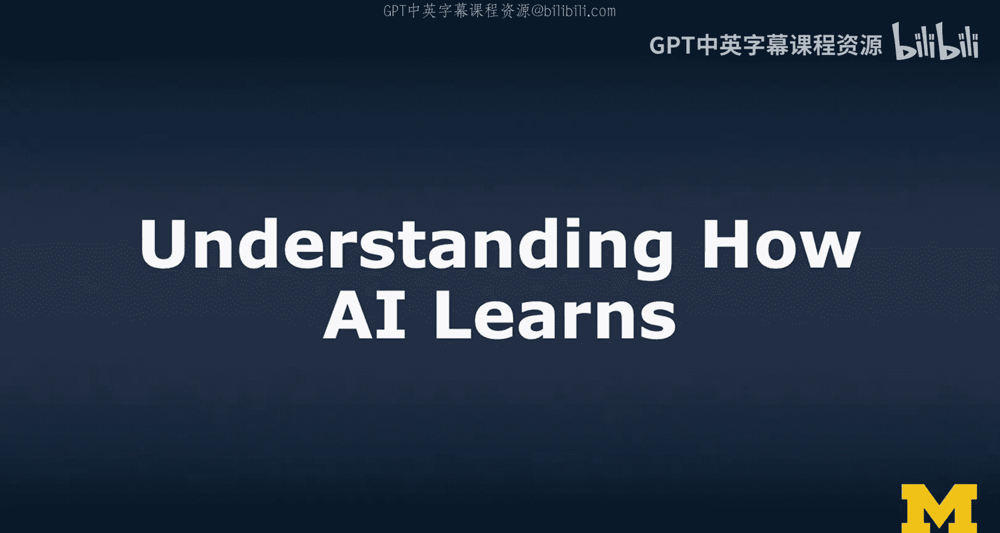
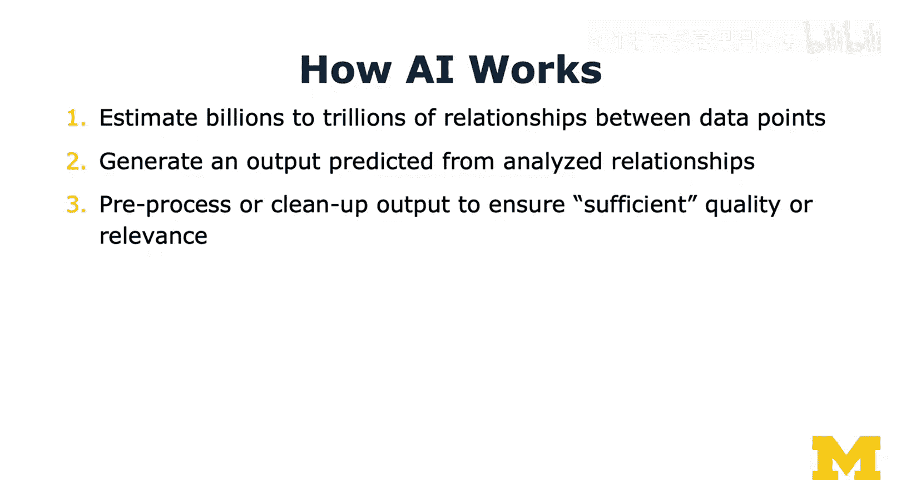
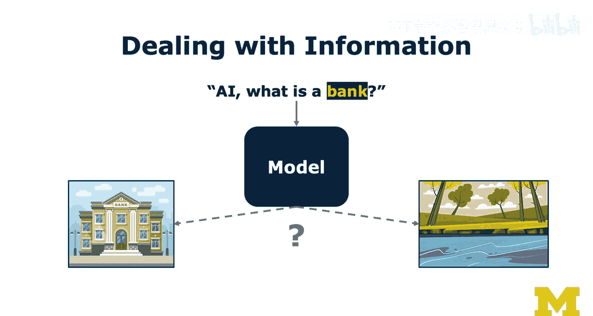
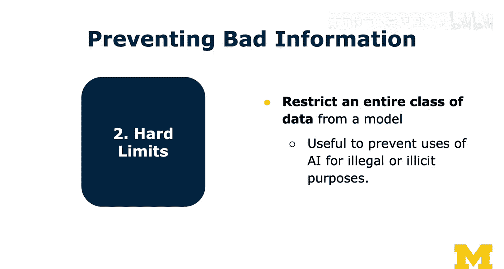
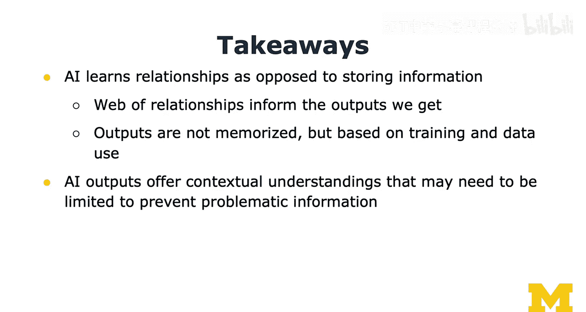
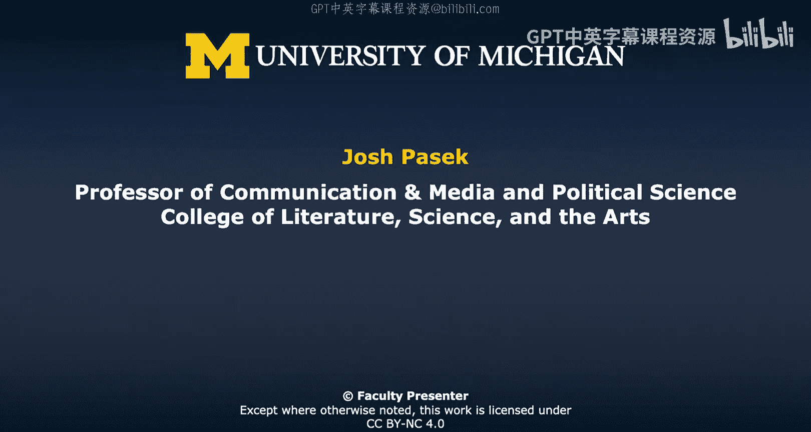

# 应对颠覆：工作场所的生成式人工智能：P9：解析人工智能的学习机制 🤖

在本节课中，我们将要学习人工智能（AI）如何从数据中学习并生成内容。我们将探讨AI学习机制的核心原理，理解其与人类思维方式的区别，并分析其能力的来源与局限性。

## 概述

人工智能通过摄入数据并理解数据流中不同信息片段之间的关系来进行学习。例如，大型语言模型根据所有先前的词语及其之间的假定关系来预测下一个词。基于图像的模型则使用类似的结构来估计不同像素之间的关系。然而，AI的“思考”方式与人类不同，它主要是寻找可能的预测，并在很大程度上模仿其训练数据中发现的模式。理解AI如何从训练数据中学习并运作，对于把握其能力和局限至关重要。

## AI如何处理信息与生成输出

上一节我们介绍了AI学习的基本概念，本节中我们来看看AI处理信息和生成输出的具体目标。本讲的目标是讨论AI如何处理信息并生成其输出。理解AI在做什么、这与人类思维有何不同、以及我们如何区分真正的智能与仅仅是复述观察到的数据，这几点非常重要。

当代的AI系统估计着数十亿甚至数万亿个数据点之间的关系。像ChatGPT这样的模型处理词语和上下文之间的关系，以生成连贯的文本。文本的生成源于模型从训练数据中获得的对关系的理解。这些训练数据经过预处理或清洗，以确保数据具有足够的质量和相关性。

## 训练数据的处理与权重分配

现在，我使用“足够”这样模糊的术语是有原因的，因为对这些训练数据的实际观察是许多公司视为其商业机密的部分。在实践中，当公司为人工智能模型训练数据集时，他们会执行一系列处理任务。

以下是这些处理任务通常包括的步骤：

*   **过滤噪音或无关信息**：从数据集中清除无意义或不相关的数据。
*   **确保数据一致性**：保证数据集不同部分之间的一致性和协调性。
*   **为数据分配价值**：对不同数据片段赋予不同的重要性权重。

这个过程涉及考虑哪些信息应该是准确可靠的，有时会主动寻找方法来排除可能不准确、具有冒犯性或对模型无益的信息。我们可以这样理解：像学术论文这样的可靠来源可能会被赋予较高的权重，而Reddit上的随机帖子可能不会被模型赋予高权重。确实，许多当代AI系统会吸收所有这些数据并将其用作训练的一部分，但模型真正学习的是在此过程中获得较高权重的数据。重要的是，我们正在进行一个权重分配过程，为某些信息分配较高权重，为其他信息分配较低权重。

这意味着，最终我们会看到AI生成的内容类似于那些高权重数据源。例如，如果我们说报纸、学术文章和专业书籍应该获得最高权重，那么AI的写作就会看起来很像报纸、学术论文和专业书籍的内容。

## AI如何“记忆”：关系网络 vs. 传统存储

当一个人工智能系统被构建时，我们所认为的AI系统的很大一部分实际上并不存储信息。传统上，当我们思考计算机时，关键部分之一是内存，它接收你可能拥有的数据文件并将其存储在特定位置，供你以后访问。当你稍后重新打开一个Word文档或你正在使用的任何文件时，它会精确地重现你输入的内容。这不是人工智能系统的工作方式。

相反，人工智能系统不记录事物的状态；它们记录不同事物之间如何相互关联。这一点很重要，因为它们产生的是基于其对那些状态间关系的理解而生成的新内容。模型没有对词语的特定内部定义，而是逐渐理解一个词语可以根据上下文拥有多组关系。以这种方式，如果你问一个人工智能系统“什么是bank”，在看到该词周围的上下文之前，它不会知道你说的是金融机构还是河岸。

## AI的偏见风险与限制策略

人工智能系统也有可能产生有偏见的输出，因为来自现实世界的训练数据不仅提供高质量和准确的信息，也包含低质量和不准确的信息。有偏见的信息或有问题的关联可能潜入模型，导致有偏见或不准确的输出。防止这种情况涉及设置软限制（如下调刻板印象内容的权重）和硬限制（例如排除某些类别的数据）。我们知道这可能发生在所有类型的系统中。例如，关于谁可能成功或失败偿还贷款的金融模型，当它们基于在“红线歧视”时代产生的数据进行训练时，有时最终会重现种族偏见。

防止人工智能系统中的不良信息可以通过两种基本方式完成：

以下是两种主要的限制策略：

*   **软限制**：对产生的信息种类进行软性约束。例如，我们可能会说，倾向于对某个群体产生高度刻板印象的关系，可能是我们希望赋予较低权重并视为不太可靠的内容。这提供了一种软限制，我们可以告诉系统，我们不希望这些关系被频繁激活。
*   **硬限制**：设定硬性规则，规定特定模型不会提供整类数据作为响应。因此，如果你要求人工智能系统产生许多人都认为有问题的内容，系统有时不会那样做。例如，如果你问它如何短路启动汽车或做其他非法的事情，许多系统已被训练为不回答此类问题。

所有这些都意味着，存在各种策略来帮助设定人工智能模型的输出。理想情况下，这些策略的设置是为了使模型更可靠、偏见更少，尽管有很多情况下这并不总能实现。

## AI是“随机鹦鹉”吗？关于创造性的探讨

存在相当大的担忧，我们将在未来的讲座中讨论这一点。即模型持续生成有害或不准确信息，或突显可能并非明显且固有问题的想法之间潜在关联的可能性。一个长期存在的问题是：AI是否只是一只“随机鹦鹉”，仅仅是在组合和转述信息而没有真正的创新？还是它实际上在生成新的东西？这引发了关于创造力以及人类创造力是否与AI组合新片段的方式有根本区别的问题。

有明确的证据表明，人工智能所做的事情超出了我们所说的单纯模仿行为。早期的AI系统通常提供与已有内容非常相似的片段。但随着模型的发展，计算机科学家已经证明它们可以学习复杂的模式，并且实际上可以生成与上下文相关的、相当独特的响应，这些响应可能与原本可能产生的内容不同。这就是为什么你可以做类似要求人工智能模型创造一个新词这样的事情，而它能够做到。

## 总结

那么，我们应该如何看待人工智能学习信息的过程？AI学习的是事物之间的关系，而不是传统意义上的存储信息。这创建了一个关系网络，从而生成我们得到的新内容。因此，你得到的内容不是记忆的，其输出取决于训练和数据的使用，产生了对上下文的理解，在某些情况下需要加以限制以防止有问题信息的产生。

总之，在这些模型中，AI在一定程度上进行着学习，尽管不一定是我们传统上认为的那种方式。但随着这些模型继续用更多数据训练，它们将理解该数据中可能存在的潜在关系集合，并能够生成覆盖该范围大部分内容的新事物。

本节课中我们一起学习了人工智能如何通过分析数据间的关系进行学习，其输出如何依赖于训练数据的质量和权重分配，以及为减少偏见和有害输出所采用的软硬限制策略。我们还探讨了AI是否具备真正创造性的问题。理解这些机制是有效且负责任地在工作场所应用生成式AI的关键基础。