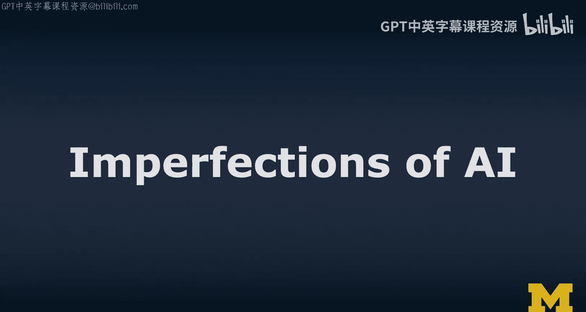
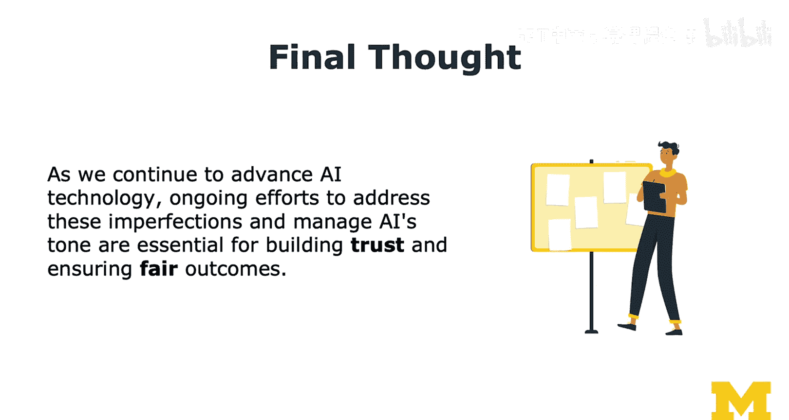
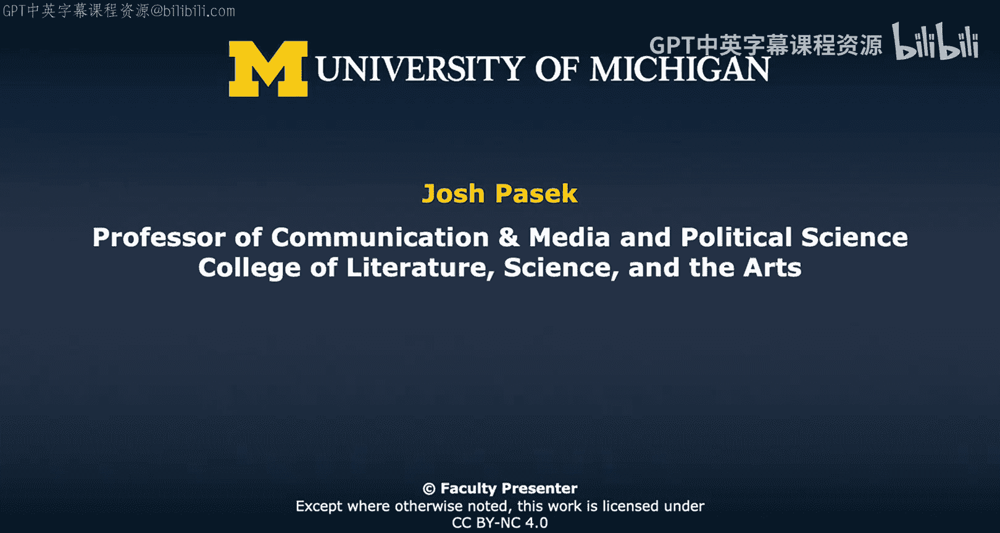

# 应对颠覆：工作场所的生成式人工智能｜P10：人工智能的局限性 🤖

在本节课中，我们将探讨人工智能，特别是生成式AI，所存在的一些关键局限性。理解这些局限性对于负责任和有效地使用AI至关重要，因为如果不加以识别，它们可能导致问题性的结果。

上一节我们介绍了AI的强大能力，本节中我们来看看AI在哪些方面可能出错，以及用户应如何应对。

## 幻觉：AI的“虚构”问题 😵‍💫

研究人员在各种AI应用中发现的一个重大挑战被称为“幻觉”。当人工智能生成看似合理、但实际上不正确、无意义甚至危险的信息时，就会发生幻觉。例如，AI可能会撰写包含捏造数据的文章，或解释不存在的事实。

这种现象的发生是因为AI试图呈现完整的输出。当它没有足够信息来填补知识空白时，它会根据已学习的其他模式进行猜测，以有效地填补这些空白。这背后的挑战在于，AI对上下文的理解有限，训练数据不足，或者只是“感觉”某物应该是什么样子，但并不真正知道答案。

以下是一些关键点：
*   **表现**：AI会自信地编造信息，尤其是在它缺乏特定数据时。
*   **原因**：AI基于数据集中的模式工作，而非依赖某种正式的记忆。
*   **影响**：许多AI产生的幻觉看起来足够可信，以至于非专业用户很难察觉信息是错误的。

这意味着用户必须用批判性思维和可靠来源的验证来持续检查AI的输出。虽然未来AI算法在追踪信息来源方面可能会改进，从而减少幻觉，但目前这仍然是一个持续的担忧。

## 重复性：内容的单调循环 🔁

AI用户应该意识到的另一个挑战是，人工智能经常对问题提供重复性的答案。因为它反复调用相同的关系模式，可能难以深入探讨某个主题，而是反复重申相同的基本观点。

重复性之所以发生，是因为当AI代理回溯其拥有的关系模式时，它可能发现许多关系频繁迭代。这通常是由于训练数据缺乏足够的多样性，或者AI算法无法获取关于某些主题足够广泛的信息集所导致的。

这个挑战可以通过考虑用于训练AI算法的数据类型来缓解。如果AI算法是为特定任务训练的，那么拥有丰富且相关的训练数据会特别有帮助。在某些情况下，使用更优先考虑响应新颖性和可变性的算法（即AI研究人员所说的“调低AI模型的温度”）也可能有价值。

简而言之，需要检查AI以确保其输出不具有重复性，并确保用户能够从中提取有价值的信息，而不仅仅是看似合理的内容。

## 偏见：数据中的社会镜像 🎭

人工智能还可能在其处理的各类流程中引入偏见。AI中的偏见之所以产生，是因为其输出基于训练数据，而这些数据在许多方面反映了人类在其他语境中存在的偏见。

因此，如果大量正式工作暗示了某种特定关系，那么这种关系就会在AI模型中再次出现。在某些情况下，即使某项信息不在学习数据中，但其他类型的历史数据恰好强化了该信息或偏见模式，AI代理也可能在无意中学会不恰当或有偏见的关联。

这种情况可能发生在诸如住房贷款等领域。即使算法中没有输入社区的种族信息，不同种族群体居住在不同地方的历史仍可能被“烘焙”进算法中，从而在谁有资格获得贷款或房屋价值几何方面产生不同的输出。

以下是缓解此类偏见的一些方法：
*   **精心策划训练数据集**：确保用于训练的数据本身没有偏见。
*   **审计算法**：确保算法不会产生有偏见的结果。

然而，对于终端用户来说，在不了解训练数据来源以及偏见最初如何产生的情况下，识别和纠正偏见可能很困难。认识到这种可能性并留意AI是否在事实上强化了偏见非常重要。

## 权威性与其他挑战 🧐

到目前为止提到的挑战，由于AI主要训练数据的固有特性而变得更加复杂。这些数据主要是期刊文章、报纸文章和书籍等。这意味着AI在许多方面学会了听起来非常权威，就像它知道自己在说什么一样。这使得检测幻觉、重复性或偏见内容变得更加困难，因为它们都以如此权威的方式陈述。我们在评估AI时，需要摒弃那种认为权威性文本就一定准确的倾向。

使用人工智能时可能出现的另一个挑战是，AI代理被设计为产生它们认为的结果分布中概率最高的区域。这意味着AI有时会创造非常常规的句子，或者对标准事物给出基本回应，而不是探索所有可能的领域。认识到这种局限性很重要。

我将重点指出其他一些值得关注的担忧，但其中许多超出了本课程能讨论的范围：

*   **隐私风险**：与AI共享数据可能存在隐私风险。当你将一段数据输入AI系统时，该系统通常能够基于该数据进行学习。例如，AI代理可以学会识别个人面部，这可能带来隐私风险。
*   **黑箱问题**：许多AI模型如同“黑箱”，其决策过程不透明且难以理解。这使得我们很难弄清楚为什么会得到特定的输出，以及所使用的过程是否合理。
*   **法规不确定性**：关于人工智能的监管框架，例如版权以及各种语境下的合法与非法界限，尚未完全确立，规则变化很快。确保自己不会无意中违反新出现的规则很重要。
*   **技术快速变化**：人工智能是快速发展的技术。这意味着既有需要跟进的新功能和发展，也意味着你在特定时间点从AI模型得到的结果，可能与之后从同一模型得到的结果不同，因为输出是在特定时刻、基于特定的训练数据集和算法产生的，因此不可复现。

最后值得注意的是，随着我们不断推进人工智能技术，许多问题将需要重新审视，这些不完美之处也将发生变化。重要的是要意识到，即使你在任何特定时间都能有效、合法地使用人工智能，也并不意味着你认识到了AI周围所有潜在的风险。

## 总结 📝

本节课中我们一起学习了人工智能的几个关键局限性：**幻觉**（生成看似合理但不准确的信息）、**重复性**（输出内容单调重复）以及**偏见**（反映并强化训练数据中的社会偏见）。我们还了解到，AI输出的**权威性语调**可能掩盖这些缺陷，并且存在**隐私风险**、**黑箱问题**、**法规不确定性**和**技术快速迭代**等更广泛的挑战。理解这些局限性是负责任地使用AI、并对其输出保持批判性眼光的第一步。在后续课程中，我们还将再次回到这些问题。