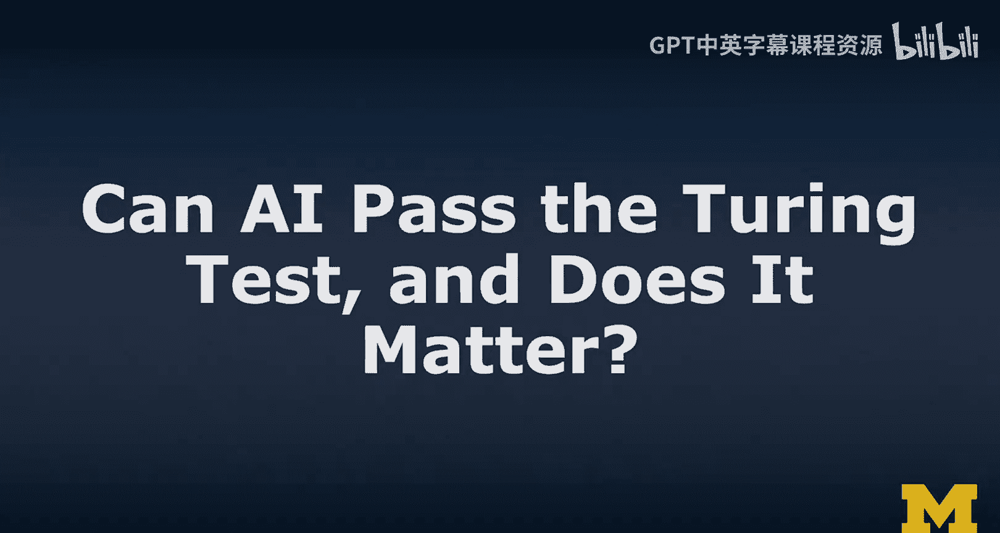
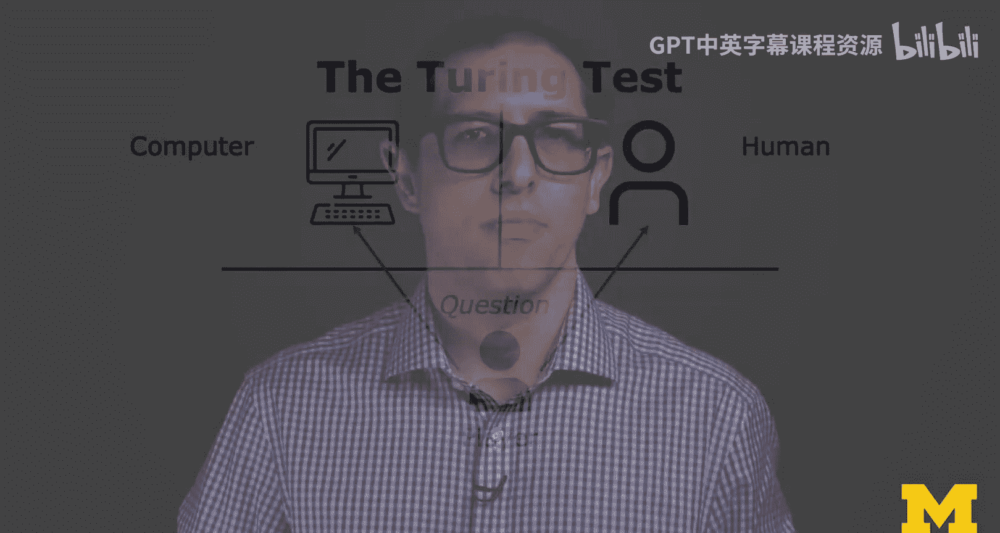
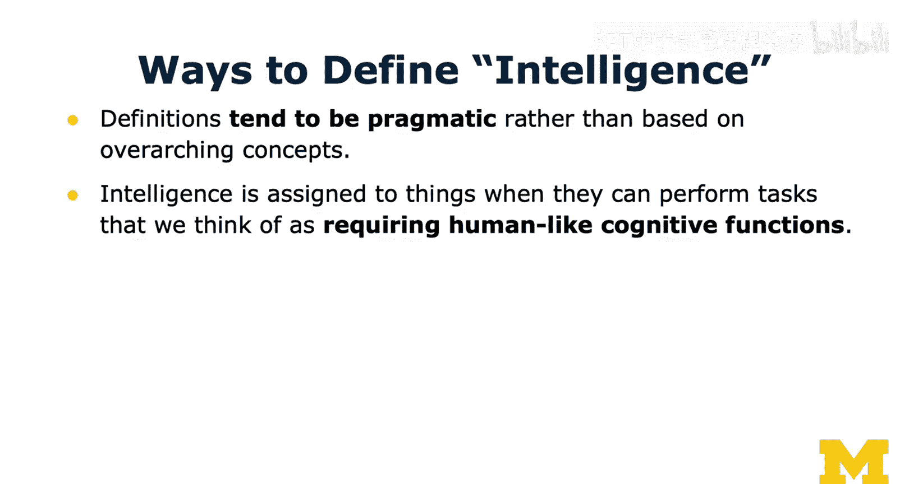
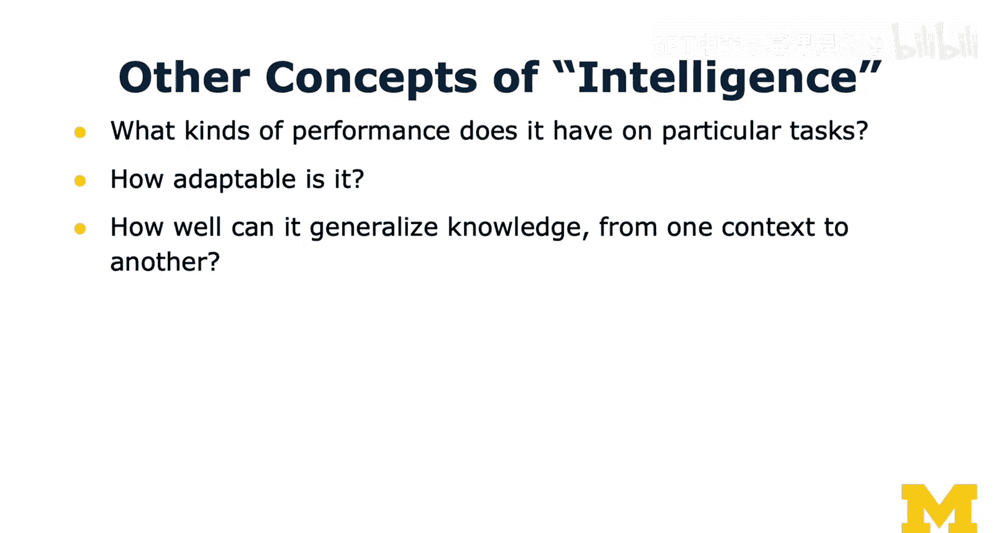
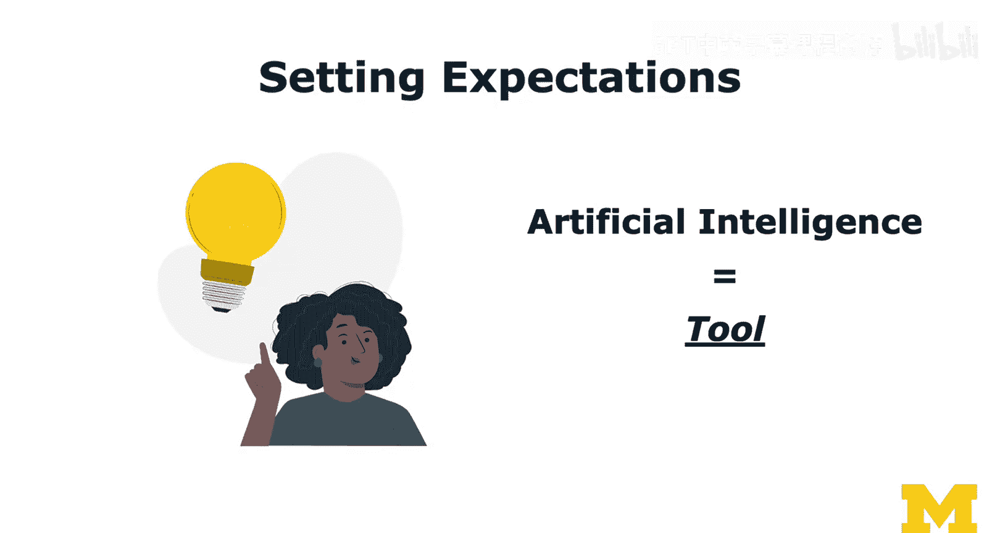
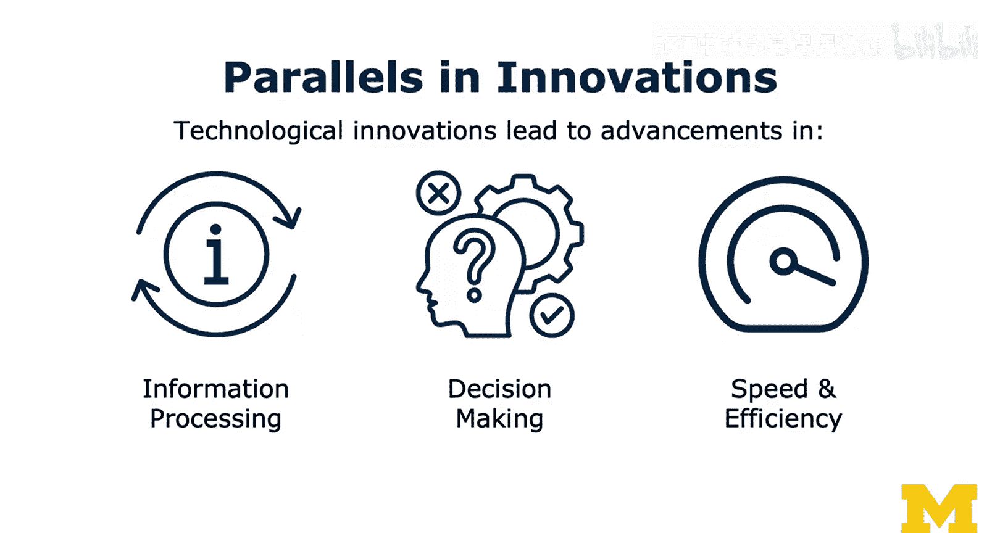
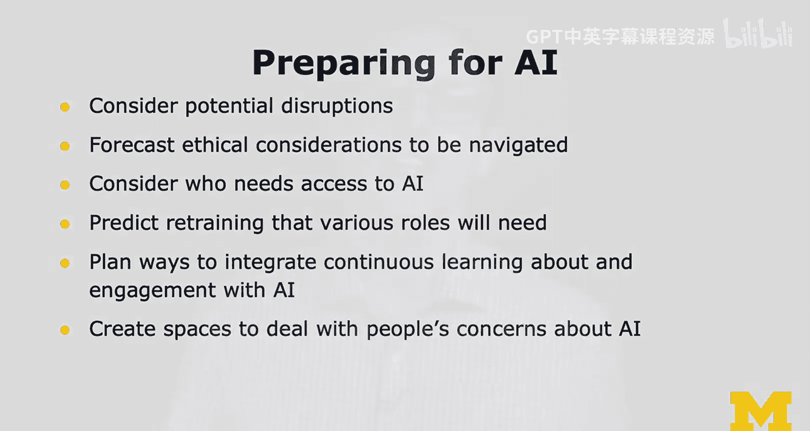
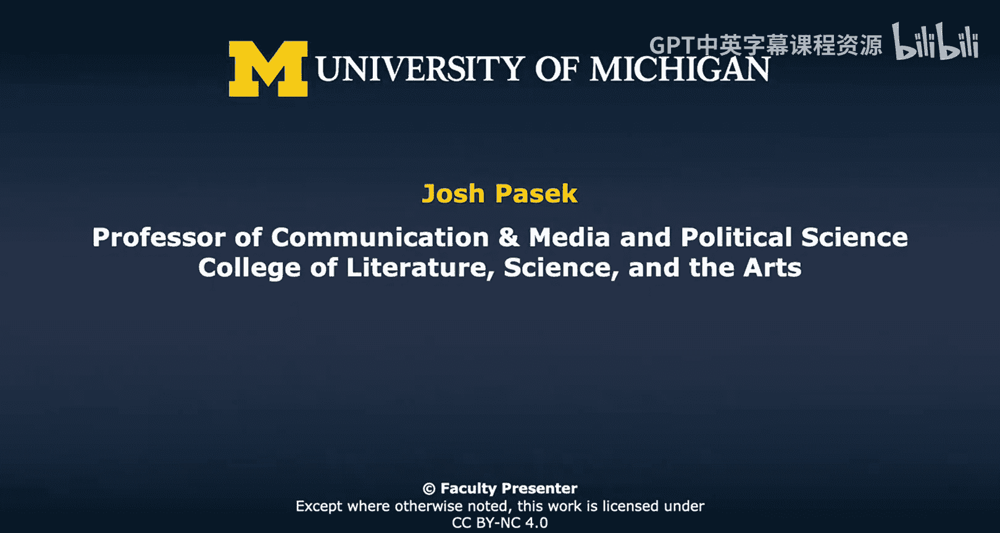

# 应对颠覆：工作场所的生成式人工智能｜P11：人工智能能否通过图灵测试及其意义 🤖

在本节课中，我们将要学习图灵测试的概念，探讨人工智能是否能够通过这一测试，并深入理解其背后的意义。我们将超越“机器是否智能”的争论，转而关注如何将人工智能视为一种工具，并思考其在实际工作场所和社会中的整合与应用。

---

## 图灵测试的起源与定义

1950年，艾伦·图灵发表了一篇论文，预言机器终将能够表现出与人类无异的智能行为。

他设计了一个测试，用于评估计算机何时可以被认为是具有人工智能的。

这个测试基于当时一个名为“模仿游戏”的电视节目。其核心思想是：如果你向一个人和一台计算机提出相同的问题，却无法分辨出哪个是哪个，那么我们就可以称这台机器具有人工智能。

因此，如果评估者无法分辨出哪个是计算机、哪个是人类，我们就可以说计算机通过了图灵测试。

---

## 定义“智能”的挑战

计算机能够具有智能这一概念本身就很棘手。究竟什么是“智能”？我们又如何真正知道？

图灵的测试是否足够？在实践中，越来越明显的是，“智能”的定义方式通常存在问题，它并非基于某个根本性的、普适的概念。

也就是说，我们是在推断智能，并将它赋予那些能够执行我们认为需要类人认知功能（如学习、推理、解决问题和理解自然语言）的任务的事物。

当我们观察一个智能体时，它进行对话的能力会让我们觉得它很智能，正如图灵所预测的那样。

---

## 超越图灵测试的评估标准

然而，我们还可以使用各种其他基准来思考一台人工智能机器是否真的智能，以及它有多智能。

以下是我们可以考虑的几个方面：
*   它在特定任务上的表现如何？
*   它的适应性有多强？
*   它能否很好地将知识从一个情境推广到另一个情境？

早期的人工智能研究在很多方面都围绕着人工智能在复杂游戏中击败人类展开。

当计算机“深蓝”在费城击败国际象棋世界冠军加里·卡斯帕罗夫时，人们意识到，许多我们曾认为本质上是人类才能完成的任务，现在可以由机器来完成了。

但是，评估计算机是否真的智能以及这意味着什么，实际上有点转移了我们的注意力。

---

## 将AI视为工具而非智能实体

在实践中，对于许多目的而言，图灵测试并不那么重要。作为人工智能的使用者，我们需要将我们使用的东西视为一种工具。

这是一种可能与我们生活中遇到的大多数其他工具截然不同的工具，但它终究是一种工具。它是一种帮助执行一系列特定任务的工具，而不是一个我们应该赋予其类人智能的实体。

如果我们认识到AI是一种工具，我们就可以思考如何在数据处理、模式识别和自动化等领域使用人工智能，以帮助我们自己、我们的工作场所和社会。

我们应该关注实际应用：AI将如何帮助我们解决现实世界的问题？以及AI可能在哪些地方将我们引向歧途？仅仅评估AI是否能模仿人类对话并无太大帮助。

更有帮助的是思考人工智能将在医疗保健、金融、交通或客户服务等领域扮演什么角色。

---

## 人工智能的社会技术整合

随着我们将AI整合到社会、职业和个人生活的方方面面，问题将在于这种整合如何进行。

我们需要将人工智能的整合视为一种社会技术互动。也就是说，技术将提供某些能力，并将塑造我们作为人类的行为方式。而我们在履行社会、职业等角色时，这些角色与技术使用之间的互动，共同决定了技术将做什么以及它将产生何种影响。

为了理解人工智能在工作场所的角色，我们不应争论智能是否是“人工的”。相反，我们应该回顾历史。

你可以找到历史的相似之处，例如印刷机如何彻底改变了知识的传播，电报如何改变了我们通信的速度。

我们正在改变信息处理、决策制定的本质，以及完成某些事情的速度。这些先前技术的影响并非立竿见影。

事实上，定义其影响的不仅仅是技术本身，还有社会对该技术的反应。

例如，印刷机的影响随着越来越多人学会读写而增长，电报则通过快速信息传输系统变得强大。

同样，我们必须认识到AI的颠覆性潜力。它可以普及信息获取、提高生产力、推动创新，也可能传播不准确信息。

AI的真正影响将取决于我们如何使用和整合它。

---

## 从历史中学习，面向未来

回顾历史，我们可以看到先前的发展如何指导我们对待人工智能的方法。

我们需要考虑潜在的颠覆、我们需要有哪些伦理考量、谁需要获得访问权限，以及如何对个人乃至更大的组织进行再培训，以适应AI带来的变化。

我们还需要弄清楚如何将持续学习、参与过程以及人们可能存在的担忧整合到未来的进程中。

我认为，人工智能确实已经通过了图灵测试，因此可以被视为一种智能体，其方式在70年前的人类看来只能是想象。

然而，通过这个门槛并不是衡量AI价值或智能的最终标准。其真正价值在于我们将其作为一种工具进行整合的能力，我们可以用它来完成任务，并在实践中改善我们在社会中的运作方式。

我们需要学会与AI共存。通过社会技术整合的视角，反思印刷机为我们提供了洞察AI引发重大社会变革潜力的视角，以及那些我们可能还无法完全想象的变革。

但从这个角度出发，我们可以思考这项技术：它做什么、如何做、它不做什么，以及它可能在何处出错，这为我们思考未来提供了基础。

在本系列的其他课程中，我们将更深入地探讨AI在工作场所的角色、它将如何影响特定工作、更广泛地如何改变工作场所，以及在我们设想一个由AI驱动的未来时需要考虑的其他风险。

思考其他曾引发类似颠覆的技术，可以帮助我们更脚踏实地地想象人工智能。

---

## 总结

本节课中，我们一起学习了图灵测试的概念及其局限性。我们认识到，与其纠结于AI是否“真正智能”，不如将其视为一种强大的工具。我们探讨了将AI整合到工作和社会中的社会技术视角，并从历史（如印刷机、电报）中汲取经验，以更务实、更全面的态度来迎接AI带来的真实颠覆，同时忽略那些可能夸大其益处或危险的炒作。