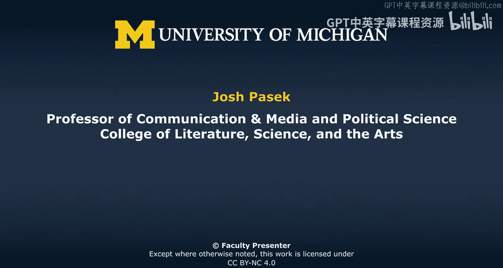

# 应对颠覆：工作场所的生成式人工智能：12：0_系列概述课程简介2

你好，我是乔希·帕索克，密歇根大学传播学、媒体学和政治学教授。

欢迎来到《生成式人工智能：塑造工作与任务》，这是四门系列课程中的第二门。

本系列课程名为《应对颠覆：工作场所的生成式人工智能》。在本课程中，我们将探讨生成式人工智能如何影响工作场所的日常实践，以及如何思考人工智能对工作方式可能产生的影响。

在开始之前，我先简单介绍一下自己。

我的背景是传播学研究员，我的学术研究围绕人们如何理解新闻话题展开。

我使用多种数据科学和机器学习技术来了解公众舆论状况，以及人们如何利用信息做出社会和政治决策。

我研究中使用的一些数据分析方法，构成了现代人工智能系统的核心。

从技术视角及其作为信息和通信技术的角色来理解人工智能，有助于我们深入了解人工智能的功能或能力如何与社会世界互动。

确实，在社会科学和数据科学的交叉领域工作，并曾担任密歇根数据与人工智能社会研究所的副所长，使我处于关于人工智能可能产生的社会影响讨论的中心。

在这个短期系列课程中，我们将探讨人工智能如何影响当代工作场所。

鉴于人工智能可能带来的巨大变革，以及人工智能未来发展和我们如何应对的不确定性，我设计本课程时着眼于过去的信息和通信技术如何塑造其时代的社会和工作环境。

这些历史案例的经验教训，为我们思考人工智能的影响提供了背景。

要理解人工智能将对工作场所产生何种影响，以及它可能在何处引入意想不到的障碍，需要理解四个关键领域，这也是本短期系列课程的重点。

首先，评估人工智能的影响要求我们理解当代人工智能究竟是什么。

聚焦于生成式人工智能，系列课程的第一门名为《生成式人工智能：预测颠覆》。它将人工智能置于早期颠覆性技术的背景下，研究人工智能的工作原理，并剖析不同的使用方式如何产生不同的结果。

理解人工智能影响的第二个支柱，源于关注人工智能如何改变构成当代工作场所的各类任务。

第二门课程名为《生成式人工智能：塑造工作与任务》，重点介绍了来自各类工作场所的一系列工作。

本课程探讨哪些工作任务更容易或更不容易被人工智能替代或增强，以及人工智能的整合可能如何改变人们的工作内容。

接下来，我们将视角放大，思考角色和职责的转变将如何更广泛地改变知识工作，以及在企业、员工和客户之间，人工智能整合后互动关系可能发生的变化。

系列课程的第三门《生成式人工智能整合：对劳动力和劳动力的影响》，将探讨这些问题以及企业应如何准备。

最后，本系列课程将以探讨当代及近期人工智能系统在工作场所实施中可能带来的诸多挑战作为结束。

在《工作场所中的生成式人工智能：政策、伦理与风险》中，我们将审视哪些类型的人工智能使用可能被认为是合适或可接受的，公共政策如何处理人工智能，以及该技术似乎正朝着哪个方向发展。

虽然你可以选择性地学习这些课程，但我认为按此顺序学习会获得最大价值。

理解生成式人工智能的工作原理，是理解它可能对工作任务产生何种影响的重要基础，而这本身对于理解即将到来的颠覆对工作场所更广泛的影响也很有价值。

识别可能发生的变化，有助于你为思考何时何地可能出现问题做好准备。

如果你已经完成了本系列的第一门课程，欢迎回来。如果还没有，我建议在学习本课程之前先学习第一门课程《生成式人工智能：预测颠覆》，以理解人工智能的工作原理，这为本课程提供了宝贵的基础。

在《生成式人工智能：塑造工作与任务》中，我们将探讨人工智能在几个示例工作场所中可能产生的影响。

认识到当代工作场所中的工作由多项任务组成，我们考虑了各种任务受人工智能影响的程度。我们研究的许多工作都包含可能高度暴露于人工智能增强或替代的要素，同时也包含一些可能仍然明显属于人类努力的方面。

思考这些类别，为思考人工智能在你工作场所中的影响提供了一个框架。

学习本课程后，你应该能够：

*   对人工智能可能影响工作场所任务的关键方式进行分类。
*   强调生成式人工智能对不同类型工作的影响。
*   考虑特定的人工智能使用是否合适。
*   解释人工智能的适当使用如何根据情境而变化。
*   讨论人工智能可能如何改变工作内部任务的分配。

非常高兴你能加入本课程的学习，希望你有所收获。

