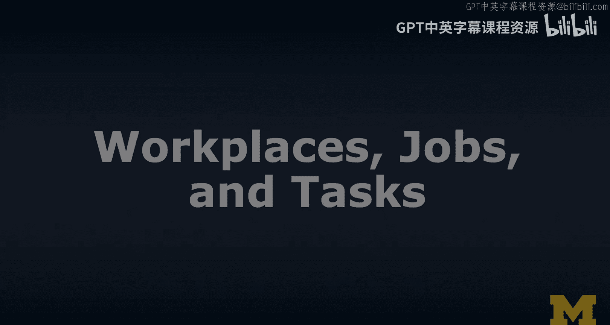
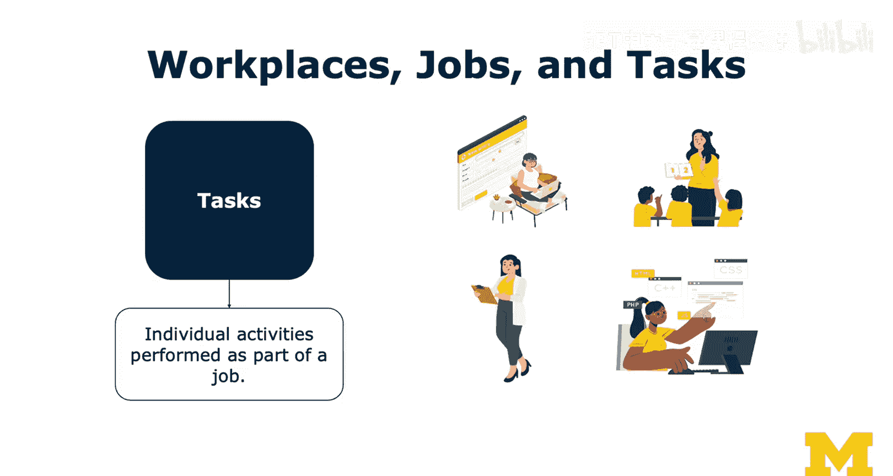
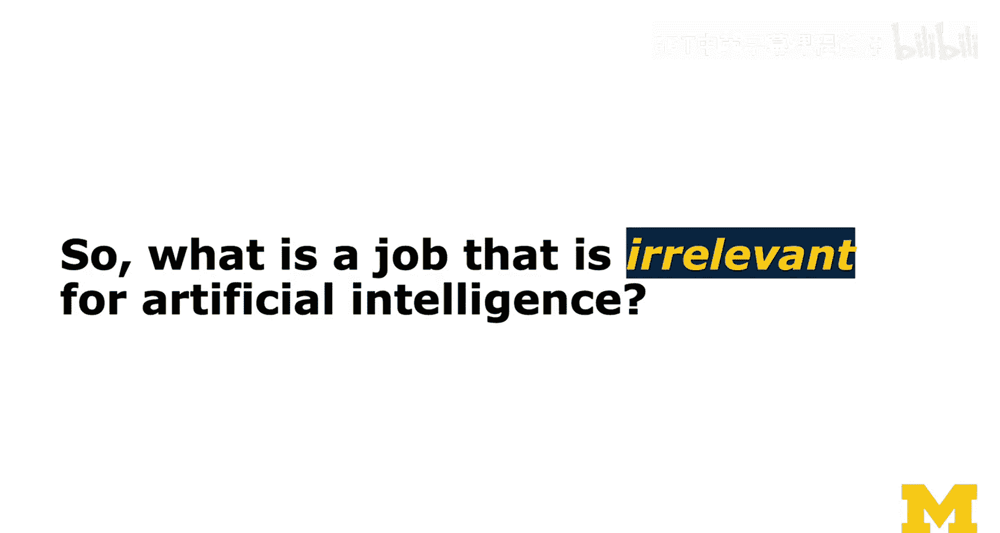
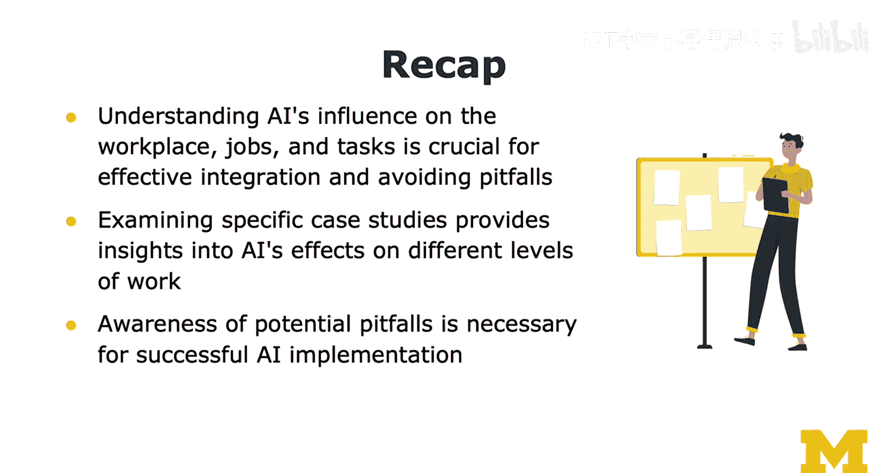
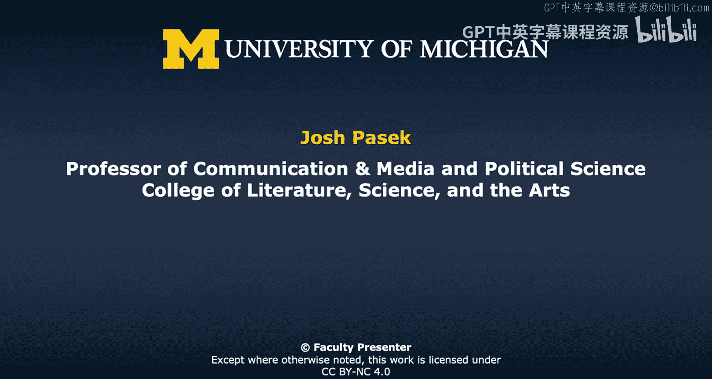

# 应对颠覆：工作场所的生成式人工智能：13：1_工作场景、岗位与任务

## 概述

在本节课中，我们将要学习生成式人工智能进入工作场所后，如何从宏观到微观地影响我们的工作。我们将从**工作场所**、**工作岗位**和**工作任务**这三个层面进行分析，并探讨人工智能对不同类型任务的具体影响。

随着生成式人工智能进入工作场所，它在各个行业中的重要性将持续增长。

我们将在本次讲座及后续课程中探讨的问题是：这将产生何种影响？

在本节中，我们将介绍生成式人工智能将如何影响工作场所、工作岗位以及具体的任务。我们需要从所有这些层面进行思考，才能充分理解正在发生的事情以及我们预期会观察到哪些变化。

## 理解三个层面：工作场所、岗位与任务

首先，我们来明确一下讨论的范围。当我们谈论“工作场所”时，指的是进行工作的全部组织或环境。这包括从公司办公室到工厂、学校、医院、建筑工地甚至餐厅等任何人们去工作的地方。

认识到工作场所的组织方式千差万别，并且人们在这些不同的工作场所中拥有各种不同类型的工作，这一点很重要。

人们所拥有的“工作岗位”，本质上是个体在其工作场所内承担的一系列角色。例如，某人可能是项目经理、教师、护士或软件开发人员。每个岗位都包含在该特定工作场所内存在的各种角色和职责。

而这些角色就是我们定义的“任务”。它们是人们作为其工作一部分而执行的个体活动。任务可能包括数据录入、授课、进行病人检查、编写代码或其他活动。正是在任务层面，人工智能可能产生其主要影响。

## 人工智能对任务影响的四种类型

上一节我们介绍了工作场所、岗位和任务的基本概念。本节中，我们来看看人工智能如何具体影响任务。我们可以将任务划分为四种类型，这有助于我们系统性地思考。

以下是四种任务类型：

1.  **人工智能无关或基本无关的任务**：人工智能对这些任务没有影响或影响甚微。
2.  **人工智能增强型任务**：人工智能可以增强人们执行任务的方式。
3.  **人工智能替代型任务**：人工智能可能完全取代个人执行任务的需要。
4.  **人工智能转变型任务**：人工智能可能改变人类所扮演的角色，以及自动化与人工的界限。

让我们通过例子来逐一探讨这些类别，理解它们将有助于我们在整个课程中思考人工智能在特定工作场所和岗位中的作用。

### 1. 人工智能无关的任务

那么，什么是人工智能无关的任务呢？

存在多种此类任务。例如，治疗师或社会工作者等关怀型角色，可能不适合用人工智能替代，因为这些角色主要由人际互动来定义。

其他一些角色也可能与生成式人工智能无关。例如建筑工人或清洁工等体力劳动角色。很难想象人工智能能对我的发型师产生多大影响。

此外，某些旨在突出人类体验的创造性艺术，可能与生成式人工智能没有特别大的关联，因为人工智能无法复制这些职位所需的人性化接触、创造力或情商。生成式人工智能或许能够模拟一些艺术成果，但它无法真正复制艺术中固有的那种“人性”。

### 2. 人工智能增强型任务

接下来，我们来看人工智能可以增强但无法真正替代人类劳动的角色。

这里我们考虑的是人工智能可以增强人类能力，并可能允许更高效或更有效执行的任务。例如，人工智能可以协助制定营销活动。营销人员可能会发现，与虚拟助手进行创意头脑风暴很有帮助。

在这种情况下，人工智能可以增强人类任务，提高生产力，降低错误率，或将时间从仍需人工处理的更具战略性的工作中解放出来。在这些情况下，人工智能与人类协同工作可以产生增效作用，提升整体任务绩效。

### 3. 人工智能替代型任务

也存在人工智能可以完全自动化任务的情况。这正是我们担忧工作岗位被取代或发生重大转变的情形。

在某些情况下，人工智能或许能够接管那些曾经需要人力、相对程式化的内容或客户服务任务，并将其自动化。这可能导致失业，并需要重新培训或技能提升以适应新角色。围绕这类替代也存在一系列伦理考量，并引发了关于如何在更大规模的劳动力队伍中进行转型的问题。

但它们也可以减轻某些可能属于个人工作一部分，但对任务核心而言不那么重要的角色负担。

### 4. 人工智能转变型任务

最后，人工智能可以转变人类所扮演的许多角色。这是指人工智能将改变工作的性质，可能会优先考虑与以往不同的新技能或方法。

例如，内容创作者可能使用人工智能来起草作品的初稿，然后由人类进行细化和编辑。同样，程序员可能使用人工智能生成初始代码，然后他们再进行修改和改进。

在这种情况下，人类现在执行的任务与以前可能有所不同。不再是人类产生初始输出，现在可能是人工智能产生输出的初始版本，然后人类负责修改和更新它。这为生产力、潜在的工作增长和不断演变的工作角色创造了新的机会。但这要求工作者具备灵活性，愿意转向持续学习和适应。

## 总结与展望

本节课中，我们一起学习了从工作场所、工作岗位到具体任务这三个层面来分析人工智能的影响。我们重点探讨了人工智能对任务的四种影响类型：**无关型**、**增强型**、**替代型**和**转变型**。

虽然我们无法涵盖所有领域，但理解如何思考人工智能对工作场所、岗位和任务的影响，对于有效整合人工智能并避免潜在陷阱至关重要。

通过研究具体的案例，我们可以深入了解人工智能如何影响不同层面的工作，并制定将其有效整合到我们职业生活中的策略。请注意，这些案例研究本身是有限的，因为在这门短期课程中，我无法合理地涵盖人工智能将影响的所有不同领域。

尽管如此，了解如何思考人工智能在工作场所层面和岗位层面产生影响的过程，对于思考如何有效整合人工智能以及如何避免它可能引发问题的领域，将是至关重要的。

