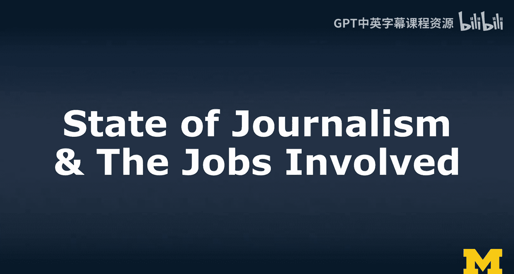
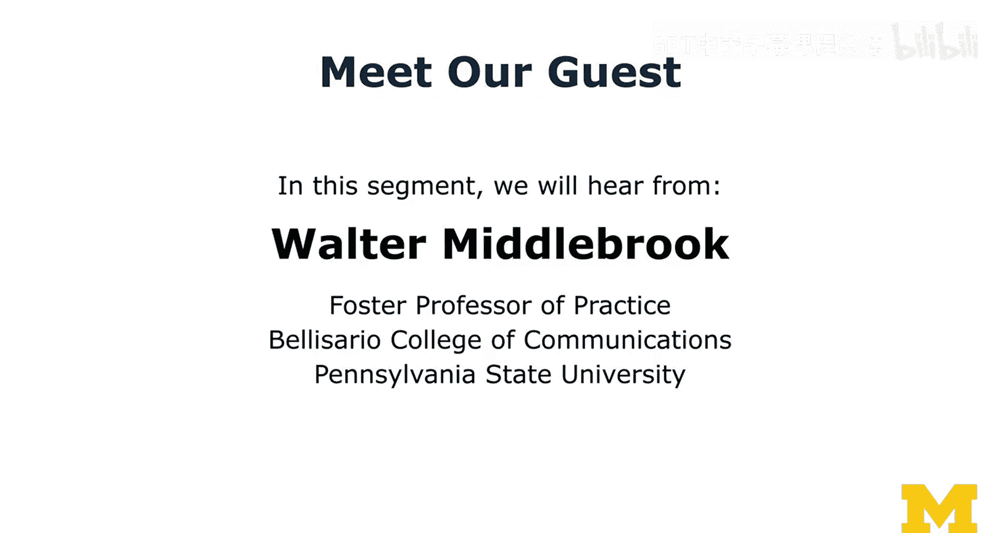
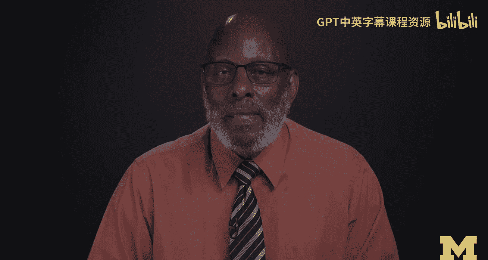
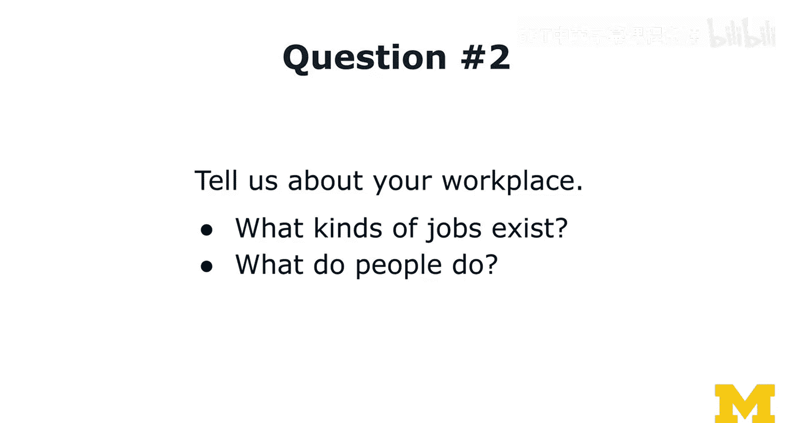
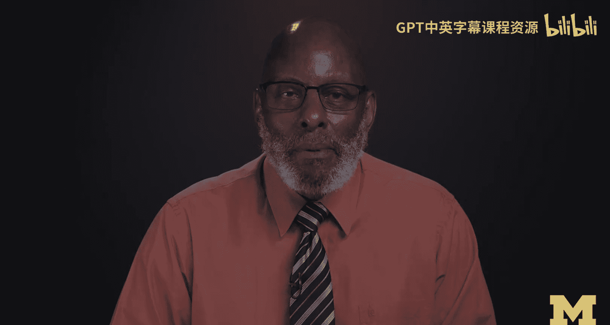
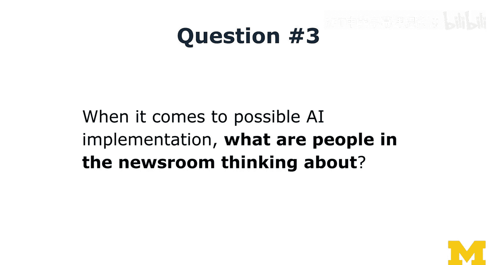
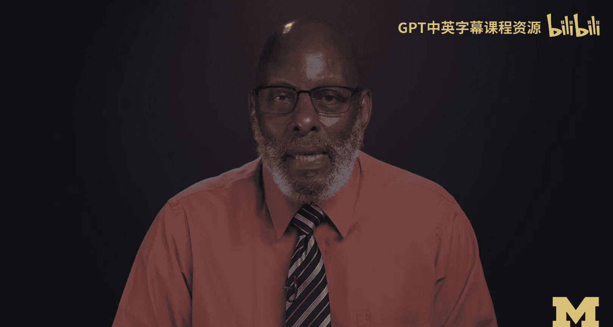
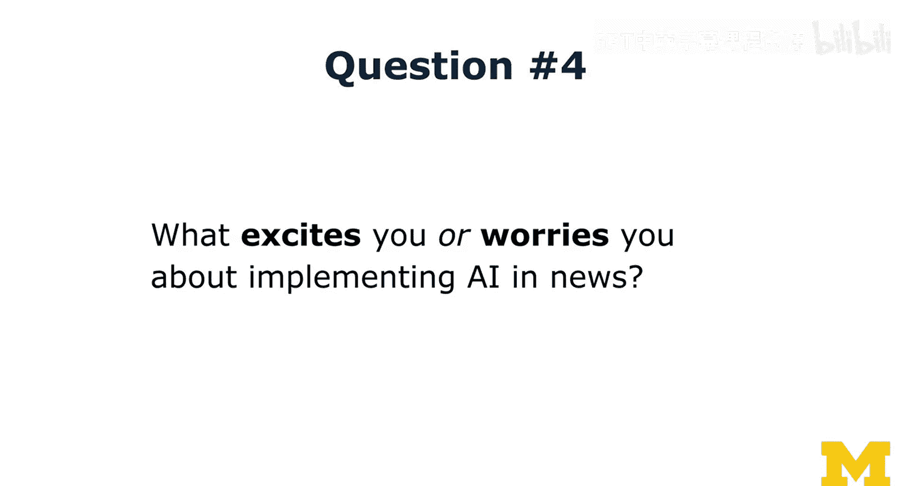
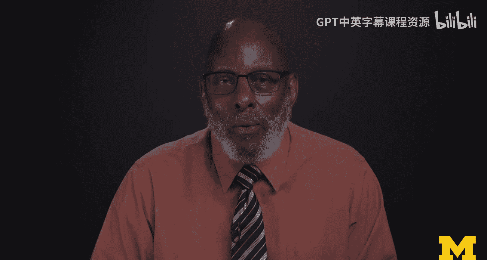
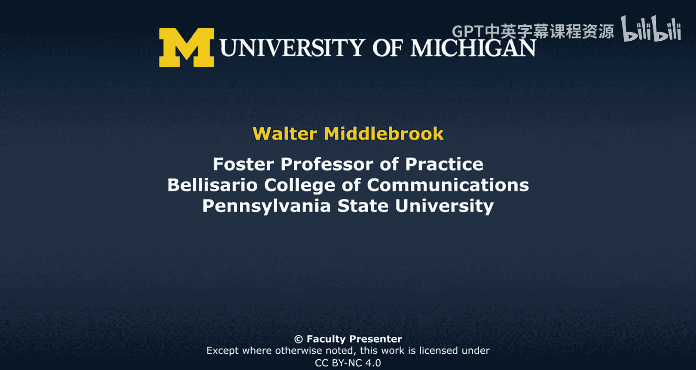

# 应对颠覆：工作场所的生成式人工智能：P14：新闻业的现状及相关职位 📰

在本节课中，我们将探讨新闻业在技术变革下的现状，特别是人工智能如何影响新闻编辑室和相关职位。我们将了解新闻组织的演变、管理者对AI的考量，以及AI应用带来的机遇与挑战。

---

我是沃尔特·米德尔布鲁克，宾夕法尼亚州立大学贝拉里奥传播学院的实践教授。我在加入大学教职之前，曾在多家大型新闻机构担任高级编辑超过20年，包括《底特律新闻》、《长岛新闻日报》、《纽约时报》和《今日美国》。自20世纪70年代末以来，我一直是一名持续工作的新闻记者。

---

## 新闻编辑室的演变 🔄

上一节我们介绍了讲师的背景，本节中我们来看看新闻编辑室是如何演变的。

新闻编辑室及相关新闻组织是不断演变的机制。当我开始职业生涯时，一个新闻机构涉及数百人，构成一个完整的社区。这个社区包括一个由编辑、撰稿人和摄影师组成的新闻编辑室，以及一系列支持系统，范围从生产（一个小型钢铁厂）到市场营销和销售，再到发行（许多卡车和运输公司），以及人力资源和医疗设施。

如今，由于整合和规模缩减，大多数新闻组织能拥有一个小型团队来制作和发布一个多媒体在线新闻网站，就已经很幸运了。

---

## 管理者对AI的视角 👁️

了解了新闻编辑室的历史变迁后，本节中我们来看看新闻机构管理者如何看待人工智能。

新闻机构管理者无疑从两个角度审视人工智能：编辑角度和商业角度。这两个领域都在探索如何利用AI来消除冗余任务。

以下是AI可能应用的领域：

*   **编辑领域**：在撰写和发布公司收益报告的商业新闻，或体育比赛更新和实际比赛报道等活动中。
*   **商业领域**：在广告预订、销售，甚至可能为广告及其文案创作提供支持。

---

## AI的潜在应用与核心担忧 ⚖️

上一节我们介绍了管理者对AI的考量，本节中我们将深入探讨AI的具体应用及其引发的核心担忧。

虽然在大型新闻采集项目中，将AI作为报道团队的补充可能有一些优势，但同样的员工也担心AI会被用作削减报道人员数量的借口。AI也可能在一些新闻编辑室中用于帮助简化运营、决策和规划长期项目等。有些人可能希望AI能为作者和编辑提供建议，告诉他们如何在截稿压力下，为大型报道及其所需的研究填补漏洞或空白（我们称之为“故事中的空白”）。

但这里存在一个核心担忧：我们能在多大程度上信任这些AI生成的内容？新闻报道是一个有机的过程。虽然从商业角度看，仅仅向程序输入比赛分数就让AI生成报道可能很诱人，但编辑方面担心并已经看到AI常常会遗漏语言的微妙之处。到目前为止，AI生成体育和商业报道的实验都惨遭失败。

我们最大的担忧最近在一件事上暴露出来：一家知名新闻机构的一名在职记者发表了AI生成的引语用于报道。这种违反新闻伦理的行为，是在一名竞争媒体的记者通过联系被引用的消息来源以确认他们是否真的发表了报道中使用的评论时，才被发现的。这种伦理违规只是人们正在失去对媒体信任和信心的另一个原因。

新闻编辑室需要一个编辑来在新闻稿件的生产过程中提供制衡。到目前为止，无论AI执行什么任务，它都无法胜任这一角色。

---

## 总结 📝

本节课中我们一起学习了新闻业在人工智能时代的现状。我们回顾了新闻编辑室从庞大社区到精简团队的演变，探讨了管理者从编辑和商业双重视角对AI的审视。我们看到了AI在消除冗余任务和辅助决策方面的潜力，但更深刻地认识到其核心局限：AI目前无法理解语言的微妙之处，无法确保报道的准确性，更无法替代人类编辑在新闻伦理和事实核查中的关键作用。对AI的不当使用，如生成虚假引语，正在侵蚀公众对媒体的信任。因此，新闻业的未来不在于用AI取代人类，而在于如何让人与AI协作，同时坚守新闻专业主义和伦理的基石。