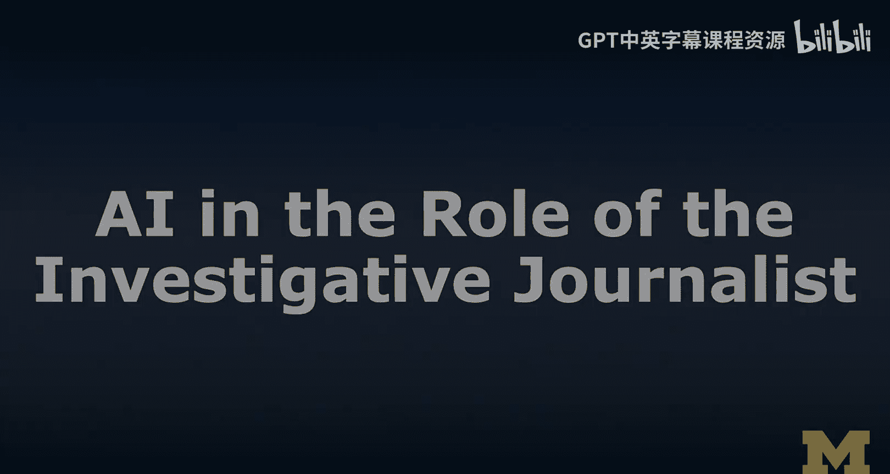
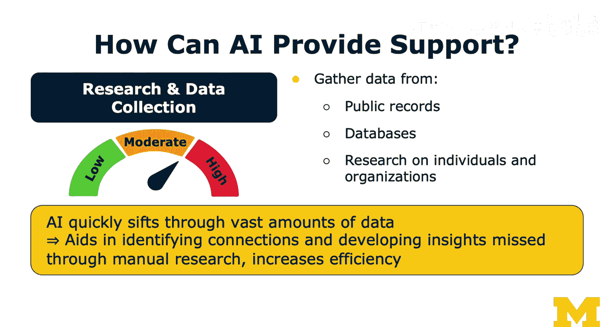
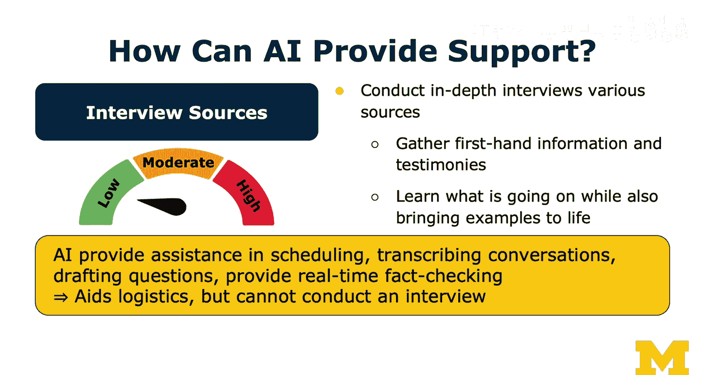
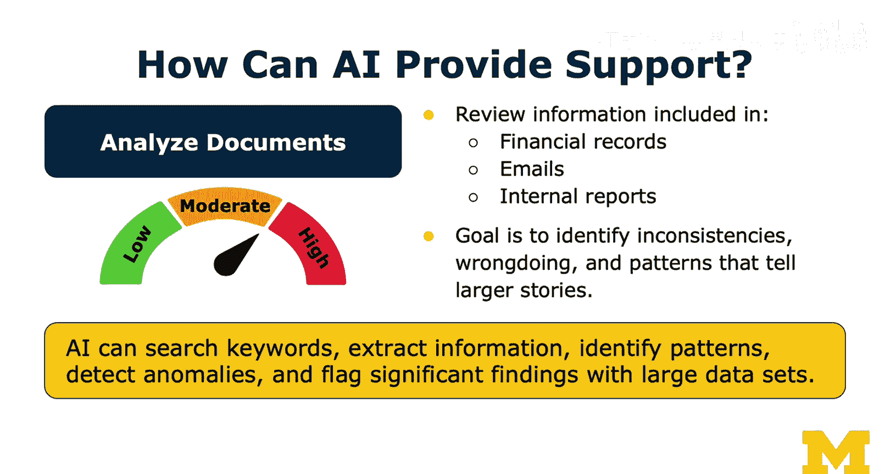
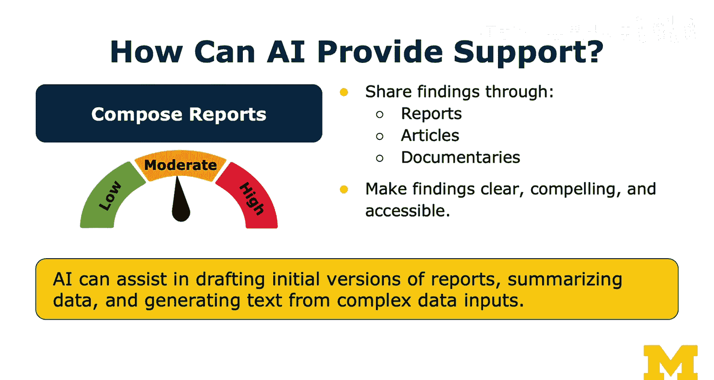
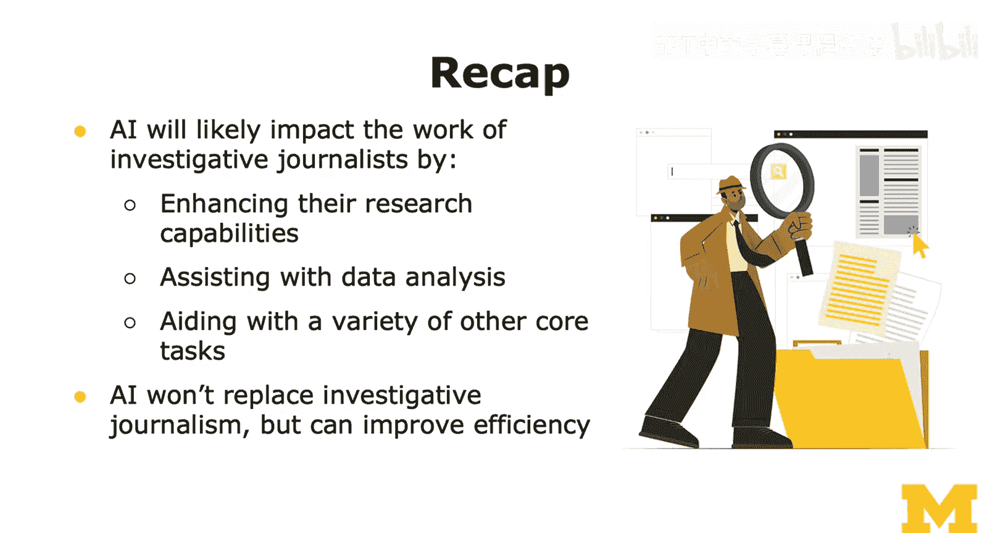
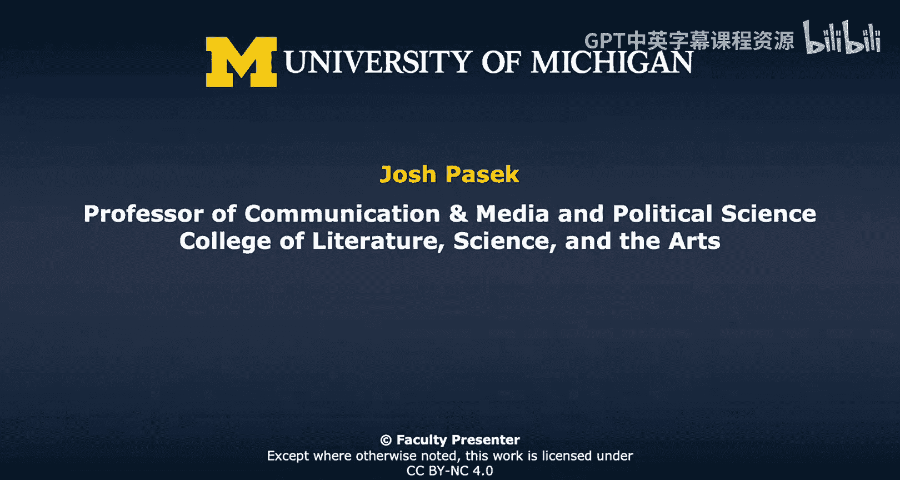

# 应对颠覆：工作场所的生成式人工智能：P15：3_人工智能在调查记者角色中的应用 🔍

在本节课中，我们将探讨人工智能如何影响新闻编辑室中的一个关键角色——调查记者。我们将逐一分析调查记者的核心工作职责，并评估人工智能在这些任务中的潜在影响、暴露程度以及可能带来的角色转变。

调查记者是深入挖掘故事、揭露通常不为公众所知的事实的专业人士。他们的工作对于监督政治机构以维持民主制度运转，以及为各行各业带来透明度和问责制至关重要。他们揭露真相，并让权力承担责任。

调查记者通常执行一系列实践。以下是他们的主要工作流程：

*   **研究与数据收集**：他们花费大量时间通过公共记录、数据库以及对个人和组织的背景研究来收集数据。
*   **采访消息来源**：他们与各类消息来源（从举报人到专家）进行深入访谈，以收集第一手信息和证词，从而了解事件真相并使案例生动具体。
*   **分析文件**：他们分析财务记录、电子邮件或内部报告等文件，以识别不一致之处、发现不当行为的证据或收集可能揭示更大故事的规律。
*   **核实信息**：他们一丝不苟地对来自消息源的信息进行事实核查和验证，以维护报道的完整性。
*   **撰写与报道**：最后，调查记者将这些发现汇编成报告、文章和纪录片，以清晰、引人入胜且易于理解的方式将信息呈现给公众。

上一节我们概述了调查记者的工作流程，本节中我们来看看人工智能在其各项具体任务中的应用与影响。

## 研究与数据收集 📊

在调查记者的研究和数据收集角色方面，人工智能的暴露程度可能为**中度到高度**。人工智能可以通过快速筛选海量数据并识别与特定问题相关的信息来辅助研究。自然语言处理工具可以帮助记者发现联系并形成见解，这些联系和见解可能通过人工研究被遗漏，或者需要花费相当多的时间。

然而，人工智能并不会使人的角色变得无关紧要。数据收集仍然需要人工监督，以确保人工智能识别出的信息的背景和相关性符合调查记者正在调查并希望讲述的叙事。因此，我们看到的是**角色转变**：人工智能可能通过减少寻找初始信息的工作量，并增加用于评估信息质量的时间，来改变调查记者的角色。

## 采访消息来源 🎤

在采访消息来源方面，人工智能的暴露程度**相对较低**。人工智能或许能提供一些后台辅助，例如安排日程、转录对话、草拟采访问题，或提供实时背景信息和事实核查。

但人工智能无法直接进行采访，至少目前做得不太好。进行有效采访所需的细致入微的理解和情商本质上仍然是人类的特质。因此，这里的暴露程度较低，尽管人工智能可能会增强这项任务，但不会以任何实质性的方式取代或转移对人类劳动力的需求。

## 分析文件 📑

在分析文件方面，人工智能可能相当有效。因此，我们可以说人工智能的暴露程度可能为**中度到高度**。人工智能工具可以搜索关键词并为特定问题提取相关信息，从而加速识别模式、检测异常以及在大型数据集中标记重要信息的任务，无论这些数据集是定量的还是定性的。

例如，对于由年度会议记录等来源的大量文本组成的数据，机器学习算法可以识别数据中的趋势，这可能会转移人类记者的角色。与初期的数据收集和研究一样，人工智能的角色将在很大程度上改变调查记者的工作内容。他们的角色可能不再是最初的数据分析，而更多地是解释人工智能识别出的内容，将其置于更广泛的背景中，并进行验证。在这种情况下，它可能使识别关键进展和变化的任务变得更容易。

## 信息核查与验证 ✅

调查记者投入大量精力的另一个领域是信息核查与验证。这也是一个面临**中度**人工智能暴露的领域。人工智能可以通过对照可信数据库和来源交叉引用数据，或者首先识别哪些数据源有帮助，来自动化事实核查的某些方面。

但同样，在区分恶意活动与巧合对应方面，尤其是在复杂或敏感的案例中，人类的判断至关重要。调查记者仍将是这些任务所必需的，尽管人工智能工具可以有效地增强他们的工作。

## 撰写与报道 ✍️

最后，在撰写和报道方面，人工智能可以协助调查记者草拟报告和文章的初稿、总结数据，并根据过去计算机无法处理的复杂数据输入生成文本。然而，讲故事、伦理考量以及构建引人入胜的叙事仍然需要相当程度的人类创造力和判断力。

虽然人工智能可能在写作的初步草拟阶段提供中等程度的帮助，但它更可能导致**替代、增强和角色转变的混合**，记者在整个写作过程中继续发挥重要作用。

## 总结与展望

当我们审视像调查记者这样的角色时，我们应该问：人工智能工具将对调查记者可能承担的职责产生何种影响？对于其中许多职责，人工智能很可能产生影响。它可以增强、有时替代并经常转移调查记者的工作，通过增强他们的研究能力、协助数据分析并帮助完成其他各种核心任务。

但它无法完成所有工作。它无法在不严重依赖人类技能的情况下进行采访并理解真正不当行为的细微差别。尽管如此，调查记者可能会被鼓励利用人工智能作为工具，以提高调查新闻的效率和深度。这意味着什么，取决于从整体上看，这是否能增强调查记者专注于其职业中人工智能无法复制的人类层面的能力，以及调查新闻工作如何随着人工智能的整合而改变。

本节课中，我们一起学习了人工智能在调查记者各项核心工作中的应用潜力与局限性。我们看到，人工智能主要在研究、数据分析和初步撰写等环节提供辅助并引发角色转变，而在需要深度人际互动、复杂判断和创造性叙事的领域，人类记者的作用依然不可替代。未来，成功的调查记者将是那些善于利用人工智能工具提升效率，同时专注于发挥人类独特优势的专业人士。