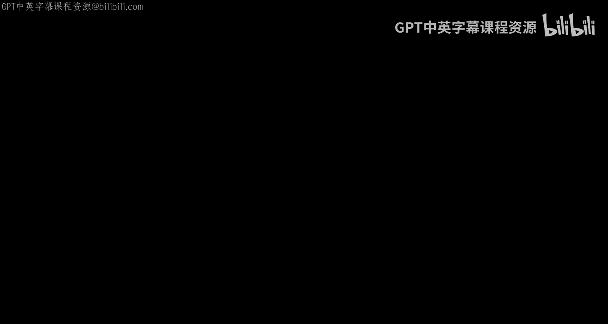
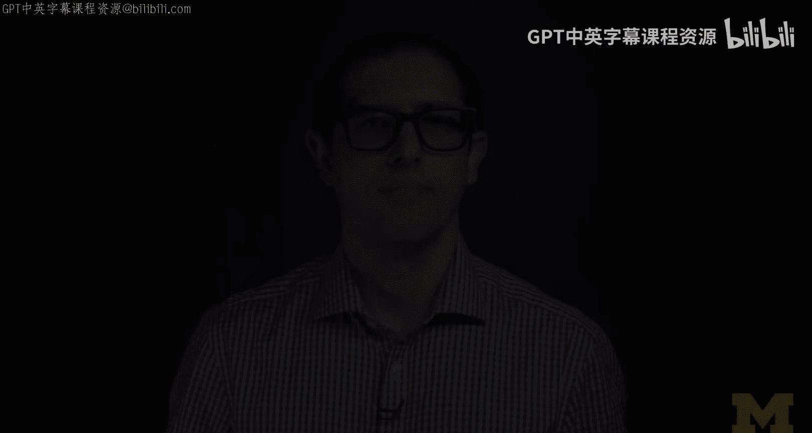
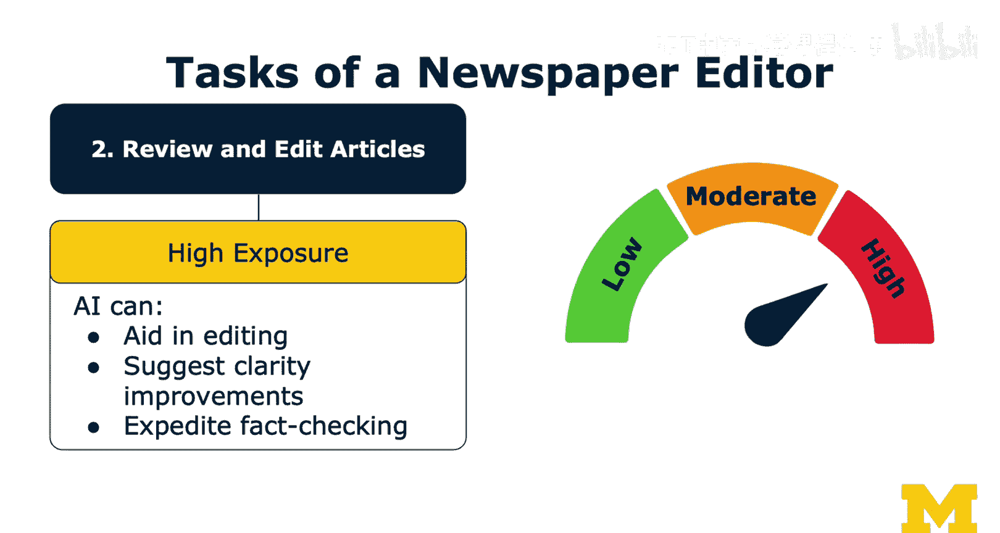
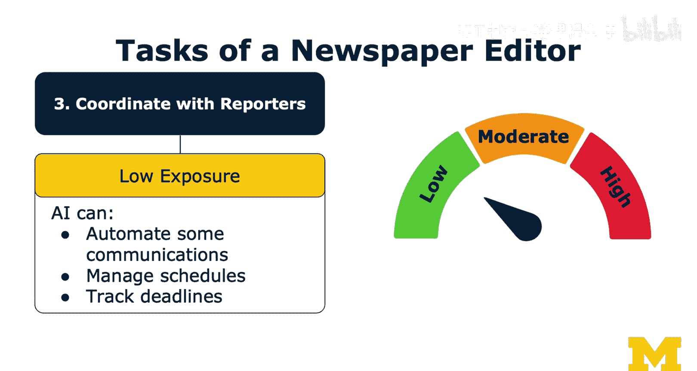
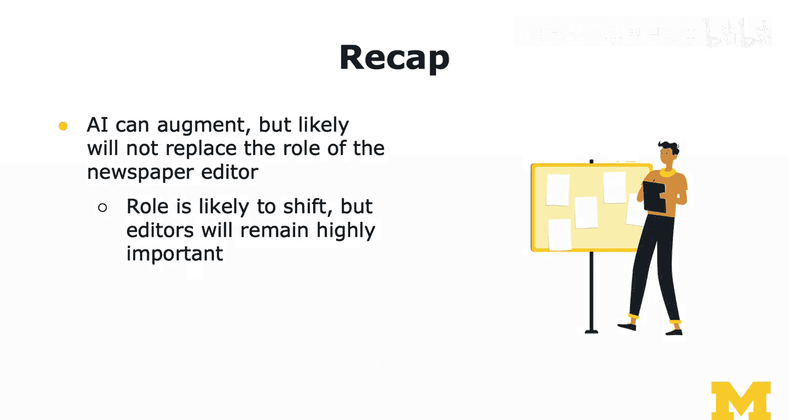
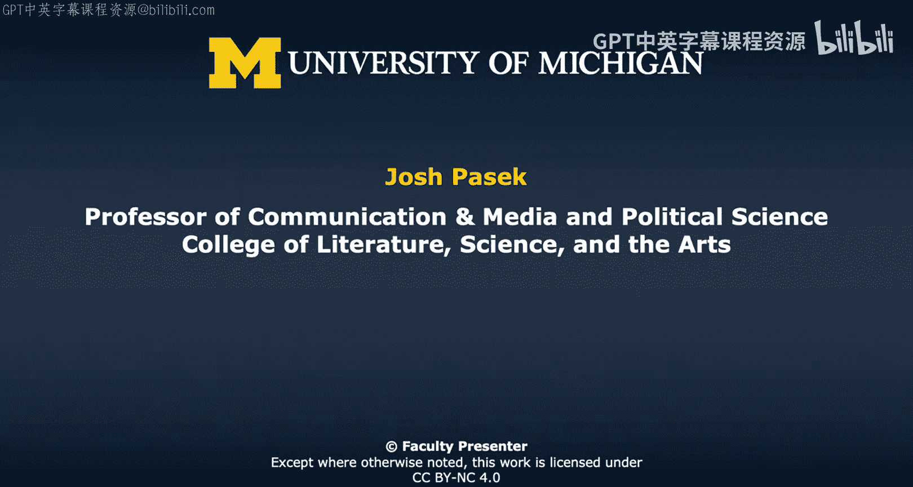

# 应对颠覆：工作场所的生成式人工智能：16：4_人工智能助力新闻编辑

在本节课中，我们将探讨人工智能如何影响新闻编辑的工作。我们将分析新闻编辑的核心职责，并逐一评估这些职责在人工智能技术下的“暴露度”，即被自动化或增强的可能性。通过本课，你将理解人工智能在新闻编辑室中的辅助角色及其局限性。

新闻编辑是新闻内容的关键把关人。他们负责确保发布的内容准确、吸引人且相关。他们的角色对于维护新闻业的质量和诚信至关重要，有效地将记者创作的新闻传递到实际出版和传播的环节。

那么，新闻编辑的具体任务有哪些？以下是新闻编辑的主要职责。

**内容选择与规划**
编辑们需要聚在一起，决定报道哪些新闻，并规划印刷版和数字版报纸的内容布局。他们评估不同事件的新闻价值，并确保内容涵盖各个领域（如本地新闻与全国新闻）的平衡。

**文章审阅与编辑**
编辑需要审阅和修改文章，评估其清晰度、准确性和连贯性。这包括检查语法错误和事实性错误，并确保内容符合出版物的风格指南。

**事实核查**
编辑还需进行一系列额外的事实核查，通过交叉引用信息来源来验证文章中呈现的信息。这对于维护出版物在公众中的可信度至关重要。

**与记者协调**
编辑需要与记者协调。他们为故事发展提供指导、提供反馈，并确保截稿日期得到遵守。

**最终审批与发布**
随着报纸各个部分的整合，编辑负责产品的最终审批和发布。这包括在内容发布前予以批准，以及为适应突发新闻事件而进行必要的最后调整。

**版面与设计监督**
编辑监督印刷版和数字版的版面与设计。

上一节我们介绍了新闻编辑的六大核心任务，本节中我们来看看人工智能对这些不同职责的“暴露度”或影响程度。

**内容选择与规划：低至中度暴露**
人工智能可以通过分析数据集（如收视率数据）来辅助编辑，建议哪些内容可能引起目标受众的共鸣。例如，算法可以识别社交媒体上的热门话题，以确定值得调查的其他内容类型，或预测哪些类型的报道会表现良好。
然而，从根本上说，报纸围绕什么、报道的时效性和重要性，这些都是人类的决策。人工智能的一个挑战在于，其训练数据大多是旧数据，而非日常动态。因此，尽管人工智能可以为内容构思提供有用信息，但它必然缺乏对当前时刻的完整背景理解，最多只能起到增强作用。需要编辑的判断来维持平衡且符合伦理的新闻报道方式，确保重要的新闻得到报道，而不仅仅是追逐热点，这本质上是人类的责任。

**文章审阅与编辑：高度暴露**
人工智能工具可以通过自动识别和纠正语法错误（如不一致的时态、拼写问题和句法错误）来显著辅助编辑工作。人工智能还可以建议提高清晰度和连贯性，有可能取代编辑以前所做的大量手工工作，因此这是一个高暴露领域。
然而，这并不意味着人类编辑毫无作用。人类编辑的角色将发生转变，他们的精力可能越来越多地集中在做出更细致的编辑决策以及维护出版物的声音和风格上。

**事实核查：中度暴露**
正如我们在调查记者部分讨论过的，人工智能可以通过交叉引用已验证数据库中的信息、评估潜在不准确之处等方式，在事实核查中发挥相当大的作用。
不过，这里也存在一些风险。如果记者和编辑依赖相同的人工智能工具进行事实核查，这些工具引入或遗漏的错误可能导致不准确信息蒙混过关。人类的判断在评估输入信息、核实复杂和模糊信息以确保最终输出高质量且具有新闻价值方面仍然至关重要。
在这种情况下，人工智能很可能会增强而非取代人类劳动。

**与记者协调：低度暴露**
人工智能可能会增强这一角色，并实现部分联系自动化，但从功能上讲，管理日程和跟踪截止日期只反映了编辑与记者协调工作的一小部分。编辑向记者提供的指导、反馈和细致入微的建议是深度的人类任务，人工智能或许能提供协助，但不太可能完全复制。因此，我们再次看到一些增强作用，但它是有限的。

**最终审批与发布：低至中度暴露**
人工智能在最终一致性、完整性检查方面可以提供协助，甚至可以根据读者偏好帮助优化版面设计。但最终的决策、伦理考量以及内容重要性的判断，本质上仍然是人类编辑的职责。在编辑的角色中，人工智能可以增强，但无法真正取代编辑的工作。

**版面与设计监督：低至中度暴露**
人工智能可以协助优化版面设计，但最终的审美和编辑判断仍需人类把控。

本节课中我们一起学习了人工智能在新闻编辑工作中的应用与影响。人工智能在提升新闻编辑效率方面，特别是在编辑和事实核查环节，具有相当大的潜力。然而，新闻编辑工作的许多方面——做出编辑判断、指导和管理记者、审批内容、识别和突出重要新闻——仍然需要人类的技能和直觉。因此，我们再次看到一个案例：随着人工智能的整合，编辑的角色可能会发生转变，但即使人工智能融入新闻编辑室，编辑仍然可能保持高度重要性。

