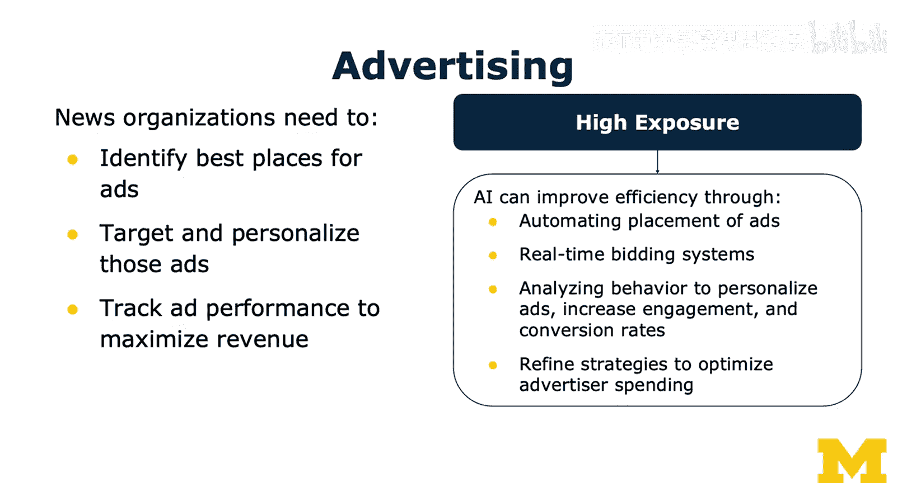
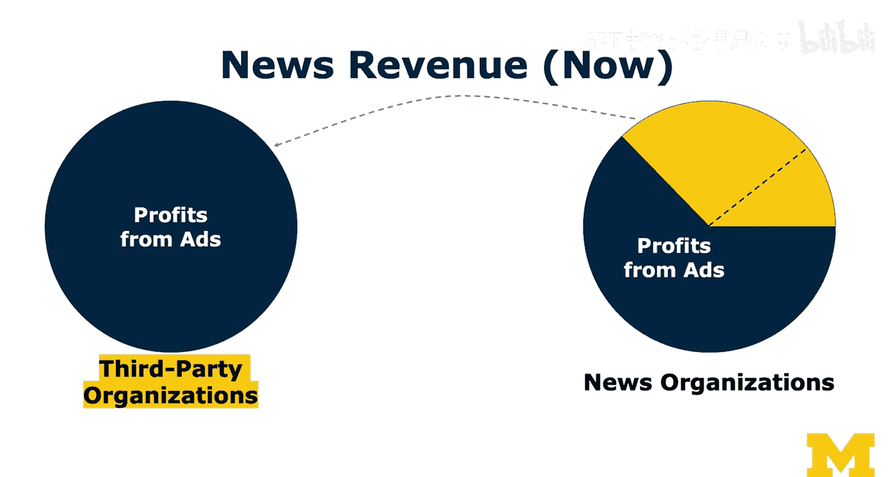
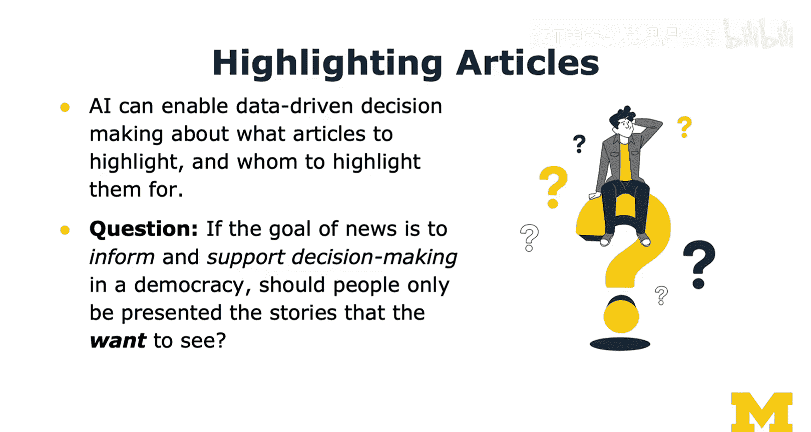

# 应对颠覆：工作场所的生成式人工智能：17：5_后台运作中的人工智能

## 概述
在本节课中，我们将探讨人工智能在新闻机构后台运作中的角色，重点关注其在广告、营收和订阅模式优化等方面的应用与影响。

当我们思考人工智能在新闻业中的角色时，或许人工智能与新闻生成和评估最相关的领域，在于新闻机构的**后台运作**。

在这里，问题主要围绕**广告、营收和印刷**展开，这些都是人工智能最有可能发挥日益重要作用的领域。

## 新闻编辑室的后台工作
那么，除了新闻采编和编辑，新闻编辑室还有哪些工作？为了维持新闻机构的运营，需要有人管理和优化广告业务。

以下是新闻机构后台广告运营的关键任务：
*   新闻媒体需要确定投放广告的最佳位置以最大化收入。
*   广告团队需要针对特定受众群体进行广告定向投放和个性化，并追踪广告效果以最大化收益。

## 人工智能在广告中的应用
这是一个人工智能高度适用的领域。人工智能通过**自动化投放**和**实时竞价系统**，拥有使广告投放效率大幅提升的巨大能力。

人工智能算法可以分析用户行为和偏好来个性化广告，从而提高参与度和转化率。人工智能驱动的分析工具还能提供更详细的性能报告，有助于优化策略和广告主的支出。

## 人工智能应用的现实挑战
尽管人工智能可以处理大量此类工作，但报业（至少迄今为止）并未真正从人工智能的广告能力中获益。

这主要是因为人工智能驱动的广告流程在很大程度上由少数主导在线广告市场的大型科技公司控制。因为这些公司使用的数据是报业无法获取的，并且已经采用了成熟的人工智能工具。

这一发展的结果是，报业在很大程度上已将广告业务外包。广告投放曾经是新闻机构的主要收入来源。

## 营收模式的转变
但这一流程在很大程度上已移交第三方的事实，对当代报业的利润造成了重大打击。

在很大程度上，由于广告回报下降，报业的营收模式越来越依赖于**订阅**。

近年来，要求个人订阅报纸（甚至是为了阅读数字报道）变得必要，因为来自广告的营收模式已无法像过去那样维持报业的生存。

## 人工智能与订阅策略
因此，确定如何为新闻机构的订阅服务定价并鼓励订阅，已成为一项日益重要的后台任务。这也是一个很大程度上受人工智能影响的领域。

虽然在人工智能时代之前，通过电话推销报纸订阅的日子就已一去不复返，但人工智能也正在改变这个领域。

人工智能可以帮助新闻机构识别有效的定价模型，并优化可能对新闻机构更高效的策略，例如帮助它们决定何时应该或不应该展示付费墙。

但到目前为止，鼓励个人为新闻付费的过程仅部分有效，并且未能取代新闻机构在以往时代从纸质订阅中获得的收益价值。

因此，人工智能帮助优化的这些边际差异，可能不足以弥补当代报纸营收模式所面临的挑战。

## 人工智能策略的双重影响
人工智能可能鼓励的一些策略对报业而言也是利弊参半。例如，人工智能使报业能够就突出显示哪些文章以及向谁展示，进行更多**数据驱动的决策**。

但报业是否应该主要突出公众最想阅读的报道，这是一个问题。如果新闻的目标是告知信息并支持民主决策，那么人们想读的新闻，可能并非他们需要接触的新闻。

早在20世纪60年代，哥伦比亚广播公司的所有者兼主席威廉·佩利就曾告诉记者，他们在CBS新闻的工作不是公司的主要收入来源。

在一次会议上，他告诉他的新闻通讯员：“我有杰克·本尼（喜剧明星）来为我赚钱。”这表明新闻或许可以承受亏损，因为记者为国家提供了关键服务。

## 当代新闻哲学的转变
在当代，这种关于新闻角色的哲学似乎已经消亡。相反，新闻需要赚钱，而数据驱动的决策使新闻机构能够通过迎合人们想要的内容（而非最重要的内容）来实现这一目标。

这种转变最终可能催生一种非常不同类型的新闻。

## 总结
因此，人工智能在新闻机构后台运作中的作用更加复杂。它改变了新闻机构思考赚钱的方式以及它们开展工作的方法，并且这种改变是相对根本性的。然而，尚不清楚这是否提高了新闻业的效率。相反，它可能改变了新闻的本质及其在社会中扮演的角色。