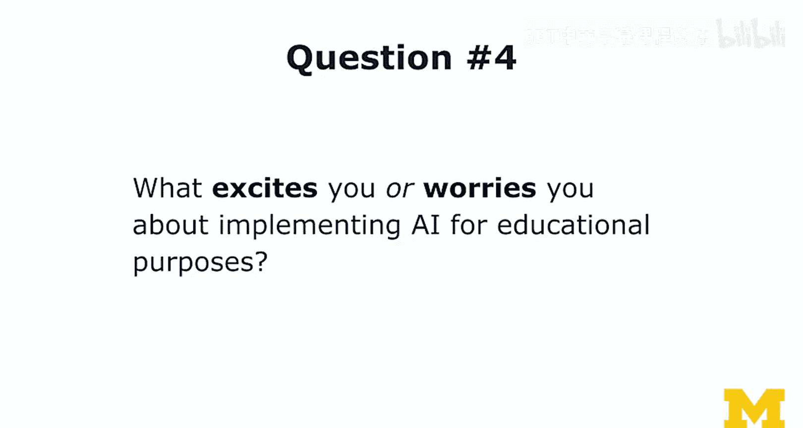
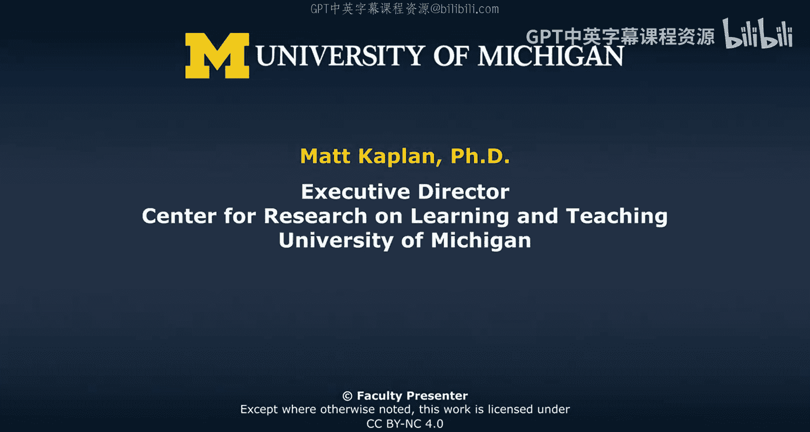

# 应对颠覆：工作场所的生成式人工智能｜P18：6_教育行业现状及相关职位

在本节课中，我们将探讨生成式人工智能在教育领域的应用现状、相关职位以及它带来的机遇与挑战。我们将从教育从业者的视角出发，分析生成式AI如何影响教学、学习以及学术环境。

大家好，我是马特·卡普兰，密歇根大学教学卓越中心——学习与教学研究中心的执行主任。我们中心成立于1962年，是美国第一个教学中心。我们的使命是促进教学与学习领域的创新、卓越与公平。这是我在大学的第30年。

密歇根大学是一个庞大的机构。我们拥有超过8000名教职员工，其中包括传统意义上在教室和实验室进行研究和教学的教授，也包括在附属医疗专业领域、在医院接诊病人并在诊所指导学生的人员。他们总共教授超过3万名本科生和约2万名研究生及专业学生。

大学还雇用了超过2万名工作人员，他们的角色多种多样，从院系和行政人员、学术顾问，到为学生提供基本服务的住宿和餐饮部门员工，以及负责大学基础设施的员工。当然，还包括协助教学流程各个方面的人员，比如我在学习与教学研究中心的同事们。

教育工作者最显而易见的工作是与学生在课堂上共度的时光，这可能包括讲课、引导讨论、在艺术或临床环境中提供一对一指导。但这只是冰山一角，其下还包括教学规划方面的智力工作，从选择最相关的内容并如何有效地排序，到设计评估学生学习的测试和作业。

他们的工作还包括在办公时间和通过电子邮件非正式地指导学生，以及在学生攻读学位、寻求大学毕业后的人生建议和推荐信时，提供更正式的指导。这个群体深受生成式人工智能出现和普及的影响。

我很自豪能与一群专注的专业人士共事，他们的主要角色是与大学所有19个学院的教师合作，涵盖从课程设计到教学实践的各个方面，目标是确保所有学生，无论其背景如何，都能取得成功。这包括应对生成式人工智能带来的机遇与挑战的方法。

我认为，至少从我的角度来看，教育界对生成式人工智能的反应多种多样，从拥抱ChatGPT等生成式AI工具的前景，到试图最小化其影响，再到鉴于包括教师职业倦怠在内的其他关切话题而完全不参与。这些观点并非相互排斥。

对于许多教师来说，这仍然是一个陌生的领域，他们正在努力思考如何以及是否要根据生成式AI来调整自己的教学。因此，典型的问题包括：我需要在教学大纲中包含什么样的政策声明？我的学生使用ChatGPT完成作业的情况有多普遍？这对评估他们的学习有何影响？学生是否平等地获得生成式AI工具？考虑到我手头的其他所有事情，我如何找到时间学习更多并确定我的方法？

另一些人则一直在开发创造性的方法，将这项技术整合到他们的课程中。这范围很广，从使用密歇根大学的工具创建按需数字导师，可以24/7随时回答学生的问题，到使用生成式AI来启动学生的思维和技能培养。

推动这些实验的动机也各不相同，从对创新的兴奋，到致力于使用工具箱中的所有工具来支持学生学习，再到需要为学生准备在日益包含生成式AI的工作世界中具有竞争力。

我们还需要从学生的角度来思考这个问题，在这方面要谨慎对待假设。例如，我最近读到的一项研究报告了一项学生调查，显示他们对生成式AI也持有复杂看法。虽然他们认为这是一个有用的工具，并觉得在大学毕业后生活中培养使用AI的技能很重要，但他们也担心滥用，比如抄袭。目前，政策和实践因课程和教师而异，这可能使学生难以在任何特定情况下驾驭自己对生成式AI的方法。

因此，除了培养生成式AI素养的愿望外，他们确实喜欢关于此事的明确指导和公开讨论，特别是围绕生成式AI的道德使用。这是学习与教学研究中心以及密歇根大学“技术协作教学”计划的其他办公室正试图通过为教师举办研讨会来解决的问题，主题涵盖从生成式AI基础到整合可直接辅助学习的特定应用程序。

这些研讨会也是分享校内同事创造性工作的绝佳论坛。我们还为希望思考生成式AI在其课堂中具体应用的教师提供一对一咨询。

上一节我们介绍了教育工作者对生成式AI的复杂反应和初步探索。本节中，我们来看看生成式AI在教育领域的具体机遇与挑战。

想象生成式AI能够促进学生成功并帮助他们培养未来重要技能的方式是令人兴奋的。例如，生成式AI可以加速学习，无论是作为合作伙伴为论文构思初步想法，还是帮助工程领域的非计算机科学博士生更快地培养编码技能。

它也可以成为学生的支持工具。例如，在回应写作提示时，如果你英语不流利，或者在视觉创作方面不擅长时，它可以提供帮助。它同样可以成为教师的支持工具。例如，帮助制定评分标准或作业的初稿。

或许更重要的是，它有可能帮助学生磨练批判性思维技能，这些技能对未来职业发展和培养民主公民技能至关重要。随着信息来源的激增，信息素养变得越来越重要。审视当前的政治格局可以清楚地看出，需要对广泛传播的信息的真实性做出明智的判断。

通过与ChatGPT等应用程序合作，并不得不评估其提供响应的质量和准确性，学生将更广泛地加强他们作为信息批判性消费者的能力。这自然可以引发对数据和信息道德使用的见解，这是一个跨学科的话题。

尽管如此，生成式AI也带来了许多挑战。我最常听到的担忧是关于学术诚信、公平性和知识产权。例如，围绕作弊问题，教师们想知道如何判断学生是在完成自己的作业。检测软件已被证明会产生相当数量的误报，所以这并非一个好的解决方案。这可能意味着他们需要重新思考作业设计，并与学生就期望进行明确的政策说明和对话。

即使学生没有从AI应用程序中大量抄袭，教师们也在努力思考如何评估那些融入了AI的作业。在公平性方面，虽然密歇根大学的生成式AI应用程序有潜力确保无论收入如何都能平等访问，但更富裕的学区将有能力提供生成式AI相关的准备，这在资源较少的地区是无法实现的。

我们知道生成式AI建立在模型之上，这些模型很容易复制网络上信息宇宙中存在的刻板印象和其他负面表征。除此之外，像ChatGPT这样的应用程序容易出现“幻觉”，即编造数据。我们在一个广为人知的案例中看到了这一点，一名纽约律师因在法律简报中使用ChatGPT生成的虚假案例而受到制裁，这正是缺乏我之前提到的适当评估技能。

教授和学生都可能轻易学到或传播错误信息，而研究表明，这些错误信息随后很难纠正。还存在关于谁将拥有输入生成式AI应用程序的数据的问题。例如，商业程序可以使用输入的信息作为其算法的一部分来生成未来的内容。这对于受本国法律保护、归学生所有的学生作品来说是个问题。

最后，还存在保持与时俱进的挑战，因为生成式AI应用程序的激增和更新似乎是持续不断的。

本节课中我们一起学习了生成式人工智能在教育领域的现状与影响。我们了解到，教育工作者群体正以复杂多样的态度应对这一技术，从积极探索整合到谨慎观望。生成式AI为加速学习、提供个性化支持、培养批判性思维和信息素养带来了显著机遇。同时，它也引发了关于学术诚信、公平访问、数据偏见、信息准确性以及知识产权等方面的严峻挑战。教育机构需要为师生提供明确的指导、持续的培训以及开放的讨论平台，以负责任和有效的方式驾驭这项变革性技术，最终目标是促进所有学习者的成功与公平。