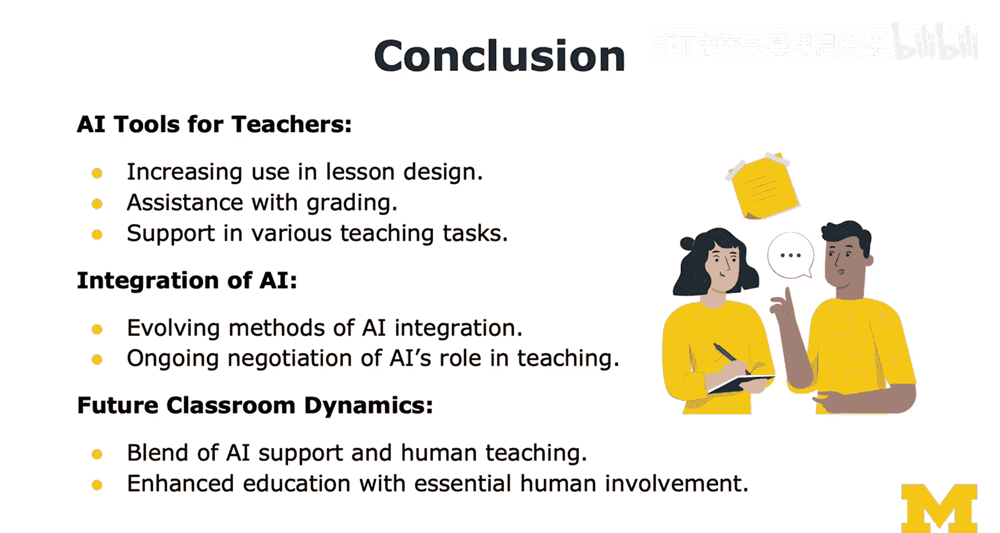

# 应对颠覆：工作场所的生成式人工智能｜P19：7_人工智能辅助高中教学

## 概述

在本节课中，我们将探讨人工智能在高中教学场景中的应用潜力。我们将分析教师工作的核心任务，并逐一评估这些任务受人工智能影响的程度，从而理解AI如何辅助而非取代教育工作者的角色。

## 教师的核心角色与任务

在任何教育机构中，教师都处于最核心的位置。教师扮演着塑造学生思维、引导学生完成各个教育阶段，并经常辅助其个人发展的关键角色。

与许多其他职业的专业人士一样，教师需要处理多种任务。他们的工作包括：课程规划、制定教学大纲、安排课程表、设计需要引人入胜的教学材料、授课、引导课堂讨论以及管理课堂行为和动态。

教师还需要评估学生的表现，通过测试、作业或项目等方式进行。他们需要提供反馈以帮助学生进步。此外，教师提供学生支持和指导，既给予学术指导，也提供情感支持，帮助学生明确未来教育和职业选择的方向。

教师被期望持续改进和精炼其教学技能，紧跟教育趋势，并通过教师培训课程和教育研讨会参与专业发展。

## 各项教学任务的人工智能暴露度分析

接下来，我们逐一分析上述各项任务受人工智能影响的程度。

### 课程规划：中等暴露度

课程规划任务具有中等程度的人工智能暴露度。人工智能具备多项能力，可以协助创建课程计划。它既能提供特定教学模块可能包含的资源，也能根据学习目标生成定制化的内容。

在这些方面，人工智能的作用是改变教师的任务性质，使教师最终转向**精炼材料**，而非从零开始**生产材料**。

AI工具还能够为课堂建议有趣的活动，突出可能增强课程效果的资源，甚至设计可作为课程一部分的补充材料。思考这些材料如何与课堂及学生个体相关联，仍然是教师的任务。但将部分工作卸载给AI的能力，意味着该领域具有中等暴露度，主要体现在**增强**作用上。

### 教学与课堂管理：低暴露度

在教学和课堂管理方面，人工智能能做的事情相对有限。

AI可以通过提供虚拟辅助来支持教学，例如为学生寻找引人入胜的材料，帮助师生在文本中找到关键信息。

然而，对于许多与课堂相关的任务，例如处理不同个体的学习风格，教师的角色仍然至关重要，无法交由人工智能代理完成。课堂管理尤其需要一个不仅能在智力上，有时还需要在身体上与学生互动的人。因此，这部分任务的AI暴露度较低。

### 学生表现评估：高暴露度

人工智能在影响学生表现评估方面具有很高的潜力。

人工智能不仅可以自动化批改选择题测试，还可能为其他类型的评估提供反馈。AI驱动的工具可以帮助学生改进其作业的拼写、语法和结构，并可以检查抄袭行为。

AI在学生作业评估方面的贡献潜力日益增长，它已经能够提供相当数量的初步反馈。当然，仍有部分评分工作需要教师直接参与，教师审阅任何AI工具的反馈也至关重要。然而，人工智能有可能补充甚至取代大部分与评估相关的任务。

### 学生支持与指导：低暴露度

在学生支持和指导方面，人工智能不太可能扮演重要角色。

虽然存在AI引导的辅导程序并且它们将持续改进，但那些能产生最大长期影响的学生支持方面，依赖于教师与学生建立的人际联系，以及有效指导和情感支持所需的同理心。这些是独特的人类品质，确实无法被AI取代。😊

### 专业发展：中等暴露度

在专业发展方面，人工智能有中等潜力来补充教师的劳动。

AI不仅可以帮助引导教师找到最有效和最相关的专业发展机会，还可以帮助评估哪些机会可能最有益，或者可能在功能上是冗余的。

此外，将AI整合到教师的教学库中，有助于生成满足个别学生需求的个性化学习材料。这在学生众多或学生对某个主题处于不同概念水平的班级中，通常更具挑战性。在这些领域，AI在减轻工作量和识别增强型教学资源方面具有相当大的潜力，能以有价值的方式增强教师的工作。

## 总结

本节课中，我们一起学习了人工智能在高中教学中的应用前景。虽然教学最初看起来是一项高度动手操作和以人为中心的任务，但教学的许多方面都可能受到人工智能引入的影响。教师可能会越来越多地使用这些工具来辅助他们设计课程、评分以及其他工作方面。

人工智能如何融入课堂，以及如何在教学专业中进行协商，仍有待观察。未来很可能涉及AI支持与人类教学的结合，在保持课堂中必要的人类参与的同时，增强教育体验。

