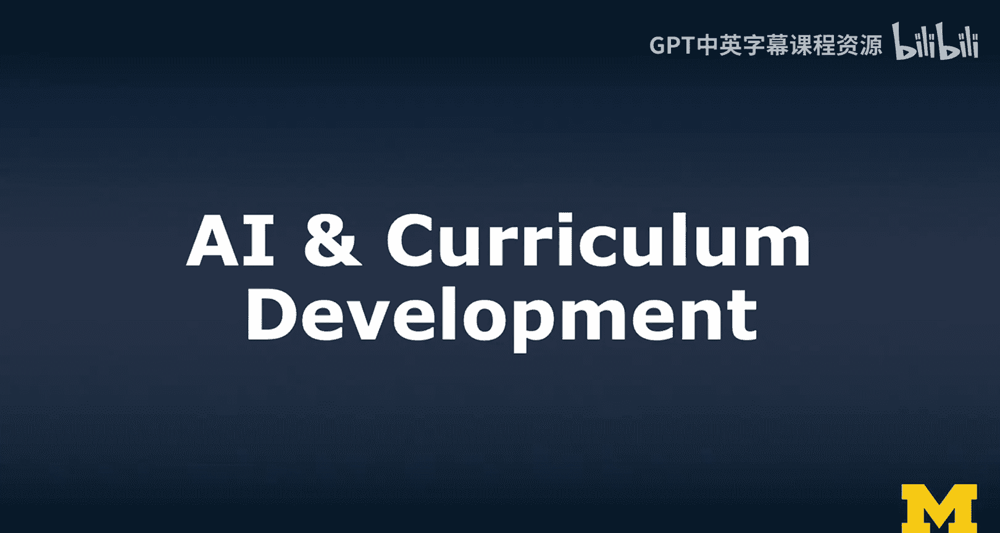
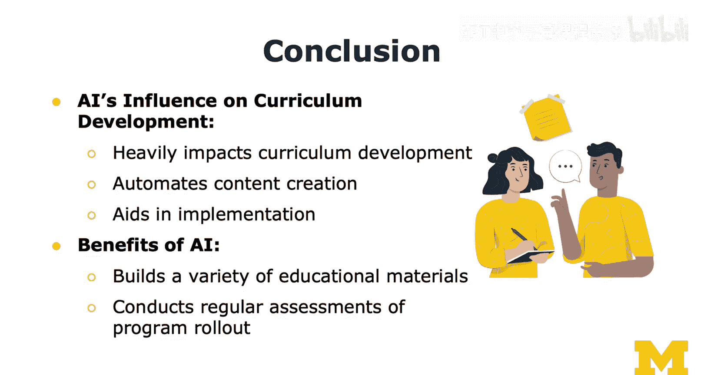
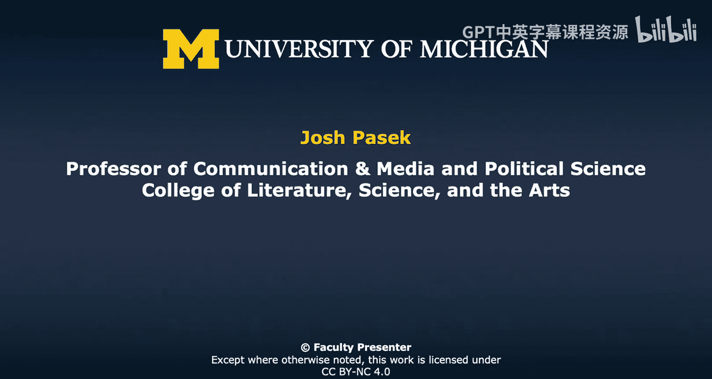

# 应对颠覆：工作场所的生成式人工智能：P20：8_人工智能课程开发

## 📚 概述

在本节课中，我们将探讨人工智能如何影响课程开发这一关键教育环节。课程开发涉及设计学习工具与体验，以确保教学内容适合学习者的水平。我们将逐一分析课程开发的各个阶段，并了解人工智能在其中扮演的角色。

## 🔍 课程开发的核心流程

课程开发是一个系统性的过程，旨在为学生设计合适的学习材料和体验。其核心目标是确保教学内容与学习者的教育水平相匹配。

以下是课程开发的典型步骤：

1.  **需求评估**：识别学生的教育需求以及现有课程中可能存在的差距。
2.  **设定目标与规划**：在需求评估后，课程开发者需要收集和分析数据，以指导课程决策。接着，他们会确立课程目标，勾勒课程大纲，并制定具体的教学计划。
3.  **内容与材料创建**：在此阶段，开发者将教育标准、学习成果和具体评估方式融入课程。这包括创建新内容和开发教学材料，如教科书、多媒体资源和作业。开发者需确保内容具有吸引力、准确性，并与教育目标保持一致。
4.  **评估与修订**：课程设计和内容开发完成后，开发者会对其进行评估和修订，以确保其在实践中有效。他们会收集反馈和表现数据，以改进内容及其呈现方式，并进行必要的调整。
5.  **实施与支持**：在课程开发和完善后，开发者通过培训教育者使用新课程来支持其初步实施。他们还会监控推广过程，解决出现的问题，并进行适当调整。
6.  **持续支持**：即使在课程开发、完善并推广后，课程开发者仍需扮演实施支持的角色，培训教育者如何使用新课程，并在课程广泛使用时，帮助监控进一步的推广并解决出现的其他问题。

## 🤖 人工智能在课程开发各阶段的应用

上一节我们介绍了课程开发的标准流程，本节中我们来看看人工智能如何介入并改变这些环节。

### 需求评估阶段

评估特定课程的需求通常涉及分析大量数据集，以确定当前的教学内容以及潜在的可教授领域。人工智能在这些任务上可以提供相当大的帮助。

以下是人工智能在此阶段的具体作用：
*   **处理数据**：人工智能算法可以处理现有课程中的学生表现数据。
*   **总结信息**：它可以总结调查结果和其他指标。
*   **分析内容**：它甚至可以评估当前课程的文本内容，为课程规划提供见解。

因此，需求评估是人工智能**中度至高度影响**的领域。虽然仍需人类进行解读以确保见解具有相关性和可操作性，但人工智能可以显著简化数据分析，从而改变课程开发者的角色。

### 课程设计阶段

课程设计也受到人工智能的**中度影响**。

以下是人工智能在此阶段的能力：
*   **建议主题与生成大纲**：人工智能可以建议主题、生成大纲，并使材料与教育标准保持一致。
*   **规划学习成果**：人工智能工具还可以帮助规划学习成果和能力。

然而，创造性的决策仍然是人类课程设计者的领域，我们可能还不希望将整个课程完全委托给人工智能工具。因此，虽然人工智能可以提供协助，但目前人类的投入仍然至关重要。

### 内容创建阶段

人工智能可以生成教学材料的初始版本，例如测验、互动模拟、图像、幻灯片演示文稿、教科书内容的草稿等。

自然语言处理工具还可以创建针对不同学习风格和水平量身定制的个性化学习材料。

在许多方面，一旦课程的基本参数确定，大部分内容都可以高度自动化，这可能会取代课程开发者在此角色中所做的相当一部分工作。

### 评估与修订阶段

课程的评估和修订也属于**中度影响**类别。

与评估现有课程类似，人工智能可以分析学生表现数据和反馈，并评估课程各部分的有效性。

以下是人工智能在此阶段的作用：
*   **分析数据**：人工智能模型可以识别模式。
*   **提出建议**：它可以提出需要改进的领域。

同样，人类教育者仍需考虑如何根据这些发现做出最佳调整，以响应数据并在整个课程中取得平衡。这体现了人工智能对课程开发者角色的重要增强和转变。

### 实施支持阶段

在支持课程实施方面，人工智能的帮助可能较小。

虽然人工智能可以在不同程度上提供培训资源、支持并监控教育者的实施情况，但培训和课程管理中的人际互动元素无法被人工智能完全复制。

## 💡 总结与展望

本节课中，我们一起学习了人工智能对课程开发全过程的影响。

那么，人工智能将如何影响课程开发？它将提供一系列数据驱动的见解，并在材料生产方面提供大量帮助，同时生成针对不同类型学习者的个性化、差异化材料。它可能会自动化许多耗时的任务，使开发者能更专注于课程在课堂上的实际效果，而非设计的某些方面。

因此，课程开发很可能受到人工智能出现的**相当大程度的影响**。人工智能可以通过自动化内容创建和对项目推广的定期评估，来构建许多材料并协助实施。