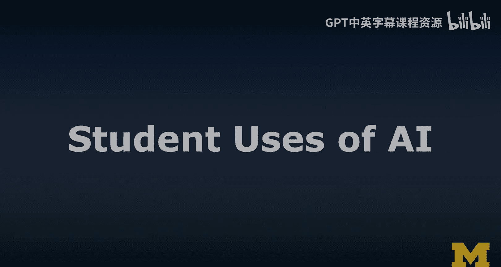
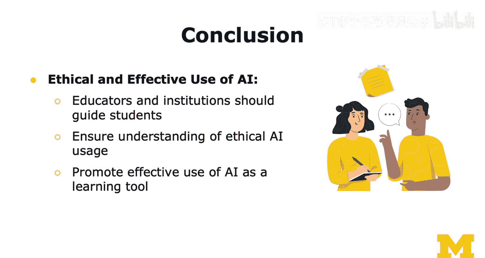
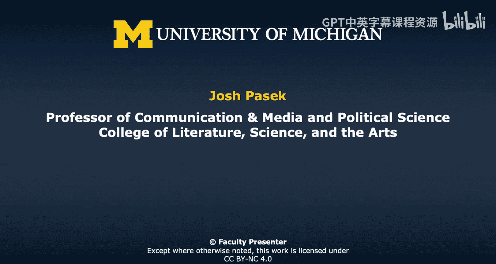

# 应对颠覆：工作场所的生成式人工智能：P21：学生对人工智能的应用

在本节课中，我们将探讨人工智能在教育领域中对学生角色的影响。我们将分析学生在学习、作业、考试、协作及技能发展等关键环节如何与AI互动，并理解其带来的机遇与风险。

## 概述

教育中的另一个关键角色无疑是学生。在探索人工智能对工作场所的影响时，必须认识到AI的影响不仅限于正式员工，也延伸至与其互动的群体。理解学生在教育环境中的角色，能为我们提供宝贵视角，以洞察AI将如何影响他们的学习体验。

## 学生的核心角色

学生在教育环境中承担着多项重要职责。他们需要参与学习与理解、按时完成作业、为考试做准备，并参与协作与技能发展。

以下是学生角色的具体构成：

*   **学习与理解**：学生需要上课、理解课程材料并投入学习内容。这通常不仅包括听讲，还需要利用额外的学习辅助工具和资源来加深理解。
*   **完成作业**：学生必须按时完成家庭作业，这通常需要他们进行课外研究和工作。例如，撰写学期论文的学生需要进行额外研究才能有效完成论文。
*   **备考与评估**：学生需要为考试和其他评估进行学习和准备。这包括复习课程材料、记忆信息、为特定类型的评估进行练习，以及将所学知识和技巧应用于各种场景的过程。
*   **协作与小组项目**：学生参与小组项目，与同伴合作完成集体任务和作业。这要求他们在团队环境中进行有效沟通与协作。
*   **技能发展与课外活动**：在课堂之外，学生需要学习如何与他人互动。他们参与学校的非学术活动，并通过参与这些不同的环境来发展技能，同时学会平衡学业与其他兴趣和责任的重要性。

## 人工智能对学生角色的影响

上一节我们明确了学生的核心职责，本节中我们来看看人工智能在这些职责的各个环节中如何对学生产生影响，这种影响的程度从“高度暴露”到“影响较小”不等。

### 学习与理解：高度暴露

学生在学习与理解环节高度暴露于人工智能的影响之下，这种影响兼具积极与消极两面。

*   **积极影响**：人工智能驱动的平台能够提供个性化学习体验。AI可以帮助根据学生个人的学习风格和进度调整内容。智能导师和聊天机器人可以通过实时回答问题和解释概念来辅助学生，即使学生在深夜产生疑问也能获得帮助。
*   **风险与挑战**：关键在于学生必须积极投入学习材料，并培养批判性思维技能。应避免在学习与理解上过度依赖人工智能，否则可能阻碍这些关键能力的发展。

### 作业与任务：高度暴露

在完成作业和任务方面，学生再次高度暴露于AI的影响。

*   **辅助工具**：人工智能可以帮助生成想法、进行研究、起草作业的部分内容，甚至在特定情况下起草整篇作业。此外，语法检查器和文献引用生成器等工具可以帮助学生提高作业质量。
*   **核心风险**：过度或不恰当使用AI会带来巨大风险。暂且不论这是否构成作弊，它剥夺了学生学习如何构建论点和收集信息的关键技能。学生可能过度依赖AI来完成作业，导致他们不理解材料或不掌握在没有AI的情况下完成任务的流程，这会阻碍学习并可能导致学术不端行为。其风险公式可概括为：**过度依赖AI → 关键学习技能缺失 → 学习效果受损**。

### 备考与考试：高度暴露

人工智能在学生准备考试时也高度介入。

*   **积极辅助**：AI可以通过创建定制化的学习计划、提供模拟试题以及对练习答案提供即时反馈来帮助学生。
*   **潜在弊端**：同样存在风险。过度依赖AI可能导致学生缺乏内在的学习策略，一旦脱离允许或可获取AI的环境，他们将无法有效地进行学习。

### 协作与小组工作：中度暴露

在协作和小组工作中，学生受AI的影响程度为中等。

*   **促进协作**：AI可以通过管理日程、共享文档、跟踪项目进度以及集体头脑风暴来促进协作。
*   **有限取代**：在小组协作中存在不当使用的可能性，但AI在促进人际互动方面的潜力，可能大于其取代集体努力的能力。

### 技能发展与课外活动：影响较小

在技能发展和课外活动方面，人工智能可能扮演的角色较小。

*   **有限辅助**：虽然AI可以推荐活动或在特定任务中提供帮助，但学生更可能追随自己的兴趣，并且不太可能以无法增强其学习和技能的方式滥用人工智能。

## 总结与启示

本节课中，我们一起学习了人工智能对学生学习生活各方面的影响。我们可以清楚地看到AI在提供个性化学习、协助完成头脑风暴和起草等繁琐任务、以及帮助修改论文草稿方面的价值。

然而，始终存在一个一致的风险：**对AI的滥用和过度依赖可能会破坏学习过程本身**。

因此，教育工作者和机构应确保学生理解如何将AI作为一种工具来合乎道德且有效地使用，以避免损害他们自身的教育发展。这对于培育一个健康、有效的学习环境至关重要。