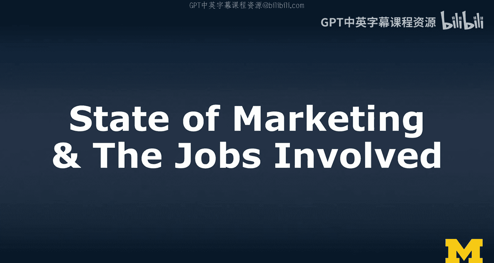
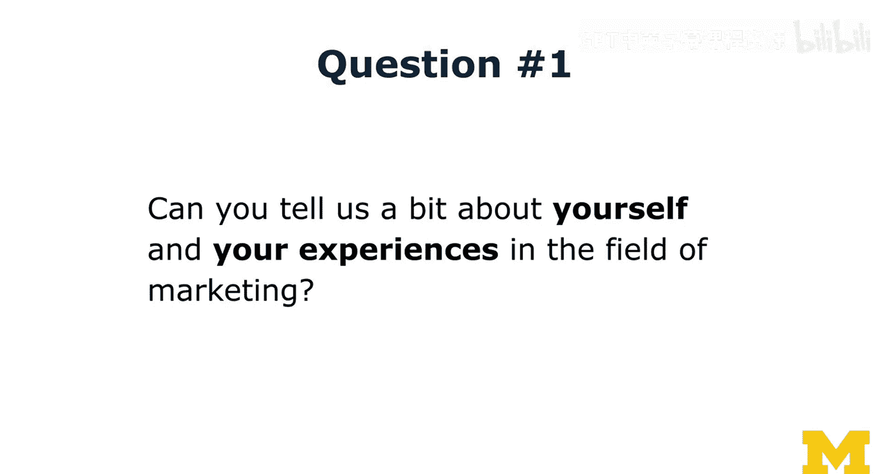
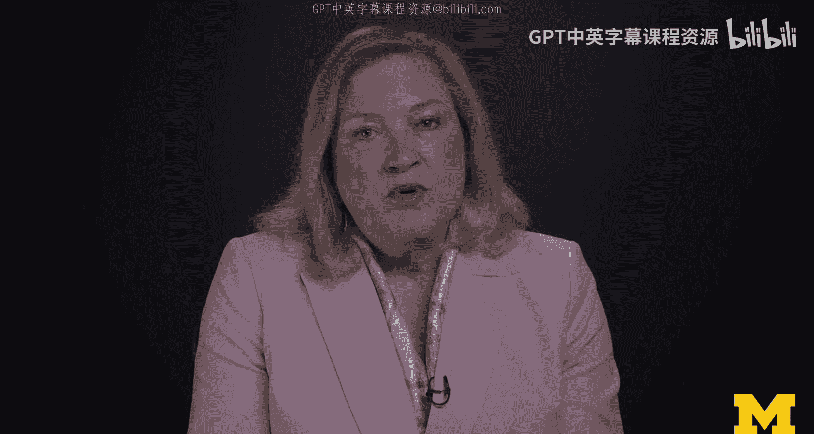
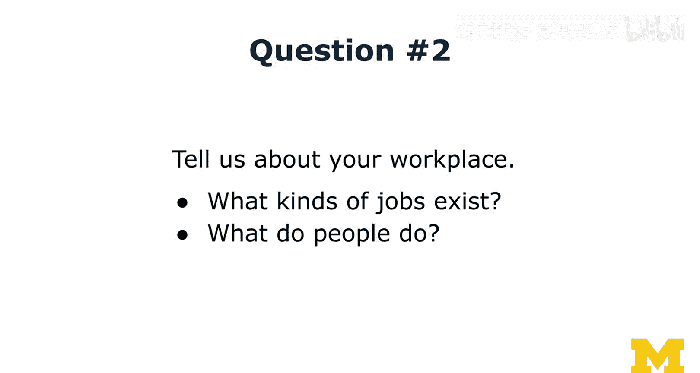
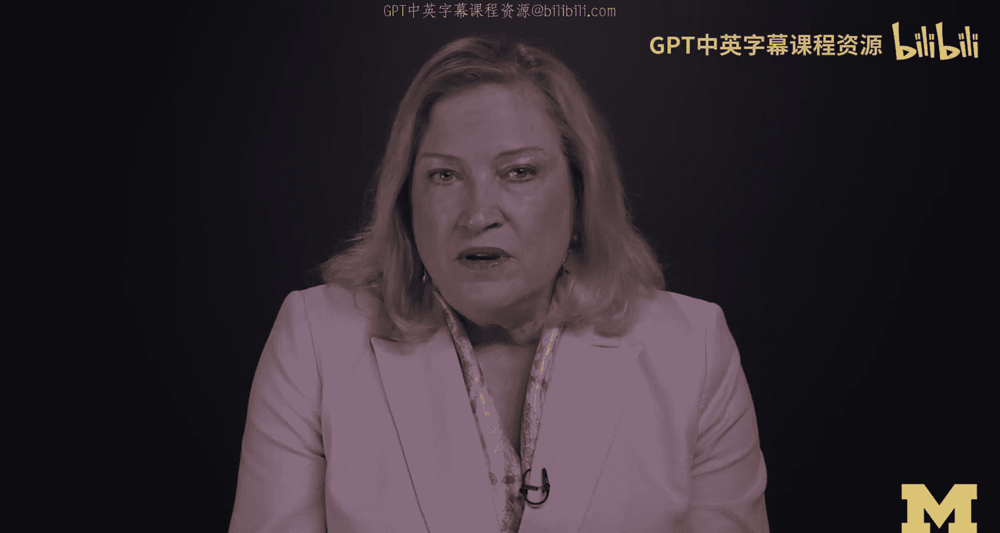
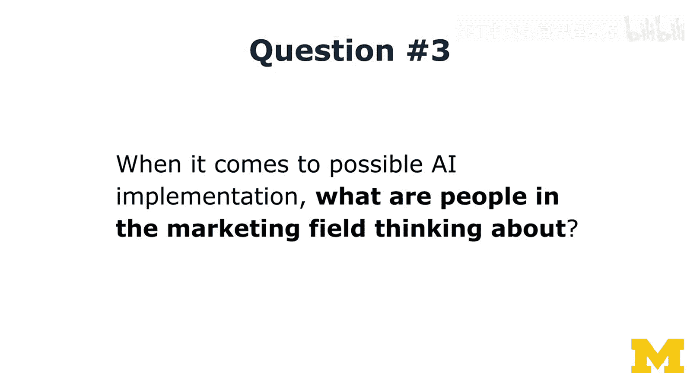
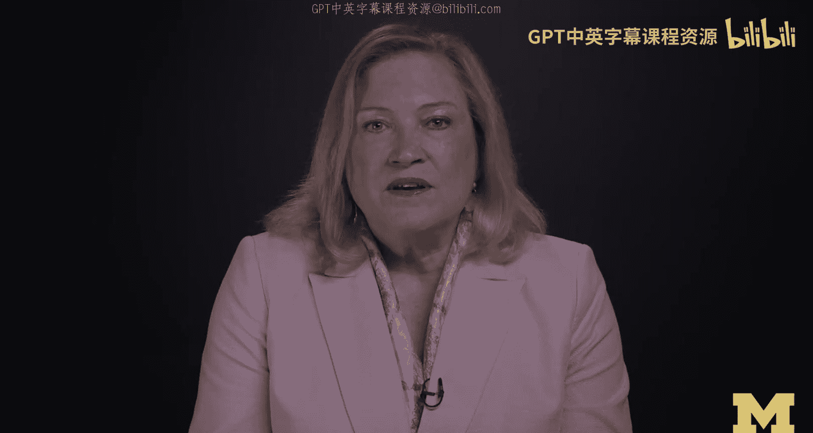
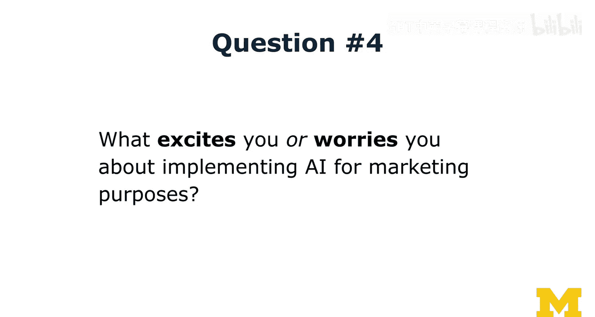
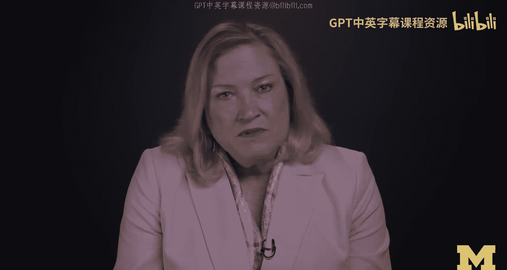
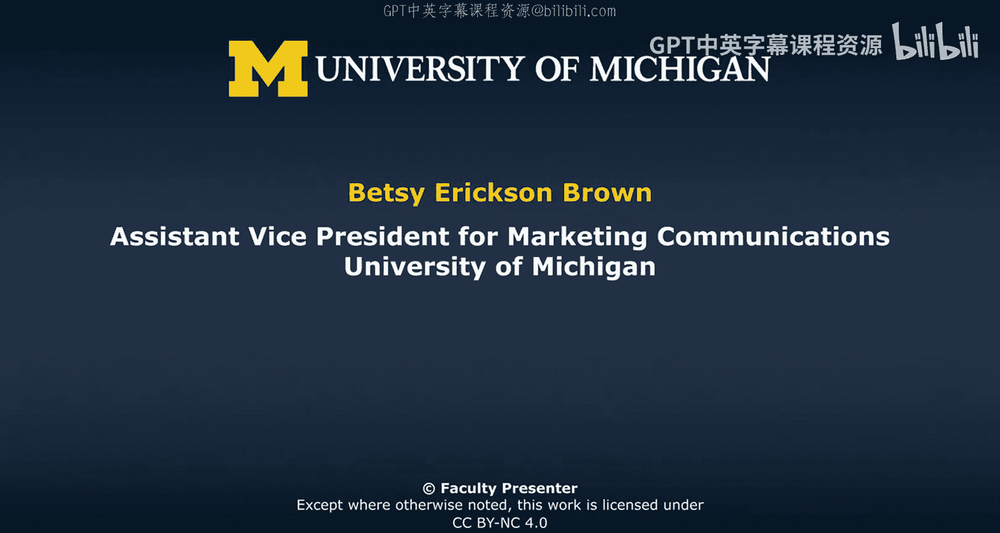

# 应对颠覆：工作场所的生成式人工智能：22：市场营销现状及相关职位

在本节课中，我们将跟随密歇根大学市场传播助理副校长贝琪·埃里克森·布朗，了解市场营销领域的现状、相关职位，以及生成式人工智能在该领域的应用与思考。

## 概述：市场营销的核心与团队构成

我是贝琪·埃里克森·布朗，是密歇根大学的市场传播助理副校长。

市场营销和公共关系是我从事了约40年的职业领域，因此我见证了巨大的变化。我在现任职位上工作了三年，在此之前，我在密歇根大学本科招生办公室担任了十年的市场传播总监。我的职业生涯始于一家全球广告公司，这是一个了解广告和营销角色范围的绝佳方式。

作为助理副校长，我管理着大约40名员工，他们以代理模式工作，服务于密歇根大学的子品牌，例如我们的学院、学生支持部门（如学生生活中心），以及像商学院的正向组织中心和“Go Blue Guarantee”这样的大学倡议项目，后者为符合条件的本州居民提供四年免费学费。我们也为密歇根大学迪尔伯恩和弗林特校区提供服务。

用一个词概括，我们是**讲故事的人**。我们通过故事让密歇根大学的品牌鲜活起来，因为人类能与好故事的情感产生共鸣。

我们的团队成员包括内容创作者，如摄影师、摄像师、文案、平面设计师和校对员。

我们也是数字营销人员，负责设计和构建网站、规划和购买数字广告，并分析用户需求和行为。我们还有项目经理，他们规划项目分配并保持工作流程顺畅；以及策略师，他们理解受众，定义我们希望激发的行为，并为营销活动制定计划。

## 市场营销中的人工智能应用现状

与任何新技术一样，询问营销人员对人工智能潜力的看法，你会得到各种各样的回答。

在密歇根大学，我们有早期采用者，他们正在对生成式人工智能进行大量实验，也有许多人经常使用它。然而，其他人则持好奇但更谨慎的态度。

我认为最终我们会达成一个共识：生成式人工智能是我们工具箱中的另一个工具，它得益于人类的互动，但可能无法完全实现早期的一些炒作。

密歇根大学工程学院谈到要以诚实的方式使用人工智能工具，以减轻负担并放大团队优势。我刚刚对密歇根大学的营销总监们进行了一次快速调查，大多数人都对获得更多关于人工智能的培训和了解最佳实践非常感兴趣。

在我的部门，我们正在考虑人工智能如何简化常规任务，并为更高层次的思考腾出时间。我们的策略团队正在研究人工智能如何帮助我们无偏见地综合定性受众研究结果。我们的数字广告和创意团队正在思考关键词选择，以及人工智能如何协助撰写最佳广告文案或制作引人注目的电子邮件主题行。我们也在尝试使用人工智能来校对大量文案。

我们的视频团队正在测试人工智能，用于创建采访记录和直播活动的隐藏字幕，以及故事板和动画的图像。我们的一些项目经理正在使用人工智能从客户会议记录中提取关键主题。

重要的是要认识到，人工智能已经伴随我们数十年了。我们现在看到的是这项技术的持续演进，尽管速度更快。例如，网站聊天机器人现在已经无处不在，提供即时客户支持以改善用户体验和参与度，并推动我们沿着销售漏斗前进或解决客户问题。

Meta和谷歌使用人工智能来定位正确的受众并优化我们的广告支出。谷歌分析长期以来一直提供用户行为的洞察。甚至当你预订航班时，人工智能通常决定你的机票价格，然后协助飞行员驾驶飞机。人工智能通过语音识别等技术驱动你的Alexa设备，等等。

所以，为了好玩，我问了ChatGPT关于生成式人工智能的优势和危险，它给了我令人兴奋的方面和令人担忧的方面。

## 生成式人工智能的优势与挑战

以下是ChatGPT列出的优势方面：
*   **营销活动的个性化**
*   **重复性任务的自动化**
*   **数据洞察和预测分析**
*   **改进的受众定位**
*   **成本降低**

另一方面，ChatGPT担心大量个人数据的**隐私问题**以及信息的**潜在滥用**。

它担心**偏见和公平性**，这取决于系统训练所用的数据。还有**安全风险**，以及营销中**人情味的减少**和**工作岗位的流失**。

我们还需要注意，不要在提示中输入客户或员工的机密信息，因为这会训练人工智能工具并可能被他人获取。这些都是合理的担忧。

在积极方面，我们希望能抓住机会，实现更好的客户体验和更高效的运营。数据隐私是密歇根大学的一个重要议题，我们有专门的工作组和部门在处理其各个方面。我们当然希望具有包容性，减少内容和营销方法中的偏见，而人类的判断力可以在这方面提供帮助。

我最不担心的是工作岗位流失。在我看来，人工智能不会取代人类，但它将借助人工智能增强我们的生产力。我们将更快更好地完成工作，从而减少对重复性任务的关注，更多地投入到创作出真正能引起受众共鸣的卓越、独特的工作中。人工智能只是实现目标的几种手段之一。

## 总结

本节课中，我们一起学习了密歇根大学市场营销部门的构成与核心使命——成为“讲故事的人”。我们探讨了生成式人工智能在营销领域的应用现状，从内容创作到数据分析，各部门都在进行有益的尝试。同时，我们也客观分析了人工智能带来的优势，如提升效率和个性化，以及需要警惕的挑战，包括隐私、偏见和安全问题。最终，我们认识到，人工智能是增强人类生产力和创造力的工具，而非替代品。