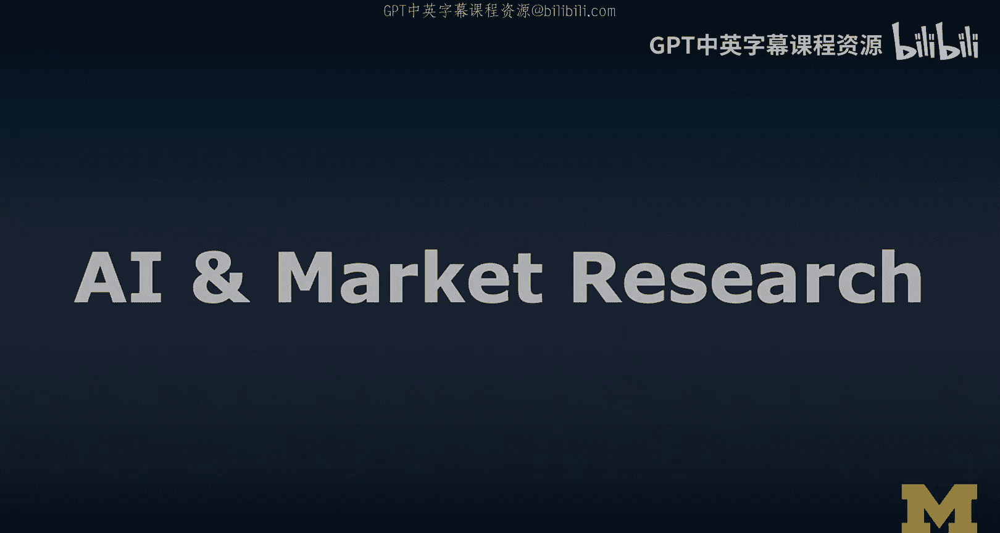
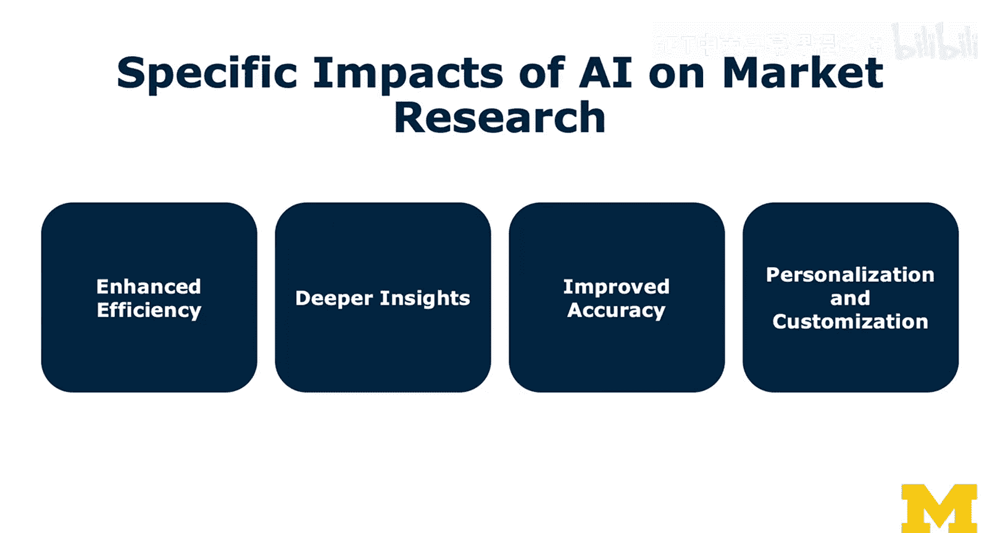
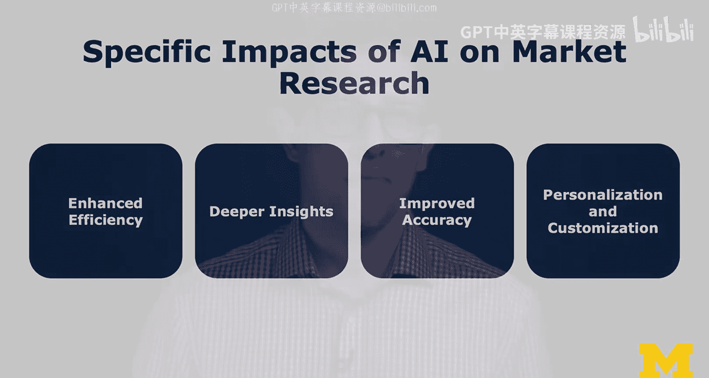
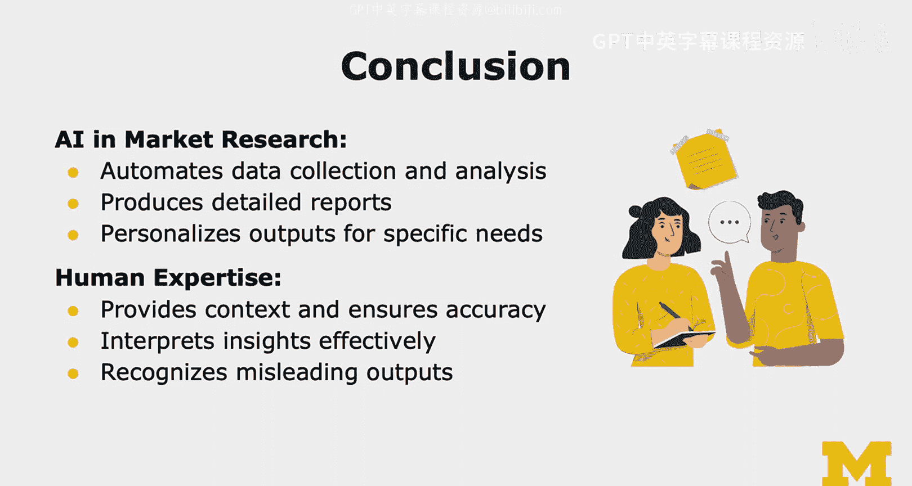
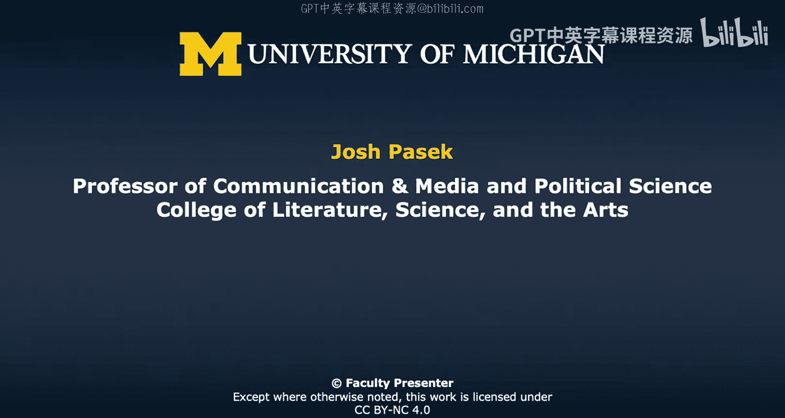
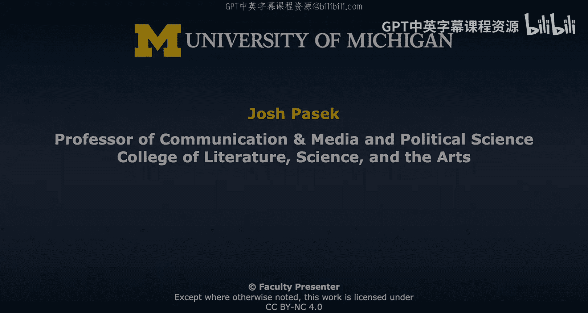

# 应对颠覆：工作场所的生成式人工智能：23：人工智能市场调研 📊

在本节课中，我们将要学习人工智能如何影响市场调研这一职业。我们将探讨市场研究人员的核心工作内容，并逐一分析这些任务如何受到人工智能技术的影响，以及未来人机协作的模式。

市场研究人员在营销过程中扮演着关键角色。他们收集并分析数据，以理解市场状况、消费者行为和趋势，从而帮助企业做出明智的决策。

## 市场调研的核心任务

上一节我们介绍了市场调研的重要性，本节中我们来看看市场研究人员具体执行哪些核心任务。

以下是市场调研工作的主要环节：

*   **数据收集**：这通常涉及大量的数据采集工作，包括设计和实施调查、访谈和焦点小组，以及从社交媒体和消费者反馈等各种其他来源汇总数据。
*   **数据分析**：数据收集后，研究人员对其进行分析。这通常包括编写代码来评估定量数据，以及系统性地评估定性数据以识别模式和趋势。他们使用统计工具和软件来解释数据并生成见解。
*   **报告与呈现**：分析结果被用于生成报告和演示文稿，向利益相关者传达研究发现。在此过程中，他们需要通过图表、图形和其他视觉辅助工具来可视化数据。
*   **预测与竞争分析**：市场研究人员还需要预测未来的市场趋势和消费者行为。因此，他们需要开发模型，例如用于预测未来销售额、市场份额和其他关键指标。他们经常评估竞争对手在做什么，基于产品、市场状况和竞争格局的知识来分析竞争对手的策略和弱点。

## 人工智能对各任务环节的影响

了解了市场调研的传统工作流程后，本节中我们来看看人工智能技术对这些具体任务环节的暴露程度和影响。

### 数据收集：高暴露度

数据收集任务可能具有相当高的暴露度。人工智能可以帮助构建调查问题的一致措辞，并可以自动化各种数据收集方法，例如网络爬虫、社交媒体监控或对调查数据进行情感分析。人工智能还可以从访谈和焦点小组中提取关键概念。基于人工智能的工具可用于生成响应式数据收集方法，根据情况改变向谁提问哪些问题，以最大化数据的价值。

> 人类仍然需要参与其中，以确保方法符合研究目标、符合道德规范，并且提出的问题被解读为相关且无偏见。

### 数据分析：极高暴露度

如果说人工智能在数据收集方面有相当大的辅助能力，那么在数据分析方面，人工智能则拥有巨大的协助能力。人工智能可以取代人类进行数据分析的很大一部分，尤其是在市场研究人员编写代码分析数据的领域。

**计算机编程是大型语言模型已被证明特别有效的领域**，而用于数据分析的编码通常涉及一系列相对简单的编码任务。

此外，在从大型数据集中识别模式和生成见解方面，机器学习可以比人类更快地发现趋势，自然语言处理可以分析来自原本难以解读的评论、留言、社交媒体帖子和深度访谈的文本数据，以识别共同的叙述。

> 虽然人工智能在数据分析甚至某些解读的重任上可能很有效，但人类在数据分析中仍有一席之地，这涉及提供背景信息并确保见解具有可操作性。尽管如此，这代表了人类劳动力从进行分析到监督分析的重大转变。

### 报告与呈现：中等至高度暴露度

在报告和呈现结果方面，人工智能至少有中等程度的暴露度。人工智能工具可以自动化创建报告和演示文稿、生成可视化、总结和提取关键见解，甚至根据不同的兴趣和需求为不同的利益相关者生成个性化报告。

> 出于多种原因，至少在不久的将来，人类对任何自动化分析报告的评价对于确保评估的准确性以及与目标受众目标的一致性仍然至关重要。在这里，我们再次看到了角色的相当大程度的替代，以及市场研究人员角色向监督而非生产大量原始材料的转变。

### 市场预测与竞争分析：高暴露度

市场预测甚至竞争分析也存在同样高度的暴露度。人工智能模型非常擅长使用预测分析和机器学习算法来预测未来状况，这些工具与市场研究人员已经使用的工具密切相关。😊

**AI模型可以处理大量数据，以生成特定领域未来情况的估计。**

> 人类的洞察力和监督对于识别可能影响预测的新颖因素仍然是必要的，因为人工智能的估计完全基于过去的数据，并且可能无法在情况变化时做出有效的预测。但即使存在这种潜在错误，人工智能也能有效捕捉许多市场波动。

对于竞争对手分析，人工智能有能力定期监控活动以跟踪市场状况、估计和分析竞争对手数据，并提供关于观察到的市场变化和策略的实时更新。

> 虽然人类的参与对于理解这些发现可能仍然是必要的，但市场研究人员的角色可能受到相当大程度的暴露。

## 人工智能的影响与风险

上一节我们分析了人工智能对具体任务的影响，本节我们来总结其带来的整体影响和需要注意的风险。

人工智能对市场研究的影响包括：

*   **提升效率**：人工智能加速数据收集和分析任务的能力将提高效率。这将使市场研究人员能将更多时间花在高层次的战略问题和解读上。自动化分析和报告的能力减少了设计分析和例行报告任务所需的时间，这些任务目前构成了市场研究人员工作的很大一部分。
*   **更深入的见解与更高的准确性**：人工智能有可能产生更深入的见解并提高准确性，因为人工智能模型将比许多当代市场研究方法整合更多的数据。

人工智能与市场研究的整合在许多方面都很有价值，但它也可能带来一些风险，这主要是由于**“黑箱”问题**，即人工智能分析无法理解所研究内容与其训练数据集中示例之间差异的关键参数。

> 这是过去在许多领域都观察到的现象，即人工智能对不完美数据进行预测，可能导致尽管预测信心十足，但输出结果极不准确。因此，评估模型是否适用于数据将成为市场研究人员一个非常重要的问题，完全由数据驱动、人工智能驱动的方法可能不会立即实现。

然而，通过市场研究输出的个性化和定制化，以及更好地针对不同受众进行定制的能力，人工智能可能会在这里扮演相当重要的角色。

## 总结

本节课中我们一起学习了人工智能对市场调研领域的深远影响。

人工智能可以通过自动化数据收集和分析、生成报告和个性化输出来显著提高市场研究的效率和准确性。然而，人类的专业知识对于提供背景、确保准确性、解读见解以及识别输出可能具有误导性或潜在因素可能即将发生变化时的缺陷，仍然至关重要。

当人工智能在市场研究中发挥作用并可能在未来扩大其影响力以增强数据分析时，人类市场研究人员在解释结果、保持所提供见解的质量和相关性、识别它们何时可能具有误导性或潜在因素可能即将发生变化方面，仍然至关重要。