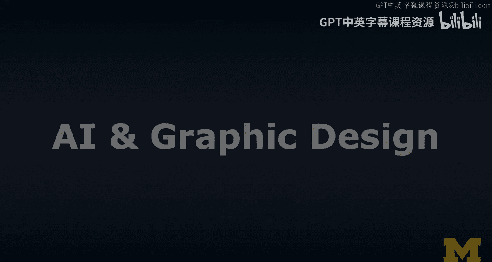
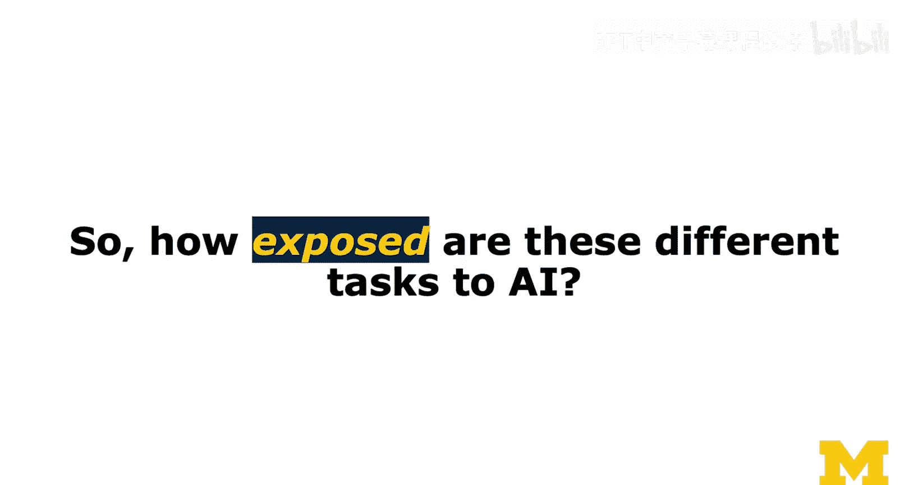
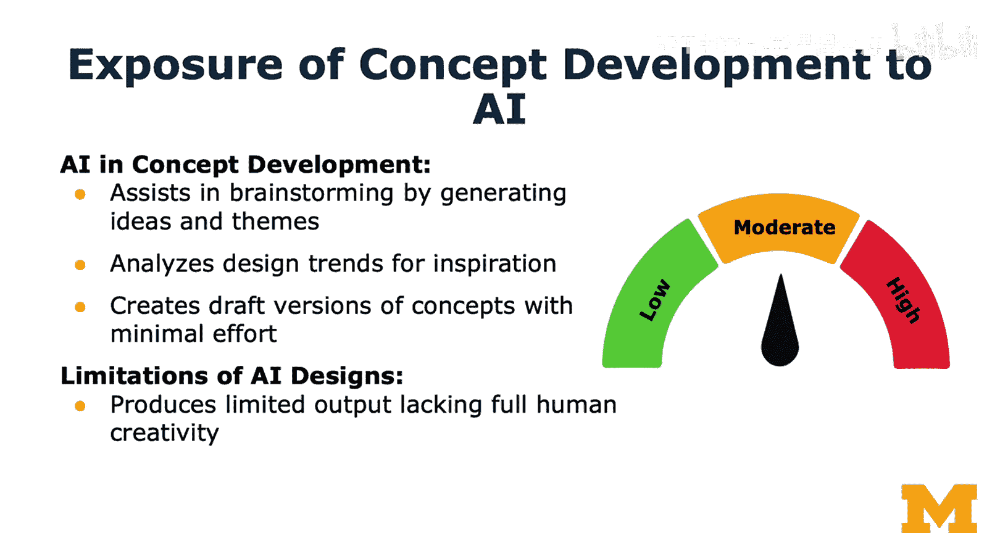
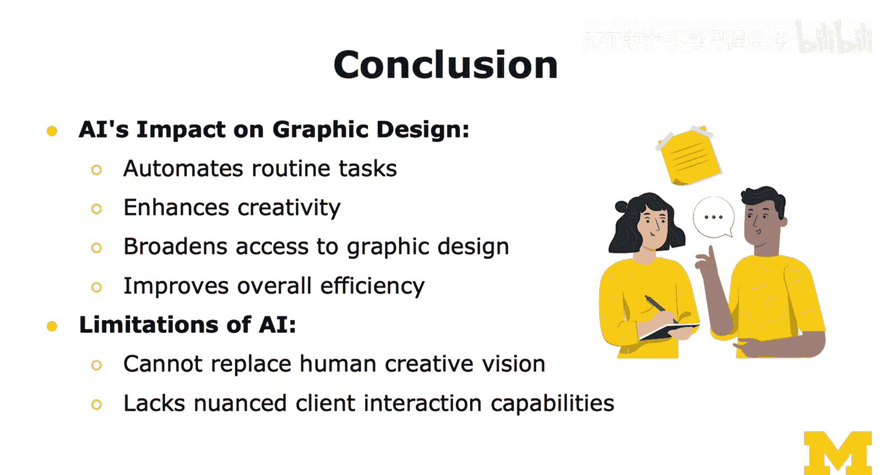
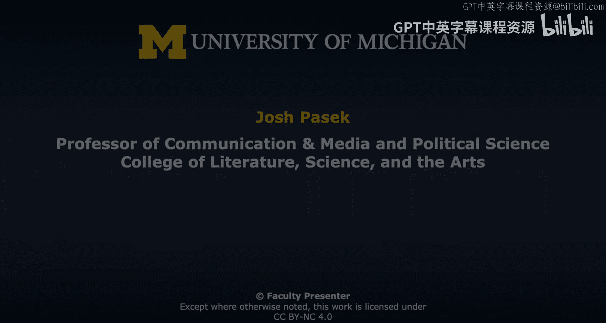
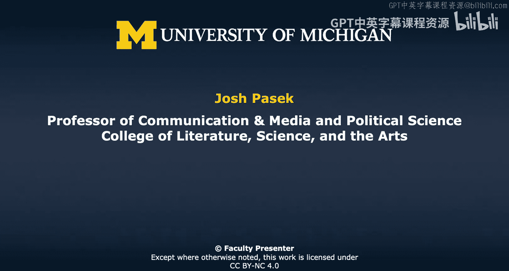

# 应对颠覆：工作场所的生成式人工智能：P24：人工智能平面设计 🎨

在本节课中，我们将探讨人工智能如何影响平面设计行业。我们将分析平面设计师的典型工作流程，并评估其中各项任务受AI影响的程度。最后，我们将总结AI为行业带来的效率提升、成本效益以及其无法替代的人类核心价值。

---

平面设计涉及创建视觉内容以传达信息，结合艺术与技术来制作具有视觉吸引力且有效的设计。

平面设计师通常参与概念开发，他们根据需求和当前趋势的理解进行头脑风暴并制定设计概念。他们还会创建情绪板和视觉主题，以构思特定图形的布局。

进入正式的设计创作阶段后，平面设计师会设计徽标、宣传册、网站、广告和其他视觉内容，使用软件工具来创建和修改图形。

此后，他们会根据客户反馈进行一系列修改和迭代，致力于改进视觉元素并融入更多细节。

最后，平面设计师更广泛地致力于创建、维护和理解品牌，确保设计符合品牌指南和视觉识别，并在整个过程中保持所有材料视觉上的一致性。在此过程中，他们持续向客户展示设计概念和想法，整合客户反馈和偏好，并相应地更新设计。

那么，这些不同的任务受AI影响的程度如何？

以下是平面设计工作流程中各项任务受AI影响程度的分析：

*   **概念开发：中等影响**
    AI可以通过基于输入参数生成想法和建议主题来协助头脑风暴。AI工具可以分析设计趋势并提供灵感，无需大量努力即可制作概念草案。然而，AI驱动的设计产出有限，缺乏人类创造力的全部范围。这属于中等影响领域，涉及大量AI增强，但仍需AI与人类协作。

*   **设计创作：较高影响**
    AI驱动的设计工具能够自动化设计创作的某些方面，例如布局生成、调色板选择甚至照片增强。像Canva这样的平台已经使用AI提供模板和设计建议。对于需要创造性视野和独特艺术触感的大型任务，AI可能落后于人类的潜力。但AI快速生成图像草稿并确保其符合更广泛设计方案的能力，可能导致设计创作任务的转变，甚至在某些情况下替代人类，特别是对于那些在平面设计预算和招聘上不愿投入过多的公司。

*   **修改与迭代：中到高影响**
    AI可以通过快速实施建议的更改、提供替代设计方案以及预测某些元素的有效性来简化修订过程。这个过程仍然需要人类的监督和润色，但我们看到的是工作方式的转变，有时能实现以往难以达成的机会。

*   **品牌识别开发：影响较小**
    AI可以通过建议符合既定指南的元素、在保留核心元素的同时生成视觉识别的变体，来帮助保持品牌一致性。但从广义上理解品牌识别，并认识其如何与目标受众产生共鸣，仍然是人类的任务。因此，AI的整合可以带来巨大的增强，但不太可能完全取代人类的角色。

*   **客户沟通：影响较低**
    需要理解并整合客户想法、并有效描述这些想法的互动，将需要人情味。AI可以通过自动化日程安排、提供项目更新甚至生成初步设计演示来协助管理客户沟通。尽管如此，人类元素对于细致入微且有效的沟通至关重要。

---

那么，AI对平面设计的总体影响是什么？

AI将为平面设计行业带来更高的效率和速度。它可以更快地创建和修改设计。常规任务可以实现自动化，让设计师能更专注于工作中复杂的创意和协调方面。

AI通过快速生成原型和评估不同可能性来增强创造力，从而催生更具创新性和多样性的设计，但这仍然需要人类参与。

AI也将更具成本效益，可能在某些不需要高水平创造力的特定任务上替代人类平面设计师。需要简单徽标的非营利组织或小企业可能会转向AI寻求解决方案，而不是雇佣平面设计师。

最后，AI可以在设计元素间引入更高的一致性和精确性，确保遵守品牌指南和设计标准，并消除设计工作中技术方面的人为错误。

---

本节课中，我们一起学习了人工智能对平面设计工作流程各环节的影响程度。总体而言，AI将通过自动化常规任务、增强创造力、降低设计门槛以及全方位提高效率，对平面设计行业产生巨大影响。然而，AI目前尚无法取代人类在提供创造性视野和进行细致入微的客户互动方面的关键作用。未来的趋势将是人机协作，各自发挥优势。