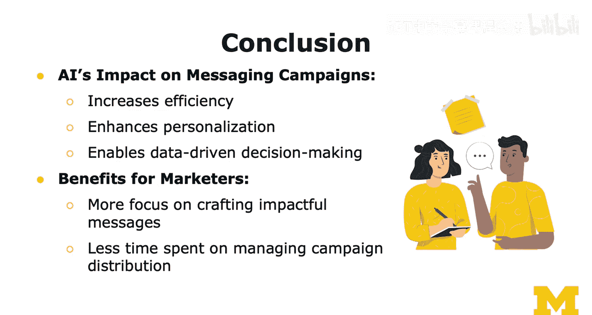

# 应对颠覆：工作场所的生成式人工智能：P25：13_人工智能在传播活动中的应用

在本节课中，我们将探讨人工智能在营销传播活动中的应用。我们将了解传播活动的标准流程，并分析人工智能如何影响流程中的各个环节，从而改变营销人员的工作方式。

传播活动是营销的关键组成部分，对于品牌沟通、吸引受众和传递重要内容至关重要。

一个典型的传播活动包含几个核心步骤。以下是这些步骤的概述：

**传播活动标准流程**

*   **策略制定**：营销人员定义活动目标，识别目标受众和核心信息，并规划整体策略与时间线。
*   **内容创作**：为社交媒体、电子邮件、广告等多种平台起草有吸引力的内容。需要确保所有渠道的语调与信息一致性。
*   **受众细分与个性化**：根据人口统计特征、行为和偏好对受众进行细分，然后为不同受众群体定制有针对性的信息。
*   **分发与排期**：决定在何时、通过何种平台传递信息。安排发布时间，管理其他推广活动，以在最佳时机出现。
*   **效果评估**：通过查看参与度、覆盖面和转化率等指标来评估活动效果。这些数据可用于优化当前及未来的活动。

那么，运行一个传播活动在多大程度上会受到人工智能的影响呢？接下来，我们将逐一分析人工智能在上述每个环节中的作用与影响。

### 策略制定：人工智能的辅助角色

在制定活动策略方面，人工智能能起到中等的增强作用。人工智能可以帮助分析市场趋势、竞争对手活动和受众洞察，为策略制定提供信息，这与它在市场研究中的作用类似。人工智能工具还可以基于历史数据建议最优策略。这将显著改变营销人员的角色。

### 内容创作：高影响领域

内容创作是受人工智能影响较大的领域。利用自然语言处理和大语言模型，人工智能可以为各种平台生成吸引人的文案。人工智能可以产出草稿、提出改进建议，并为特定受众定制信息，这些工作对单个营销人员来说可能耗时费力。

当然，仍需投入关键努力以确保内容符合品牌调性、能引起情感共鸣并达到质量标准。但在许多方面，人工智能可以改变人类的工作，甚至取代某些任务。

### 受众细分与个性化：数据驱动的高影响任务

受众细分与个性化是高度数据驱动的任务。与许多数据驱动任务一样，它们受人工智能的影响很大。人工智能可以利用大量数据有效地细分受众，并识别对人类来说可能不明显的潜在趋势。

机器学习算法可以预测受众对特定信息的偏好和行为反应，从而实现高度个性化的信息传递。然而，仍然需要有人来解释人工智能的洞察，以确保这种个性化是合乎道德且有效的。

尽管如此，角色可能会发生相当大的转变，人类可能不再需要负责信息的个性化和细分，人工智能可以承担部分角色，从而改变劳动力分配。

### 分发与排期：高影响领域

在分发与排期方面，人工智能的影响也很高。人工智能工具不仅可以分析不同分发和排期策略的有效性，还可以自动化分发过程，识别最佳的传递时间和平台。人工智能还可以根据整个活动中受众参与的模式来安排帖子和电子邮件的发送。这既取代了部分过去由人执行的行为，也带来了新的潜力。

### 效果分析：高影响潜力

在效果分析方面，人工智能同样具有很高的影响潜力。人工智能可以实时跟踪和分析活动表现，提供可操作的洞察和优化建议。人工智能工具可以识别模式，不仅提出调整建议，甚至可以自动调整活动执行以改善结果。虽然更广泛的战略决策仍需由人主导，但人工智能可以承担该任务的大部分工作。

### 人工智能对传播活动的整体影响

人工智能很可能通过加速内容创作、受众细分、效果分析以及实现更敏捷的响应式活动，对传播活动产生重大影响。

*   **提升效率与聚焦战略**：这将使营销人员能将更多精力集中在战略和创意方向上。
*   **实现超个性化**：人工智能将通过分析个人偏好和行为，生成个性化信息，从而提高参与度和转化率。但这也存在风险，即信息可能过于个性化以至于不一致或具有误导性。因此，必须对产出内容进行检查，确保其不会个性化到连营销人员自己都不清楚呈现内容的地步。
*   **驱动数据洞察**：人工智能将通过定期评估输入的数据，帮助营销人员做出更明智的决策，并优化活动以获得更好的结果。
*   **增强可扩展性**：人工智能将增强传播活动的可扩展性，使得以更少的精力在多个平台上产出大量沟通内容成为可能。

在本节课中，我们一起学习了传播活动的标准流程，并深入探讨了人工智能如何渗透并改变流程中的每个环节。总而言之，人工智能有望通过提高效率、个性化和数据驱动的决策来改变传播活动。随着营销人员利用人工智能，他们会发现这是一个强大的工具，使他们能够将更多精力集中在打造有影响力和能引起共鸣的信息上，而减少在管理活动分发上的投入。

