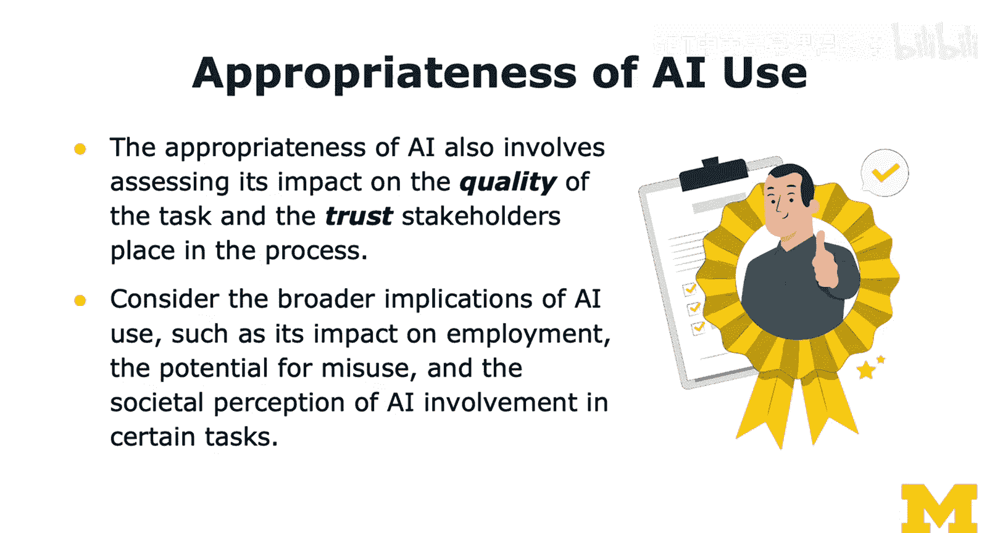
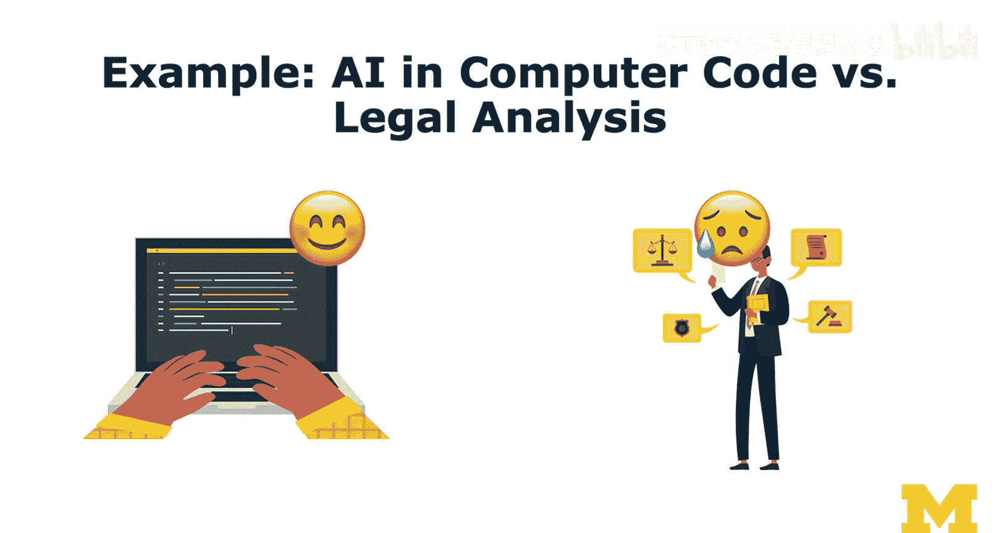
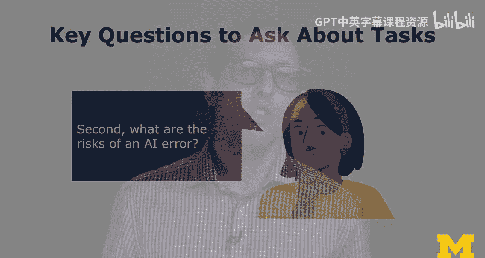
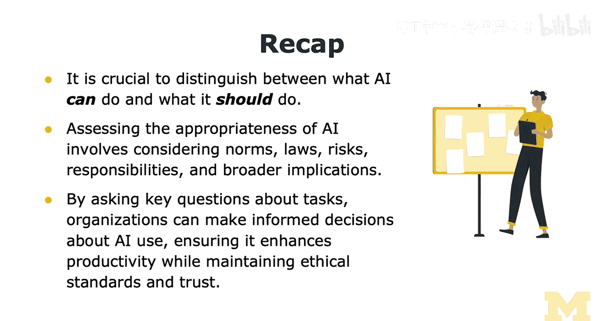
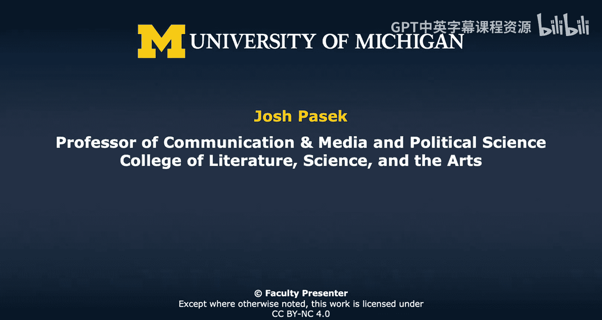

# 应对颠覆：工作场所的生成式人工智能｜P26：14_人工智能应用与场景适配

## 概述
在本节课中，我们将要学习生成式人工智能工具在现代工作场所的广泛应用，并重点探讨一个核心问题：人工智能**能够**做什么与**应该**做什么之间的区别。我们将讨论决定AI应用是否合适的因素，包括规范、法律和风险考量，并提供一套关键问题来帮助评估特定任务是否适合引入AI。

---

正如我们在多个行业部门以及您评估AI对工作场所影响的练习中所见，生成式人工智能工具在当代工作场所拥有广泛的应用前景。

然而，仅仅因为人工智能能够执行某项特定任务，并不意味着它就应该被用于此。在本讲座中，我们将讨论人工智能能为一项工作做什么与人工智能应该或不应该做什么之间的区别。

我们将探讨何时使用人工智能是合适的，以及这种判断如何根据规范、法律和其他考量因素而变化。此外，我们将强调在决定是否将AI应用于特定任务和角色时，需要考虑的一些关键因素。

### 🤔 “能够”与“应该”有何区别？
广义上讲，人工智能**能够**做的事情涵盖了一系列广泛的任务，从自动化重复性流程、分析复杂数据集、生成创意内容、编辑创意内容，到产出各类事物的初稿。

无论我们谈论的是AI撰写新闻文章、设计徽标、诊断医疗状况、做出投资决策，还是在课堂上辅助教师，都存在大量潜在的人工智能应用。

然而，使用人工智能的决定不仅仅是一个能力问题。它应受到伦理考量、对各方利益相关者的潜在影响，以及对什么是社会和法律可接受的更广泛理解的指导。

简而言之，并非所有人工智能能够执行的任务都适合由人工智能来处理。人工智能对特定任务的适用性将取决于所涉及的风险、责任和社会规范。

### 🔍 如何理解AI应用何时是合适的？
那么，我们如何理解何时使用人工智能是合适的呢？核心问题在于人工智能是否符合现有的法律框架和社会规范、避免伤害并符合用户目标。

例如，在处理数据时，人工智能需要遵守数据保护法规。用户可能期望数据的使用方式不会将他们识别为数据的一部分。

人工智能使用方式的透明度通常很重要。此外，人工智能的巨大成本和气候影响也值得考虑。

这些要求会随时间而变化，我们将在未来的课程中进一步深入探讨每一项。

规范可能因行业、地区以及所涉及的人群而异，这要求对人工智能的实施采取特定于情境的方法。在某些领域，AI生成的内容可能是可接受的，甚至是预期的；而在其他领域，它可能被视为违反职业责任。

另一个重要因素是质量和信任。围绕人类必须做什么来确保特定AI内容是合适或合理的，存在一些期望。雇主和雇员都需要思考在特定领域使用AI可能会如何影响AI所支持的产品，以及更广泛的考量，例如特定工作的角色、存在何种滥用可能性，以及如果人们知道AI参与了任务，会如何看待它。

人工智能的适用性还将取决于对特定任务背景下AI输出质量的理解，以及利益相关者在此过程中必须建立的信任。即使高质量的人工智能应用，如果某项任务需要只有人类才能确保的精确度，也可能不合适。

### 📋 评估AI适用性的关键问题
以下是我们在思考人工智能是否适合特定任务时应该提出的关键问题。

首先，我们需要评估人工智能是否能比当前方法更有效地执行任务。人工智能是否有能力有效地完成它？任务的复杂程度如何？人工智能的输入和输出质量如何？该过程是否需要独特的人类技能？人工智能可能在某些任务上比在其他任务上表现更好。例如，人工智能在生成计算机代码方面已显示出效能，但在复杂的法律分析方面仍有困难。

其次，人工智能出错的风险是什么？我们需要评估人工智能所犯错误的潜在后果，并思考其利害关系。在医疗诊断或金融交易等高风险任务中，人工智能错误可能产生巨大的影响。例如，如果个人接受了错误的治疗，将带来严重的健康风险。人工智能已经证明，至少有一次，由于算法未正确对齐，自动交易可能导致股市崩盘。在这类案例中，在我们完全信任算法之前，对AI可靠性的标准需要非常高。

第三，是否需要人类担责？由于法律、伦理或专业标准，某些任务需要人类承担责任。例如，法律判决和医疗决策将需要人类担责，以确保信任和责任。事实证明，这一领域对自动驾驶汽车等应用具有挑战性，因为当不可避免的事故发生时，谁应承担责任变得不明确。

另一个需要考虑的问题是，如果AI的参与被揭露，是否会产生问题。在需要披露AI使用或可能意外泄露的背景下，必须权衡其对信任和信誉的影响。如果AI使用被揭露会产生负面影响的场景，通常是AI使用不合适的情况。例如，如果AI的角色为人所知，AI撰写的个人推荐信或创意作品可能会被不同地看待。

最后，我们需要了解在特定情境下使用AI是否存在任何伦理、偏见相关或法律影响。AI系统是否会基于训练数据延续偏见？是否存在伦理规则要求在某些特定情况下限制AI的使用？或者随着该主题法律的进一步发展，是否存在法律标准？例如，当AI被纳入招聘实践时，迫切需要确保AI的使用得到仔细管理，以避免歧视并确保流程的公平性。因为偏见可能以不明显的方式潜入系统，确保在这些情况下对AI进行适当的审计非常重要。

### 📝 总结
因此，当我们思考AI工具的全部应用范围时，我们应该考虑AI使用的局限性，这不仅源于人工智能的能力，也基于人工智能在某些任务中的整合可能意味着什么，以及它在这些情境下是否合适、可接受和合法。

我们需要仔细区分人工智能**能够**做什么和**应该**做什么。评估AI使用的适当性将涉及考虑规范、法律、风险、责任和更广泛的影响。通过针对每项相关任务提出关键问题，组织可以就AI使用做出明智的决策，确保其在提高生产力和提供价值的同时，维护道德标准和信任。