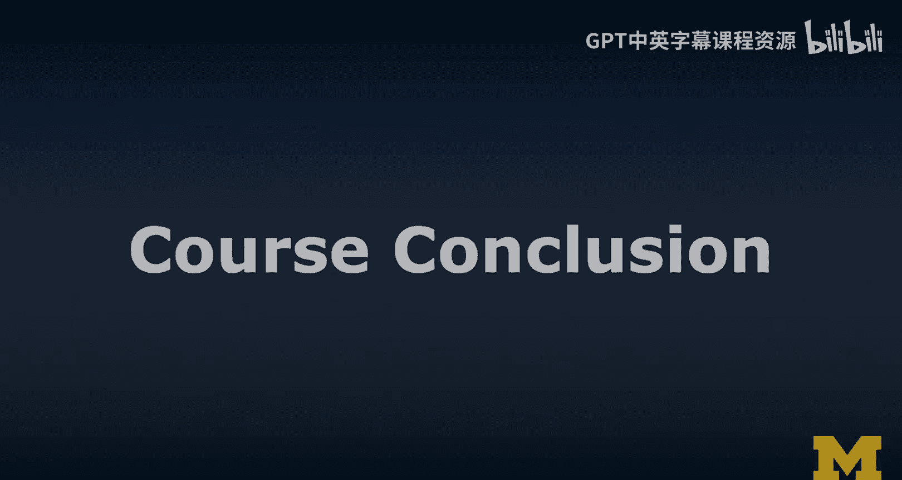
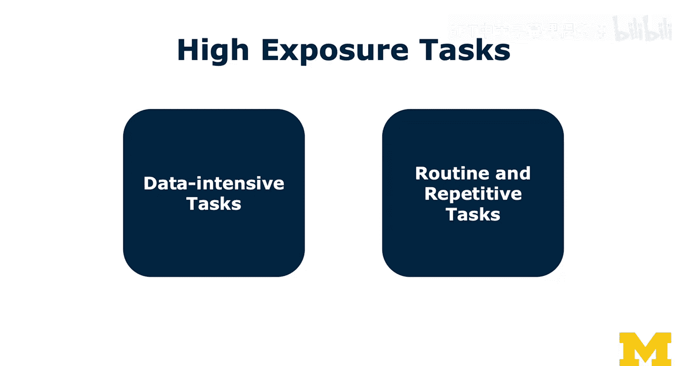
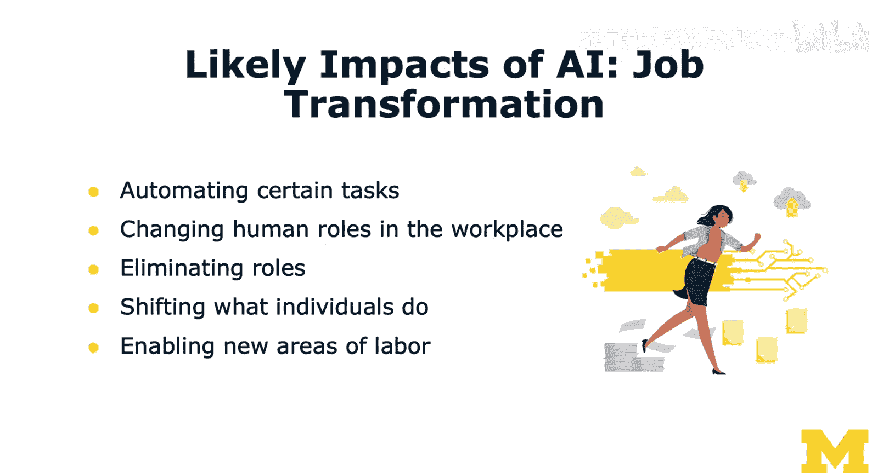
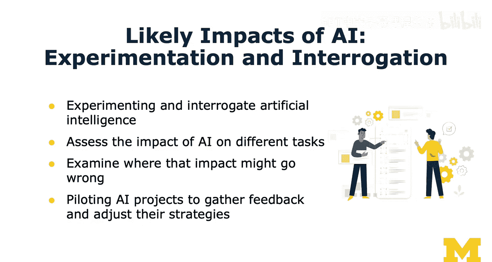
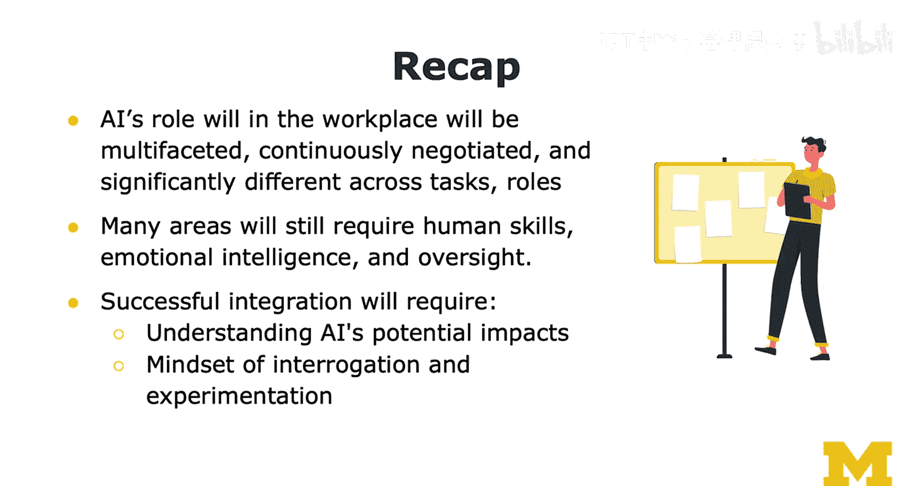
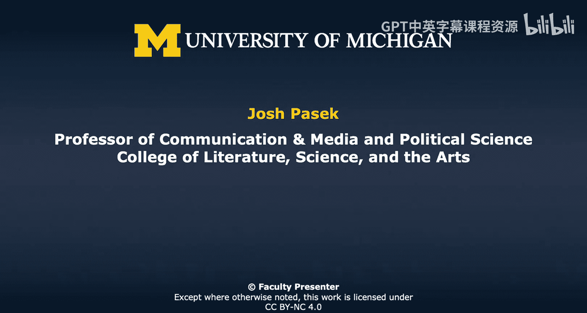

# 应对颠覆：工作场所的生成式人工智能：27：15_课程总结

## 📚 概述

在本节课中，我们将对人工智能在工作场所的潜在影响进行总结。我们将回顾不同工作类型受AI影响的程度，探讨AI带来的机遇与挑战，并思考如何负责任地整合这项技术。

---

## 🔍 人工智能对工作场所的影响

在本课程中，我们探讨了人工智能进一步融入工作场所、工作岗位以及员工执行的具体任务时，可能产生的各种潜在影响。

我们可以看到，工作场所可能受到的影响各不相同，这取决于所开展工作的性质、任务的暴露程度以及AI整合的潜在影响。

---

## 📊 高暴露度的工作与任务

某些情况下，一些任务具有很高的暴露度。

以下是高暴露度工作的例子：

*   **数据密集型工作**：涉及市场研究和数据分析等工作高度暴露于AI，因为AI擅长从大型数据集中分析和提取见解。其核心能力可表示为：`AI_Insight = analyze(large_dataset)`。
*   **常规重复性任务**：这类流程也容易被AI接管。例如，工厂和装配线越来越多地采用人工智能驱动的机器人和自动化系统来处理重复性任务。

---

## ⚖️ 中等暴露度的工作与任务

上一节我们介绍了高暴露度的工作，本节中我们来看看受AI影响程度中等的情况。

以下是中等暴露度工作的例子：

*   **涉及创意和战略思考的任务**：AI可能产生中等程度的影响。AI可以协助生成想法和初稿，但更高层次的思考和决策仍然主要由人类驱动。
*   **支持核心职能的辅助角色**：例如活动管理和客户沟通，AI也将产生中等影响。AI可以自动化日程安排、监控和初步互动，但无法进行细致入微的关系管理。
*   **创意产业和医疗保健机构**：如医院和诊所，也属于中等暴露度的工作场所。AI可以辅助后端处理，如诊断、患者监测和行政任务，但无法取代这些领域至关重要的人文要素。

---

## 🤝 低暴露度的工作与任务

接下来，我们探讨哪些工作任务受AI影响相对较低。

以下是低暴露度工作的例子：

*   **需要高度同理心的任务**：例如咨询或客户关系管理，不易受AI影响，本质上是人类中心的。这些角色依赖于情商，难以被自动化代理取代。
*   **广泛的战略思考和决策**：需要多角度考量，很可能仍由人类主导。虽然AI可以提供数据和见解，但它无法取代人类的判断。
*   **教育和社会服务**：虽然AI可以帮助个性化学习和处理行政任务，但它无法替代教师或社会工作者。学习过程需要人类参与，咨询和人际互动是不可替代的。

---

## 🚀 人工智能带来的机遇与转变

从广义上讲，人工智能的影响将在各种常规任务和数据分析加速方面，带来效率和生产力的大幅提升。

在许多方面，这有可能让员工专注于需要更多创造力、批判性思维和战略规划的更高价值活动。增强人类能力的AI工具将支持创意生成、数据处理和个性化学习，从而转移部分人类劳动并创造新的机会。

在实践中，AI将通过自动化特定任务、改变工作场所中人类的角色来转变工作，有时会淘汰某些角色，改变个人的工作内容，并在某些情况下催生新的劳动领域。

---

## 🧑‍🎓 适应变化与技能发展

员工将需要通过发展新技能和拥抱持续学习来适应这些变化。

他们需要考虑自己的角色，思考如何有效利用AI，或相应地调整自己的劳动方向。

---

## ⚖️ 伦理考量与负责任使用

在所有这些过程中，都需要考虑AI的伦理使用、隐私问题、潜在偏见和滥用风险。

随着围绕AI的规范和法律框架仍在不断发展，建立负责任使用AI的指导方针至关重要。世界各地的政府和机构正在制定新的、有时相互冲突的法律法规，以确保AI有价值而非危险。

---

## 🔬 实验、评估与调整策略

这将要求企业进行实验和审视人工智能，评估AI对不同任务的影响，并检查这些影响可能在何处出错。

AI的影响不会是统一的，并且可能随着AI工具的发展和法规的调整而随时间变化。

组织应该试点AI项目，收集反馈，并根据AI使用的结果、以及对AI在工作场所和公司产品中应用情况的理解来调整策略。

这种方法将帮助企业了解AI在其领域内的优势和局限性，确保其整合能提升绩效，同时关注AI对劳动力市场更广泛的影响。

---

## 🎯 总结与展望

当我们思考AI在工作任务中的角色时，很明显它将具有多面性并需要不断协商，同时在不同任务和角色之间也会存在显著差异。

高暴露度任务将受益于AI的效率，但许多领域仍然需要人类技能、情商和监督。AI带来的挑战与早期技术带来的挑战相呼应。

成功的整合需要理解AI的潜在影响，并以审视和实验的心态来对待它。在汽车发明后继续制造马鞭的企业很快就被淘汰了，而那些根据新技术不断评估和调整其商业模式的企业则能够适应。

展望未来，我们可以通过保持适应性、拥抱持续学习并考虑合乎道德和恰当的使用，来利用AI的潜力同时减轻其风险。这种方法可以创造一个AI与人类能力有效互补的未来。