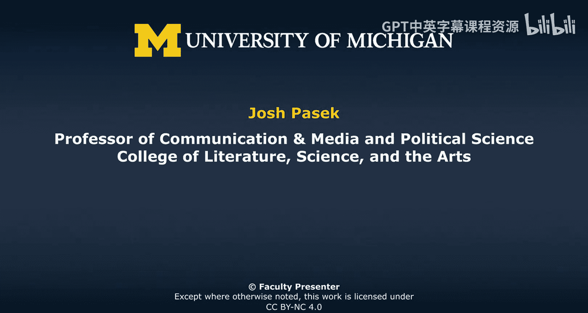

# 应对颠覆：工作场所的生成式人工智能｜P0：系列概述与课程简介

大家好，我是乔希·帕索克，是密歇根大学传播与媒体及政治学教授。

欢迎来到《应对颠覆：工作场所的生成式人工智能》四门系列课程中的第三门课程：《生成式人工智能整合：对劳动力和劳动力的影响》。

在本课程中，我们将探讨将生成式人工智能引入工作场所所带来的影响。这些影响不仅涉及员工如何完成工作，也涉及连接公司、员工和客户之间的关系。

在开始之前，我先简单介绍一下自己。

我的背景是传播学研究员，我的学术研究围绕人们如何理解新闻中的话题展开。

我使用多种数据科学和机器学习技术来了解公众舆论的状况，以及人们如何利用信息做出社会和政治决策。

我研究中使用的一些数据分析方法，构成了现代人工智能系统的核心。

从技术视角及其作为信息和通信技术的角色来理解人工智能，有助于我们深入了解人工智能的功能或能力将如何与社会世界互动。

确实，在社会科学和数据科学的交叉领域工作，以及曾担任密歇根数据与人工智能及社会研究所副所长的经历，使我处于关于人工智能可能产生的社会影响讨论的中心。

在这个短期系列课程中，我们将探讨人工智能将如何影响当代工作场所。

鉴于人工智能可能带来的变革规模巨大，以及人工智能的未来和我们对其的回应都存在不确定性，我设计本课程时着眼于过去的信息和通信技术如何塑造了其时代的社会和工作环境。

这些历史案例的经验教训，为我们思考人工智能的影响提供了背景。

要理解人工智能将对工作场所产生何种影响，以及它可能在何处引入意想不到的障碍，需要理解四个关键领域，这也是本短期系列课程的重点。

以下是本系列课程将涵盖的四个核心领域：

首先，评估人工智能的影响需要我们理解当代人工智能究竟是什么。聚焦于生成式人工智能，系列的第一门课程名为《生成式人工智能：预测颠覆》。它将人工智能置于早期颠覆性技术的背景下，研究人工智能的工作原理，并解析不同的AI使用方法如何产生不同的结果。

其次，理解人工智能影响的第二个支柱，源于关注人工智能将如何改变构成当代工作场所的各类任务。第二门课程名为《生成式人工智能：塑造工作与任务》，重点介绍了来自各类工作场所的一系列工作岗位。该课程探讨了哪些工作任务更容易或更不容易被人工智能替代或增强，以及人工智能的整合可能如何改变人们的工作内容。

接下来，我们将视角放大，思考角色和职责的转变将如何更广泛地改变知识工作，以及在公司、员工和客户之间，人工智能整合后，他们的互动关系可能发生怎样的变化。系列第三门课程，即本课程《生成式人工智能整合：对劳动力和劳动力的影响》，将探讨这些问题以及公司应如何准备。

最后，本系列将以探讨当代及近期人工智能系统在工作场所实施中可能带来的诸多挑战作为结束。在《工作场所中的生成式人工智能：政策、伦理与风险》这门课中，我们将审视关于何种人工智能使用可能被认为是适当或可接受的问题，公共政策如何处理人工智能，以及该技术的发展方向。

虽然你可以选择性地学习这些课程，但我认为按照这个顺序学习，你将获得最大的价值。理解生成式人工智能的工作原理，是理解它可能对员工任务产生何种影响的重要基础，而这本身对于理解即将到来的颠覆对工作场所更广泛的影响也很有价值。

识别可能发生的变化，有助于你为思考何时何地可能出现问题做好准备。

如果你已经完成了本系列的早期课程，欢迎回来。

如果还没有，我建议在学习本课程之前，先学习《生成式人工智能：预测颠覆》和《生成式人工智能：塑造工作与任务》，以理解人工智能的工作原理以及不同工作岗位的任务如何可能受到人工智能的影响，因为这些知识为本课程提供了宝贵的基础。

在《生成式人工智能整合：对劳动力和劳动力的影响》这门课中，我们将探讨人工智能对工作岗位、工作场所以及公司与客户之间关系的更大影响。

在本课程中，我们将识别在这些层面上可能发生的颠覆，并强调公司需要在创新的同时，努力确保其工作能创造价值并方向正确。

解决这些问题并制定强有力的政策，对于建立一个可能从即将到来的变革中受益的工作场所文化至关重要。

学习本课程后，你应该能够：
*   识别人工智能可能如何改变工作场所中的岗位分布。
*   找出人工智能可能改变管理工作的方式。
*   预见到人工智能可能给员工和管理层带来的挑战。
*   预测人工智能对公司与客户互动的影响。
*   思考关于人工智能整合的选择将如何影响谁对人工智能产品负责以及员工的自主权。
*   认识到人工智能可能如何影响员工与公司在有组织和无组织劳工方面的关系。

我非常高兴你能加入我们学习这门课程，并希望你觉得它有价值。

---

**本节课总结**

在本节课中，我们一起学习了《应对颠覆：工作场所的生成式人工智能》系列课程的概述。我们了解了课程讲师乔希·帕索克教授的学术背景，明确了本系列四门课程（《预测颠覆》、《塑造工作与任务》、《整合：对劳动力和劳动力的影响》及《政策、伦理与风险》）的核心内容和学习顺序。我们认识到，理解人工智能技术本身是评估其社会和工作场所影响的基础，而本课程《生成式人工智能整合：对劳动力和劳动力的影响》将重点探讨AI对岗位分布、管理方式、公司-客户关系及劳资关系等更广泛层面的影响，为应对即将到来的变革做好准备。