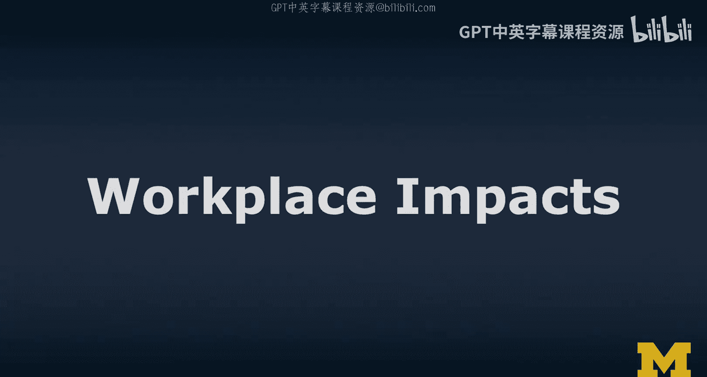
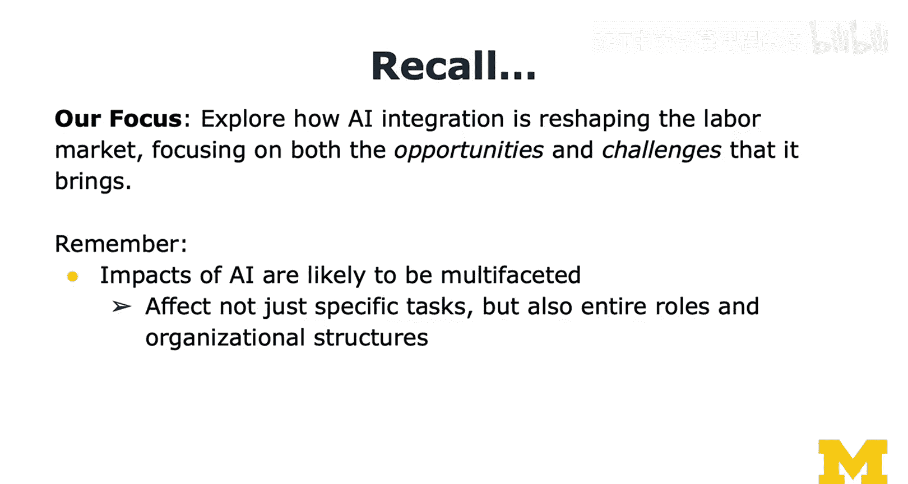
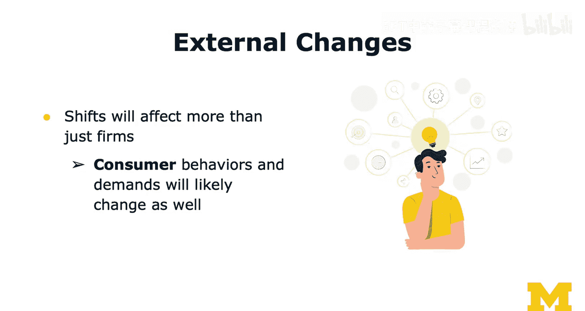
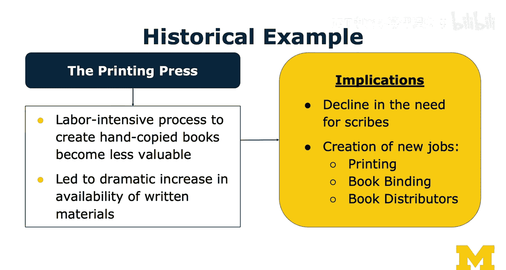
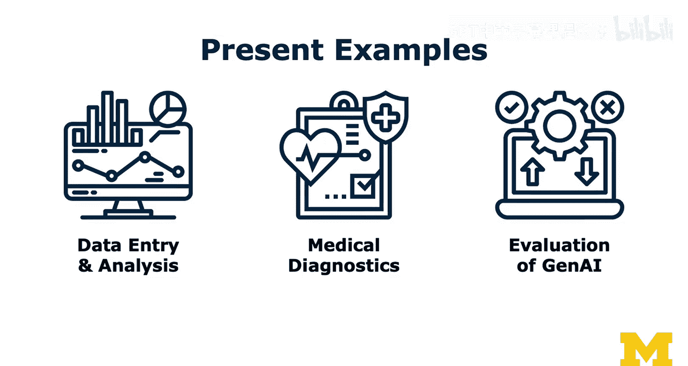
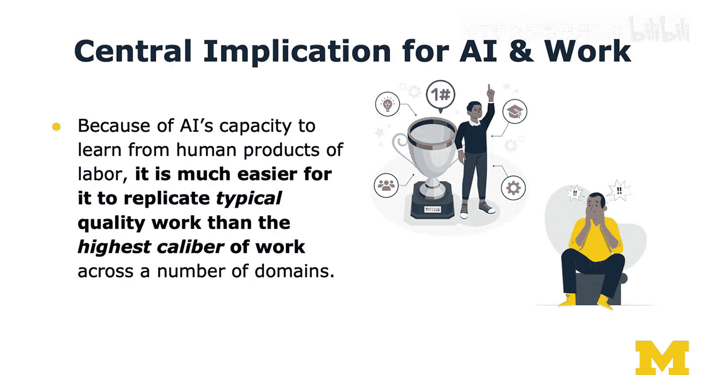
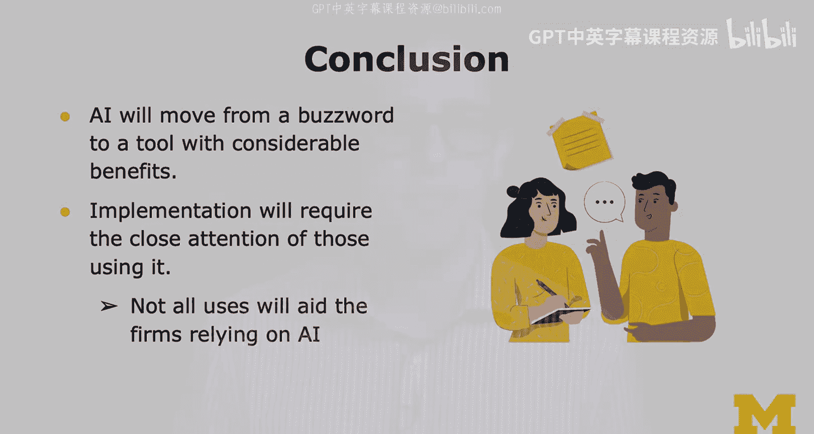
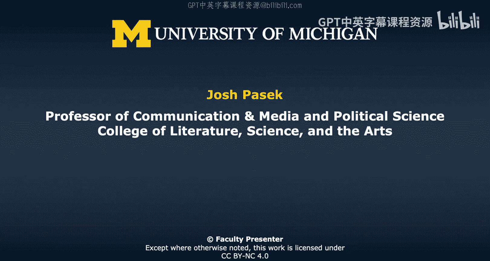

# 应对颠覆：工作场所的生成式人工智能｜P29：1_对工作场所的影响

在本节课中，我们将学习人工智能对工作场所的宏观影响。我们将从关注个体任务转向探讨人工智能如何重塑整个劳动力市场、组织结构和消费者需求。课程将分析人工智能带来的机遇与挑战，并回顾历史技术变革的启示。

## 从个体任务到工作场所的宏观影响 🔄

上一节我们讨论了人工智能对个体任务的影响。本节中，我们将视角扩大，探讨人工智能对整个工作场所的宏观影响。

人工智能已经开始从制造业到医疗保健等各个领域改变工作场所，并且这一趋势将持续下去。

具体而言，我们将探讨人工智能的整合如何重塑劳动力市场，并聚焦于它带来的机遇与挑战。重要的是，在此过程中，我们需要记住人工智能的影响可能是多方面的。这些影响不仅会波及特定任务，还会影响整个角色和组织结构。

## 工作方式的系统性变革 ⚙️

工作将在许多方面发生变化，这包括工作的完成方式，以及工作如何在员工、工作场所和消费者之间进行协商。

组织内部的工作是相互关联的。当人工智能改变一个人的工作内容时，这通常会导致其他人完成工作的方式以及工作分配方式发生连锁变化。

以下是几个关键的变化方向：

*   **任务自动化与时间释放**：当行政任务可以自动化时，曾经执行这些任务的个人现在有更多时间专注于其他活动。
*   **岗位数量变化**：在某些情况下，可能需要更少的职位，因为人工智能使得更少的人就能管理工作。
*   **新角色的诞生**：将出现围绕人工智能监督的新角色，而不是专注于人工智能现在可以复制的人类先前完成的工作。
*   **工作流程的重新评估**：实践中，所有这些转变都需要重新评估职位描述和工作流程，以确保组织的不同部分和谐地适应，并确保努力不会白费。

所有这些转变带来的影响是，个人会发现他们的角色在变化，即使他们目前的角色并非人工智能可以直接替代的。值得注意的是，这些转变不仅发生在公司内部，也存在于客户需求方面。即在人工智能时代，消费者对公司的需求很可能发生变化，而不仅仅是公司能够提供什么。

## 历史镜鉴：颠覆性技术的启示 📜

回顾历史上的颠覆性技术，我们可以看到技术进步在过去曾彻底改变过就业格局。

当印刷机彻底改变信息传播方式时，它使得抄写员手工抄写书籍这种劳动密集型过程的价值远不如前，并极大地增加了书面材料的可用性。这一转变导致了抄写员角色的衰落，但同时也在印刷、装订和分销领域创造了新的工作岗位。

与印刷机类似，人工智能预计将颠覆许多现有角色，同时创造新的机会。

## 人工智能对工作的三种影响模式 🤖

正如我们在上一门课程中谈到的，人工智能可能会取代以前由人类完成的常规或重复性工作。

以下是人工智能影响人类工作的三种主要模式：

*   **替代**：数据录入等工作越来越多地可以由人工智能处理，从而减少对人的需求，并且通常会提高工作质量。公式可表示为：`AI 任务执行 → 减少人工参与`。
*   **增强**：人工智能可以增强人类能力，使工人更高效、更有生产力。例如，人工智能驱动的医疗诊断工具可以通过快速分析医学图像、标记医生应注意的关键事项来协助医生，从而实现更快、更准确的诊断。公式可表示为：`人类 + AI 辅助 → 更高效率与质量`。
*   **转变**：人工智能可以改变特定角色的性质，鼓励工人发展新技能，并专注于更高级别的任务，例如评估人工智能工作的质量并进行事实核查，以确保消除人工智能产品中的任何幻觉或偏见。

## 间接影响：涟漪效应 🌊

当然，在许多情况下，人工智能也无法对人类劳动产生有意义的影响。完成这些任务的工人可能认为他们的角色在很大程度上不受人工智能影响，但这是一种误解。即使他们完成的任务不易直接受到人工智能增强或替代的影响，但随着人工智能影响其他角色，颠覆带来的连锁反应仍可能波及这些职位。

## 对劳动力市场和组织结构的整体影响 🏢

总体而言，当人工智能改变劳动力的角色时，它将对整个工作场所和集体目标产生影响。

在许多情况下，人工智能的整合可能导致劳动力更精简，需要更少的人来执行人工智能可以独立处理或有效增强的任务。但这些影响在不同领域可能并不均衡。

以下是可能出现的市场动态：

*   **技能需求分化**：对能够管理和改进人工智能系统的高技能工人的需求可能会增加；那些在提示和塑造人工智能结果方面有特殊技能的人也可能受益。因此，一个使用人工智能进行质量控制的工厂可能需要更少的产线检查员，但同时可能需求更多的AI技术员。
*   **赢家通吃趋势**：人工智能从人类劳动成果中学习的能力，意味着它更容易复制典型质量的工作，而不是各个领域最高水平的工作。这导致一种预期，即以人工智能为导向的劳动力市场可能出现赢家通吃的动态。具体来说，在其领域内的顶尖表现者可能会发现他们的地位更加稳固，因为人工智能增强了他们的能力，但未能侵蚀使他们成为最佳人选的独特技能组合。这类个人可能被视为更具生产力和价值。
*   **中低层风险**：相反，中层和低层工人，以及依赖大量可被人工智能替代的产出的公司，可能面临更大的被取代风险，因为他们执行的任务更容易自动化，他们的角色被视为非必需。

## 对各方参与者的具体影响 👥

这种动态凸显了持续学习和技能发展对于个人和公司在人工智能驱动的就业市场中保持竞争力的重要性。

这也意味着，在技能边际差异很重要的情境中，那些具备这些技能的个人最有可能免受人工智能驱动的颠覆影响。

总体而言，这对员工、管理者和消费者都有影响。

以下是针对不同群体的具体影响：

*   **对员工**：人工智能可能会取代某些工作并改变其他工作的角色，这就需要再培训和技能提升计划来帮助个人过渡到新角色。员工可能还需要适应新的协作模式，与人工智能工具并肩工作，并学会将评估其输出作为工作的关键部分。
*   **对管理者**：管理者将面临不同的挑战。他们需要找到有效的方法将人工智能整合到现有工作流程中，并确保人工智能和人类员工都富有生产力且投入其中。有效的AI管理将需要持续学习和适应，因为人工智能技术持续快速演进，对其使用的关切也随之变化。管理者还需要建立系统，以便监控人工智能的影响，以及人工智能对公司产品需求的影响。
*   **对消费者**：人工智能有潜力提高产品和服务的质量与定制化程度。同时，人工智能的使用也引发了人们对数据隐私和客户服务中人情味丧失的担忧。公司需要在从人工智能服务中获得效率提升与广泛保持客户信任和满意度之间取得平衡。广义上说，人工智能将从营销热词转变为当它成为所提供商品或服务的一部分时能带来可观效益的事物。但这需要关注，而非简单的广泛应用。

确实，并非所有人工智能的应用都会帮助实施它们的公司。

## 总结与前瞻 🎯

本节课中，我们一起学习了人工智能对工作场所的宏观影响。

人工智能确实可能改变工作场所，对所有参与者产生巨大影响。积极主动地思考这些影响，并设想其下游效应，是成功实施的关键。人工智能将带来替代、增强和转变三种主要影响模式，并引发劳动力市场的结构性变化，对员工、管理者和消费者产生不同层面的挑战与机遇。理解这些动态，对于在人工智能时代做好准备至关重要。