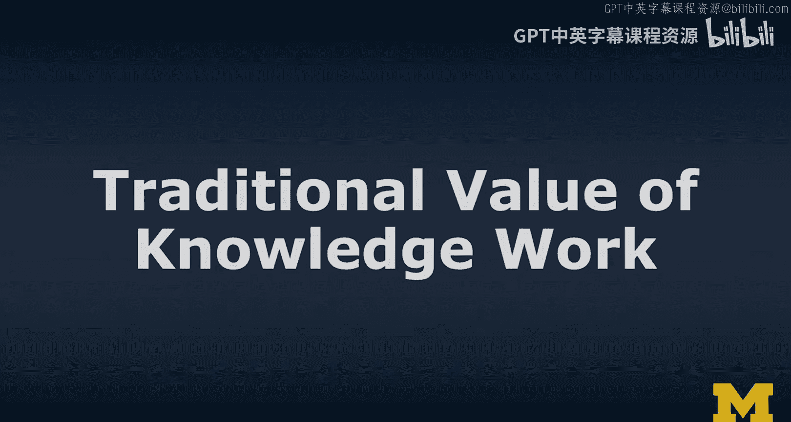
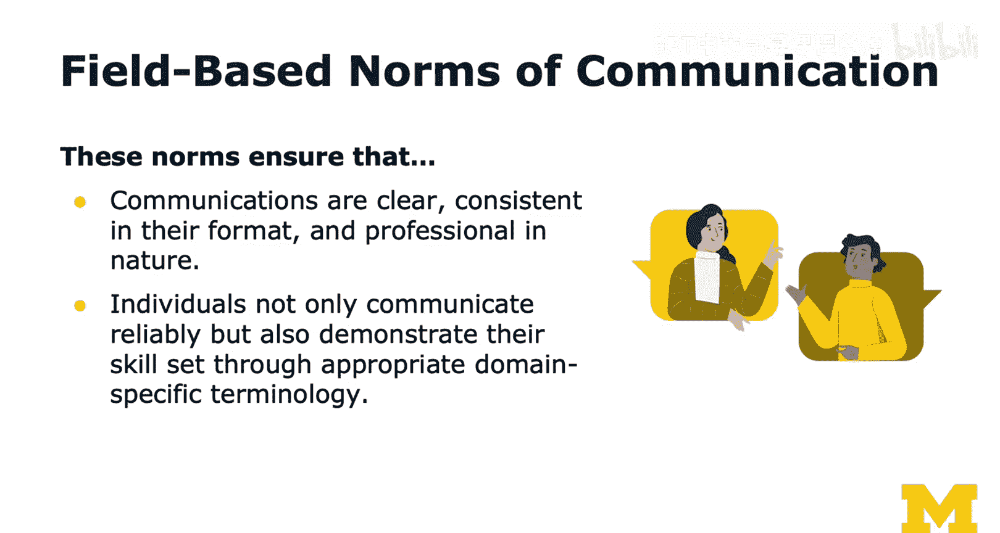
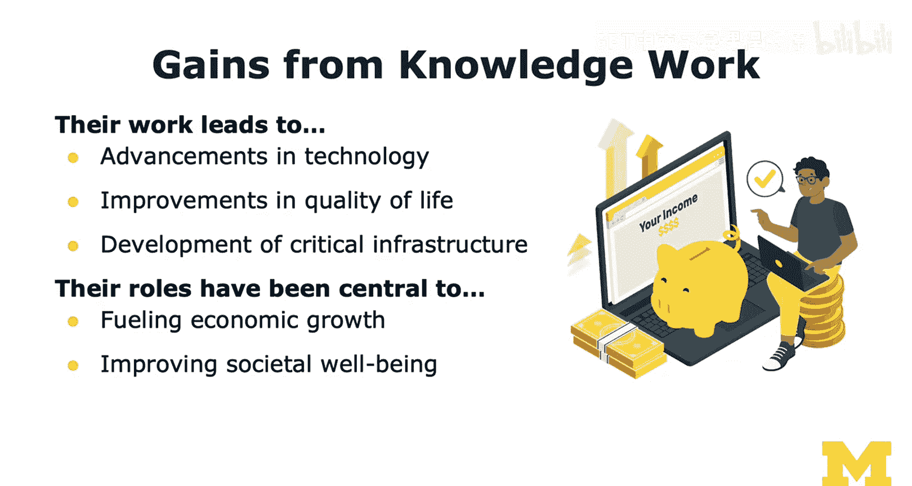
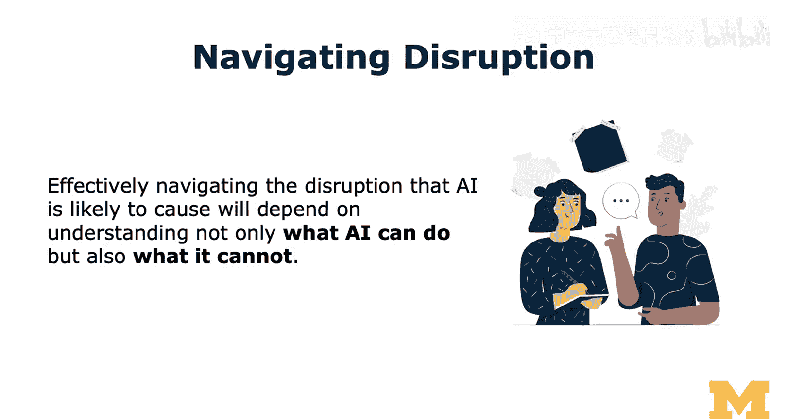
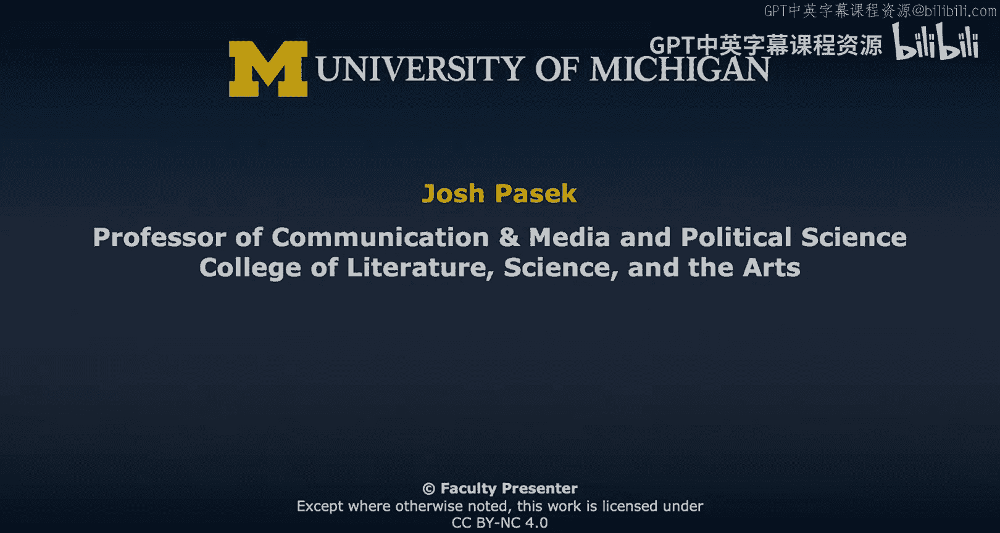

# 应对颠覆：工作场所的生成式人工智能：P30：2_知识工作的传统价值

## 概述 📖

在本节课中，我们将要学习知识工作的传统价值。知识工作涉及写作、分析、编程和起草材料等技能，这些工作在当代经济的关键领域中一直具有巨大价值。我们将探讨其核心特征，并理解为何人工智能可能对这一领域产生最重大的颠覆性影响。

或许最大的颠覆将发生在知识工作者身上。这些人的工作涉及写作、分析、编程以及起草供他人阅读和查看的材料等技能。这些工作在当代经济的关键领域中传统上一直具有巨大价值。

知识工作领域通常涉及大量的培训和资质认证，以及拥有高水平领域专业知识的个人。它还包括标准化的沟通与论述规范、对工作成果的责任感以及社会价值。

## 知识工作的核心特征 🔍

上一节我们介绍了知识工作的定义和重要性，本节中我们来看看构成其传统价值的几个核心特征。

### 1. 教育与资质认证 🎓

知识工作通常需要广泛的教育和专业资质。会计师、律师和医生需要经历严格的培训和认证过程，通常需要花费数年时间攻读高等学位。

他们的专业任务完成能力由大学学位和所修课程来认证。这种培训确保了知识工作者拥有执行其领域所需复杂任务的必要技能和知识。

### 2. 领域专业知识 🧠

知识工作领域的个人通常还需要大量的领域专业知识。这种专业知识对于解决复杂的特定领域问题和做出明智选择是必要的。

例如，金融分析师必须理解市场趋势和经济指标才能提供准确的建议。这种专业知识通常通过正规教育和实践经验的结合来培养。

### 3. 沟通规范与标准 📝

知识专业人士经常遵循复杂且特定的沟通规范和标准。

以下是常见的规范示例：
*   律师使用精确的语言并遵循严格的文档实践。
*   学者拥有完善的领域特定术语，确保同行间的理解一致。

这些规范确保了沟通清晰、格式一致且具有专业性。精通这些规范的个人不仅能可靠地进行沟通，还能通过恰当的领域特定术语来展示他们的技能。

### 4. 责任与可靠性 ✅

知识工作者通常还需要对其产出负责，这些产出必须满足高标准的可靠性和准确性。

例如，政府工作人员必须保证官方统计数据的准确性，或者工程师必须确保他们的设计符合安全标准和道德准则。

为了加强问责制，专业机构和监管框架限制了谁可以参与某些职业，并概述了工作者需要满足的要求。

## 知识工作的价值与社会功能 🌟

因此，知识工作需要专业知识、规范意识和责任感。其价值对于现代社会的运转至关重要。

它提供了支持各个领域的服务和专业知识，确保采取适当的行动，并且有关这些行动如何及为何采取的信息是可用的。

这对于医疗保健专业人员（例如改善公共卫生）和教育工作者（塑造下一代）来说都是如此。我们赋予知识专业人士的信任，取决于对他们行为原因的清晰理解，而这反过来又依赖于他们的培训、专业知识和对职业规范的遵守。

知识工作者往往能获得相对较高的薪水，这不仅是因为所需的培训，还因为他们的贡献对社会有价值。他们的工作带来了技术进步、生活质量的提高以及关键基础设施的发展。这些角色一直是推动经济增长和改善社会福祉的核心。

## 人工智能带来的独特颠覆 ⚡️

与过去几十年的许多颠覆性技术不同，人工智能似乎准备对那些往往产生最大社会价值的知识专业产生最重大的影响。

这意味着人工智能的颠覆性影响可能与其他近期的颠覆有所不同，后者主要影响了体力劳动者。人工智能在大量数据中训练，可以有效地执行那些用于评估和认证知识工作者的任务。

人工智能可以复制各个知识领域的沟通标准和规范，并复制长期以来区分那些被视为具有最大社会价值的职位的批判性思维产出。所有这些都凸显了生成式人工智能可能造成的潜在颠覆。

然而，有些特征是人工智能无法复制的。要有效应对人工智能可能造成的颠覆，不仅取决于理解人工智能能做什么，还取决于理解它不能做什么。

## 总结 📚

本节课中我们一起学习了知识工作的传统价值。我们了解到，知识工作因其对**教育与资质**、**领域专业知识**、**标准化沟通规范**和**高度责任感**的要求，而在社会中占据核心地位并创造巨大价值。然而，人工智能的出现，特别是其模仿这些核心任务的能力，正对知识工作领域构成独特的颠覆性挑战。关键在于，我们需要同时认清人工智能的能力与局限，才能在未来有效地驾驭这场变革。