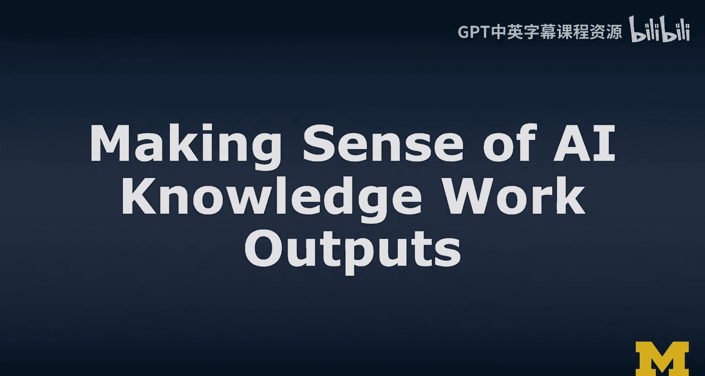
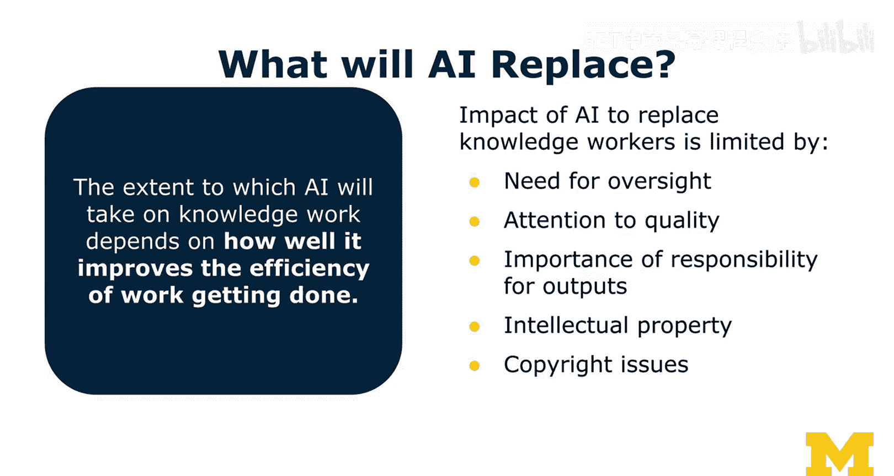
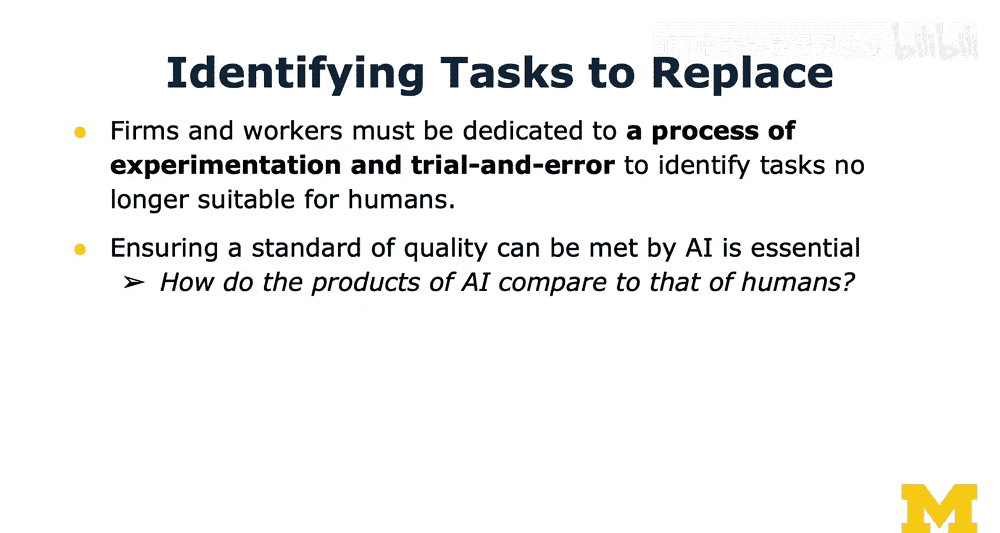
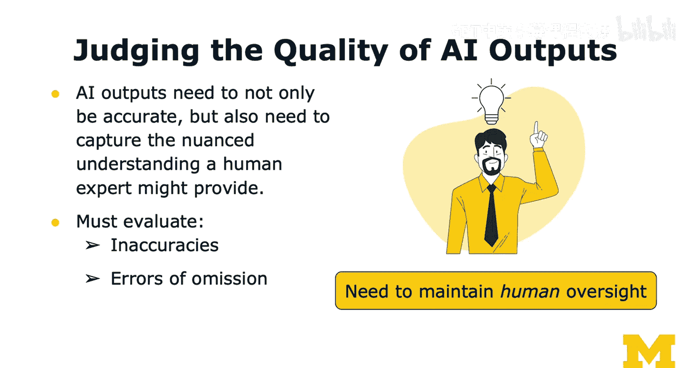
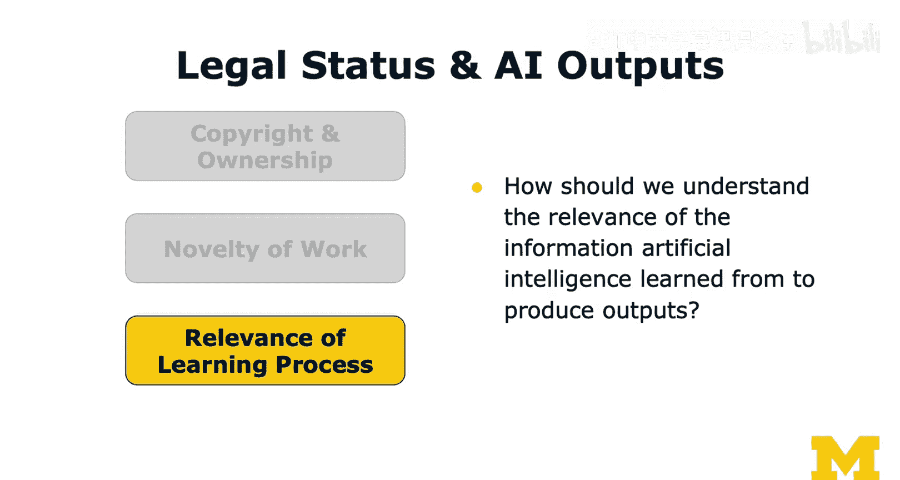
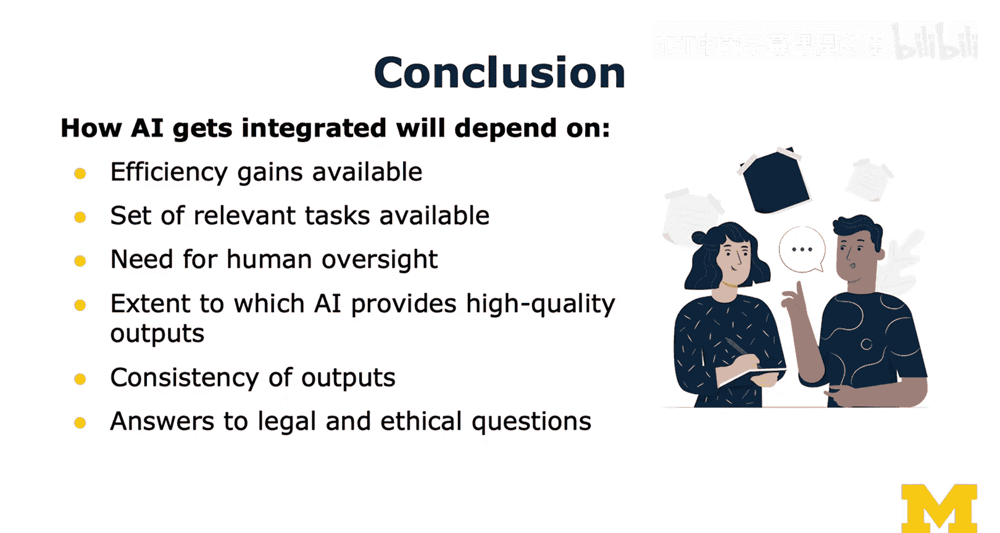
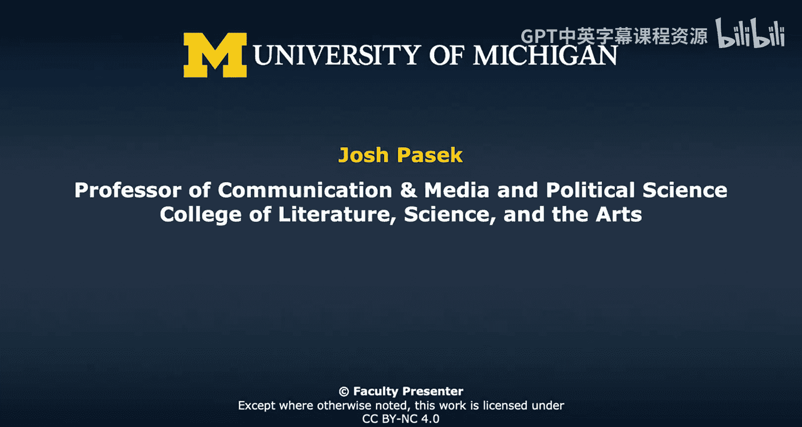

# 应对颠覆：工作场所的生成式人工智能：P31：3_解析人工智能的知识工作输出

在本节课中，我们将要学习人工智能如何影响知识工作，并探讨其带来的效率提升、质量评估、责任归属以及法律地位等一系列关键问题。

上一节我们讨论了知识工作为何在社会中备受重视。本节中，我们来看看人工智能对知识工作的具体影响。

与过去受外包或自动化冲击的低技能或体力劳动不同，人工智能可能颠覆的恰恰是那些过去相对“免疫”、且需要大量时间和技能投资的知识型工作。人工智能接管知识工作的程度，根本上取决于它在多大程度上提高了完成工作的效率。

然而，在许多情况下，由于对监督、质量把控、产出责任以及知识产权和版权问题的需求，人工智能可能无法完全取代人类知识工作者的角色。

## 效率提升的来源

回顾效率提升的可能性、劳动力的可能变化以及人类监督的必要性，使我们能够更全面地思考任务替代、任务增强和劳动力转移如何在整个工作层面，而非仅仅是任务层面，发挥作用。

那么，人工智能的效率提升体现在哪里？人工智能可以通过以下方式显著提高效率：

以下是人工智能提升效率的主要途径：
*   自动化常规和重复性任务。
*   起草和概述原本需要手动生成的内容。
*   收集和评估可能构成各种决策基础的数据。

人工智能引入效率提升的程度，在很大程度上取决于其能否被有效地引导去执行特定任务。因此，常规备忘录、标准化分析程序和常见报告形式，可能比定制化分析更快地被人工智能替代或增强。

这种效率提升最初将为复杂和创造性的任务带来额外价值。识别哪些任务不再需要人类完成，需要企业和工作者进行实验和试错。评估人工智能执行基本数据录入、初步法律文件审查或简单医疗诊断的可靠性，对于确保在没有人类主导的情况下仍能满足质量标准至关重要。

## 评估人工智能的工作质量

企业在进行此类评估时，可能不仅希望评估人工智能工作的质量，还希望将其与人类工作的质量直接比较，并检查人类核查是否能有效发现人工智能的错误。

评估人工智能工作的质量将极其重要。人工智能生成输出的准确性和质量，可能因所使用的数据、算法以及提供给算法的提示而有显著差异。在某些情况下，如果效率提升足够大，企业接受人工智能输出质量略低可能是合理的。

然而，在其他情况下，即使质量的小幅下降也可能削弱或消除人工智能的价值。我们需要问，人工智能生成的报告是否不仅准确，还能捕捉到人类专家可能提供的细微理解。我们不仅需要考虑潜在的不准确性，还需要考虑遗漏错误。所有这些都指向了保持人类对人工智能输出可靠性和准确性进行监督的必要性。企业也可能需要进行正式的努力，以评估人工智能工作的一致性和质量。

## 责任归属与法律挑战

将人工智能用于工作产品，也引发了关于对所产生信息责任的诸多问题。因为人工智能算法并非以传统方式“知道”事物，它们容易犯各种错误。依赖自动化工具的倾向会加剧这些错误，使其难以被发现和裁决。当人工智能系统推荐不当内容、在法律简报中引用不存在的判例，或者只是混淆事实时，谁应该负责？

当广泛的人工智能模型应用于特定用例时，这个问题尤其相关。开发者可能永远无法预见可能出现的具体问题，显然不应为此负责。但根据情况，责怪用户也可能没有意义，例如当聊天机器人在回应客户服务请求时提供了不准确信息时。预测和评估这类复杂情况是一项关键任务。

当我们考虑人工智能产出的法律地位时，其挑战只会更加复杂。关于人工智能生成的作品是否以及在何种情况下可以受版权保护，以及谁将拥有此类作品的权利，目前存在持续争论。如果内容是由人类或企业与人工智能共同产生的，我们应如何评估所产生内容的新颖性？我们应如何理解人工智能为产生输出所学习的信息的相关性？

这些问题动摇了传统的作者身份和所有权概念，并导致了围绕人工智能生成的艺术、音乐和文本内容的法律和伦理困境。我们可能需要数十年时间，才能为如何使用、归属和认可人工智能生成及辅助的内容建立明确的规范和法律。

## 总结

所有这些都突显了企业在试图理解人工智能能够且应该在其工作流程中扮演何种角色时所面临的一系列挑战。人工智能的能力只是故事的一部分。人工智能如何被整合，将取决于可用的效率提升、相关任务集合、人类参与各种流程的必要性、人工智能提供高质量输出的程度、人工智能输出的一致性，以及关于责任、所有权和人工智能法律地位的问题。

因此，人工智能**能做什么**、人工智能**将做什么**以及人工智能**应该做什么**，是几个重要且截然不同的问题。

本节课中，我们一起学习了人工智能对知识工作的潜在影响，分析了其效率提升的途径、质量评估的重要性、责任归属的复杂性以及法律地位的不确定性。理解这些方面对于在工作场所中负责任且有效地整合人工智能至关重要。