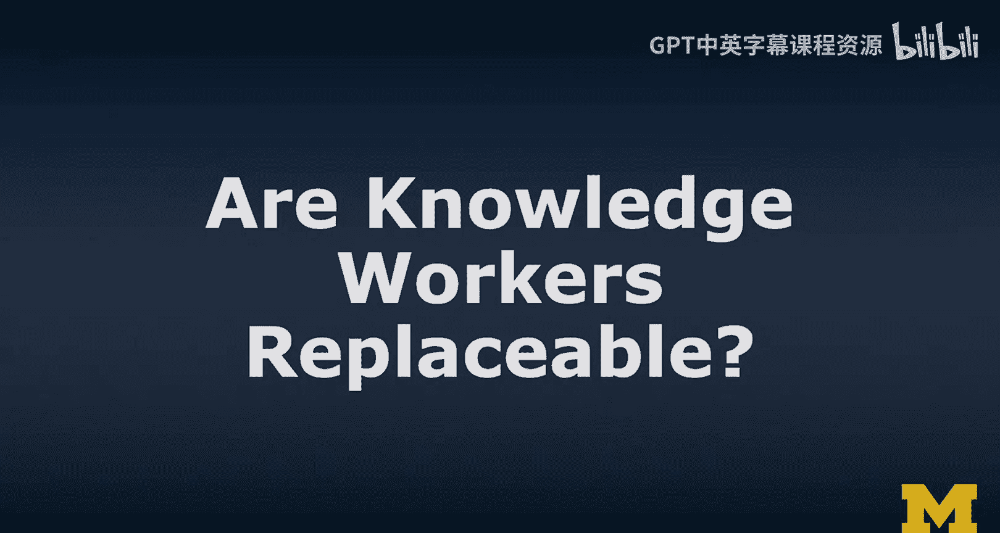
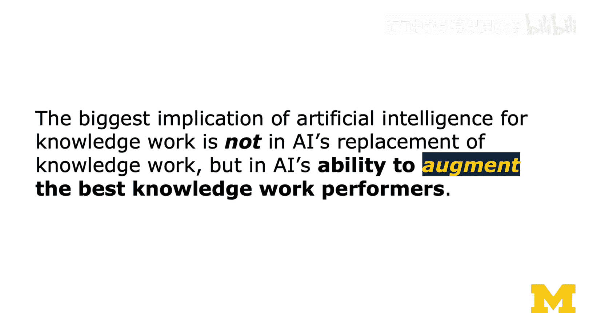
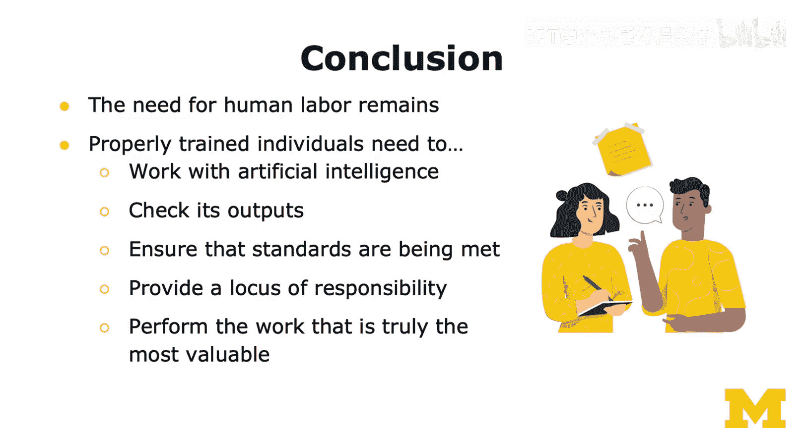
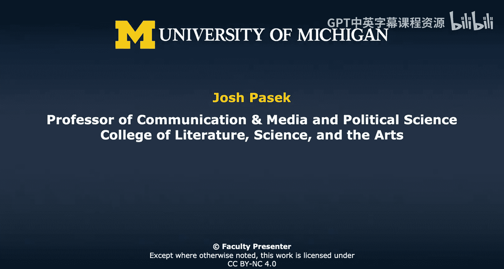

# 应对颠覆：工作场所的生成式人工智能：32：4_知识工作者是否可被替代

在本节课中，我们将探讨人工智能在何种情况下能够实质性地替代知识工作。我们将分析AI复制知识工作的能力、相关的经济考量、信任与监督问题，以及AI对知识工作价值的长期影响。

## 人工智能复制知识工作的能力

上一节我们讨论了人工智能的潜力，本节中我们来看看它具体能做什么。人工智能已展现出复制知识工作诸多方面的强大能力。

以下是AI目前能够完成的一些任务示例：
*   AI系统可以起草各类文件，包括法律简报和学术文章。
*   AI能够诊断和识别文本与图像内容。
*   AI可以基于社会、金融等数据生成自动化报告。

此外，人工智能仍在持续进步，自然语言处理和机器学习领域的发展正在不断解锁新的能力。

## 经济考量：准入门槛与价值

仅仅能够复制任务是不够的，经济因素在其中扮演着关键角色。从基本的经济学角度看，一个特定领域的准入门槛越低，该领域的技能和产出的价值就越低。

用公式可以表示为：**准入门槛 ↓ → 技能/产品价值 ↓**

当AI能够完成那些过去需要大量培训和专业知识才能完成的任务时，标志着该领域的技能和资质的相对价值同样可能下降。例如：
*   如果平面设计公司的潜在客户能够自行生成足够好的设计，那么平面设计师工作的价值本质上就降低了。
*   那些能够自行生成协议草案的客户，比空手而来的客户需要的法律服务更少。

在许多领域，这可能导致就业市场动态的转变，专业技能不再像以前那样被需求，或者必须适应变化以维持其价值。

## 信任、监督与AI的局限性

然而，人工智能能够完成某项任务这一事实本身，并不足以让企业依赖它或信任其产出。AI的产出，至少在现阶段，是相对不透明的。

由于无法观察AI生成内容和其他输出的具体方法，企业可能会发现这种不透明性阻碍了对AI的依赖。AI可能使用了导致偏见结果的信息，或者使用了不恰当的信息来做决策。

因为人工智能模型的复杂性使我们无法确定某个模型产生特定结果的具体原因，这类错误在本质上可能难以识别。当AI犯错时，其犯错的情形可能与我们通常预期人类会犯错的常见情形不同，这意味着我们甚至识别潜在问题出在哪里的能力都可能是被误导的。

所有这些都强化了将人工智能整合到许多工作场所的一个主题：**它将需要大量的人工监督，并定期评估AI输出的质量和一致性**。这种监督需要由具备能力和专业知识的人员来执行，他们能够自行识别错误并确认人工智能的结果。人类的监督也为建立有意义的问责制提供了可能。

## 人类角色的不可替代性

AI的这些局限性主要围绕着那些表面上似乎可以完全被自动化智能替代的任务。但重要的是要记住，许多任务仅能部分地由当代AI完成。

在许多情况下，AI无法独立产生足够的输出。人类的判断力、创造力、对AI输出的评估，以及对产出内容如何符合伦理、法律等标准的考量，都需要人工智能系统本身之外的输入。尽管人类角色可能比以往更紧密地与人工智能结合，但这一角色依然存在。

## AI对知识工作的核心影响：增强而非替代

或许人工智能对知识工作的最大影响不在于替代知识工作，而在于其**增强顶尖知识工作者表现**的能力。

那些在各自领域出类拔萃的人，随着AI进一步融入工作场所，可能会发现自己的需求变得更大。原因有二：
1.  顶尖表现者在人工智能的增强下，将能够完成更多工作。
2.  AI所能达到的工作质量，通常强于某个领域的平均产出，但尚未达到最顶尖输出的水平。因此，表现明显高于平均水平的企业和工作者将更有可能脱颖而出。

相比之下，中级和较低层级的工作者可能面临更大的被替代风险，因为他们的任务变得自动化，其角色变得不那么重要。

## 挑战与未来展望

这些挑战的影响是多方面的。一方面，工作者和企业必须专注于持续学习和技能发展，以在AI增强的就业市场中保持竞争力。

然而，顶尖表现者相对于领域内其他人所获得的价值提升，也会引发重要的“人才管道”问题。因为那些让个人积累专业知识以成为顶尖人才的中级工作将更难找到，并且薪酬可能更低。对于希望在未来保持竞争力的企业来说，为这些动态做好规划至关重要。

总的来说，这些动态预示着，对于那些过去相对免受技术颠覆影响的劳动者类型而言，将面临充满挑战的时期。

## 总结：人类劳动的必要性依然存在

尽管风险众多，但对人类劳动的需求依然存在。我们需要训练有素的个人与人工智能协同工作，检查其输出以确保符合标准，提供责任归属，并在某些情况下，执行那些真正最有价值的工作。

因此，虽然人工智能对知识工作的价值和性质产生了影响，但我们远未达到在短期或中期内完全替代知识工作者的境地。

本节课中我们一起学习了人工智能替代知识工作的条件与局限。我们认识到，AI目前更多是作为增强工具，而非完全替代者。经济门槛的降低、对AI输出的监督需求、人类在判断与伦理方面的不可替代性，以及AI对顶尖工作者的增强效应，共同构成了当前人机协作的复杂图景。未来的关键在于人类如何与AI协同，提升整体工作的价值与质量。

