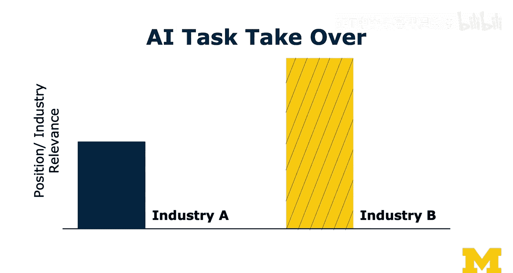
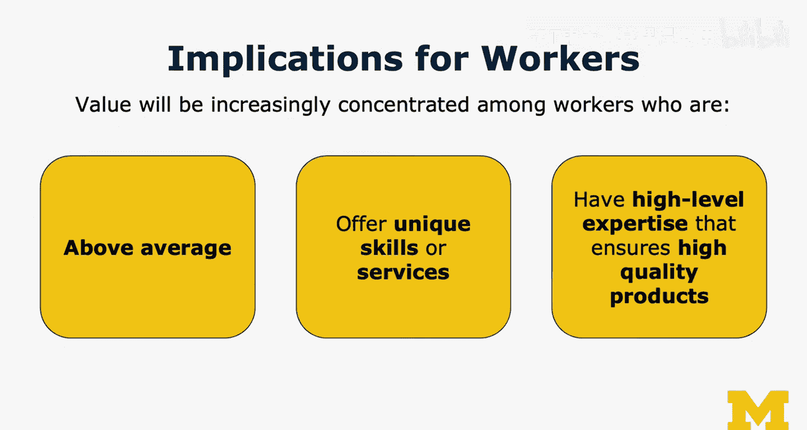
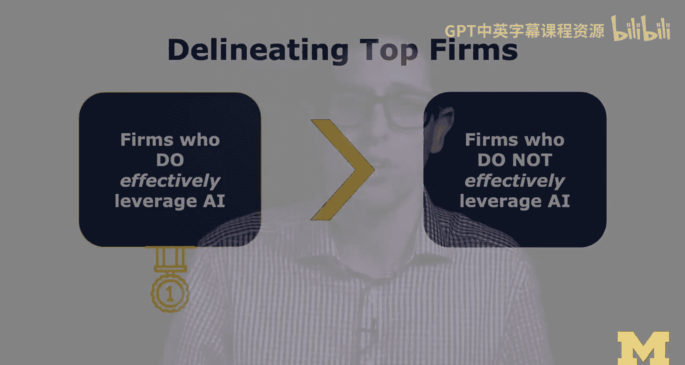
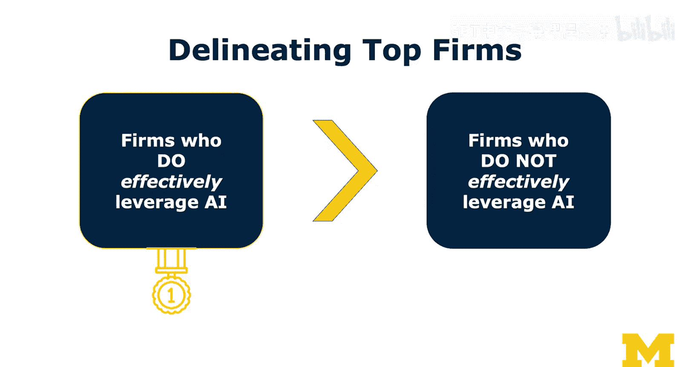
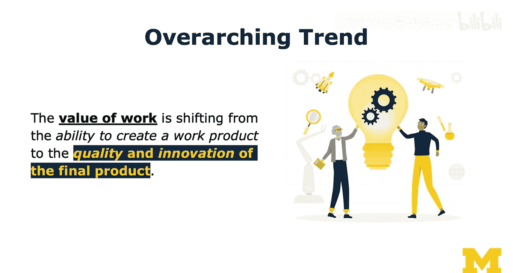
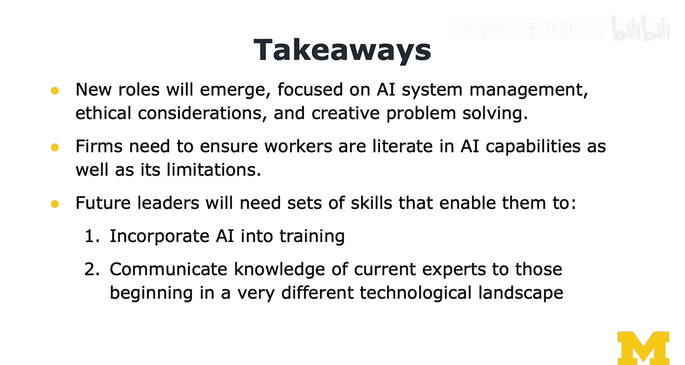
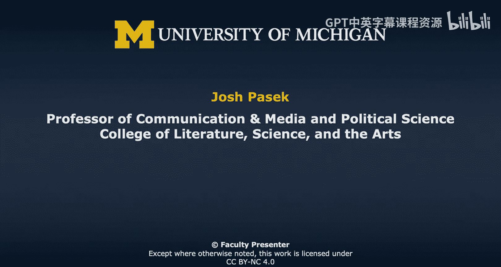

# 应对颠覆：工作场所的生成式人工智能：33：5_工作任务的分配与执行主体

在本节课中，我们将要学习人工智能如何重塑工作任务的分配与执行主体。我们将探讨AI不仅会改变个人工作的性质，还会影响行业需求、企业竞争格局以及个人职业发展的方向。

---

人工智能不仅将改变个人工作的性质，还将改变所需职位、行业以及市场需求的性质。

随着人工智能接管任务，某些完整的行业类别将变得不再那么重要，而其他领域的价值主张将发生改变，其中部分劳动领域的重要性下降，其他活动的重要性则上升。

上一节我们介绍了AI对行业层面的宏观影响，本节中我们来看看这种影响在企业层面的具体表现。

**赢家通吃效应**很可能影响高绩效与低绩效知识工作者，预计在行业层面也会产生类似的影响。为了应对以AI增强型劳动力为特征的新职位，需要出现新的工作类别和企业。

为了理解人工智能的影响，企业不仅需要考虑它将如何影响其当前供应能力，还需要考虑对其产品需求的影响。

---

整个行业可能会发现它们销售的产品变得不如以前重要。

以下是几个具体的例子：
*   例如，专门从事语言材料翻译的公司会发现，对专业翻译服务的需求急剧下降，因为许多翻译工作可以借助人工智能工具有效完成。
*   同样的动态变化也准备颠覆平面设计的许多领域，寻求设计标志的小型实体可能会转向DALL-E或Midjourney，而不是聘请专业设计师。

企业不仅需要评估其产出与竞争对手相比如何，还需要评估其与AI生成替代品相比的表现。无论是寻求一个相对快速的插图，还是用于起草遗嘱的草稿文件，如果AI看起来足够胜任，客户可能会觉得不那么需要寻求专家。

企业将需要在新兴的AI增强环境中，清晰地重新确立自己的价值。

---

在AI驱动的世界中，企业和员工都可能发现，平均水平的表现在未来将不足以保障工作安全。

随着AI让非专家也能越来越多地完成典型水平的工作，价值将越来越集中在那些**高于平均水平**的人身上。这些人拥有独特的技能或服务，并具备高水平经验，能确保交付的质量优于典型的AI产出。

目前尚不清楚消费者将如何了解哪些企业能提供这些更高质量的产出，但无论是通过口碑还是资质认证，高于平均水平将变得越来越重要。

---

赢家通吃效应也很可能存在于企业层面。

以下是其具体表现：
*   有效利用人工智能的顶尖企业很可能主导其所在行业，为其他企业留下的空间更小。
*   能更好、更迅速地利用现有数据的公司，很可能成为最有效的先行者。

然而，这里再次强调，质量至关重要。我们很可能会看到许多“昙花一现”的机构利用AI快速进入市场，但并不完全理解市场环境。无法应对这些发展的企业将失去市场份额，而那些能够清晰阐明其超越人工智能的附加价值的企业将继续发挥作用。当这些“昙花一现”的机构因其缺乏深刻理解而证明是危险的时候，其中许多将会消失。

---

事实上，工作的价值正在从创造工作产品的能力，转向最终产品的质量和创新。

在市场营销中，AI可以生成广告活动创意，但人类提供的战略洞察力和创造性执行则增添了显著价值。在这种环境下的竞争优势，将来自于人类为AI生成的产出所带来的独特贡献。

---

那么，从这些过程中将产生什么结果？

虽然有些任务将完全自动化，但更多的任务可能需要人类的监督和定期干预。

以下是将会出现的新工作角色：
*   新的工作岗位将出现，专注于AI系统管理、伦理考量和创造性问题解决。
*   像AI伦理官、数据科学家和AI维护工程师这样的职位，在未来工作场所中将至关重要。

企业需要确保其员工充分了解人工智能的能力和局限性，以便识别该技术未来的有效用途，并阐明公司采用的方法为何是恰当的。此外，赢家通吃效应将导致需要建立新的渠道，来培养许多领域的未来领导者。不仅需要将人工智能正式纳入培训，每个领域中最专家的个人所拥有的专业技能，也需要有效地传授给以截然不同方式做事的新一代。

适应性和持续学习对于员工和企业在受AI影响的商业环境中蓬勃发展至关重要。

---

总的来说，这些发展表明我们将看到更广泛的人机协作。

以下是几个关键趋势：
*   执行以往属于专业技能的能力将得到普及。
*   高度高级培训的价值将增加。
*   价值创造的方式将发生转变。

---

本节课中我们一起学习了人工智能对工作任务分配与执行主体的深远影响。核心在于，AI的普及将导致价值向高于平均水平的个人和企业集中，催生新的工作角色，并使得人机协作、持续学习以及独特的“人类附加值”成为在未来职场中立足的关键。