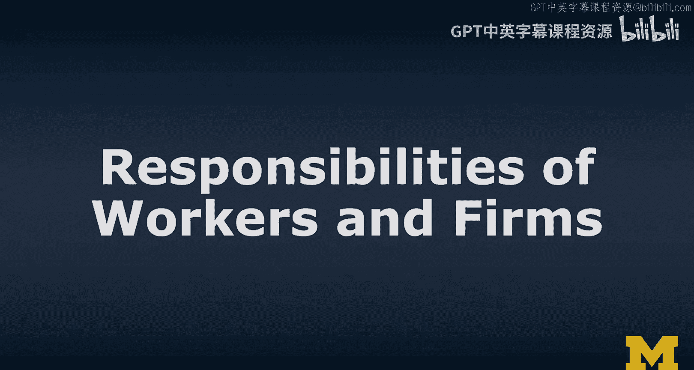
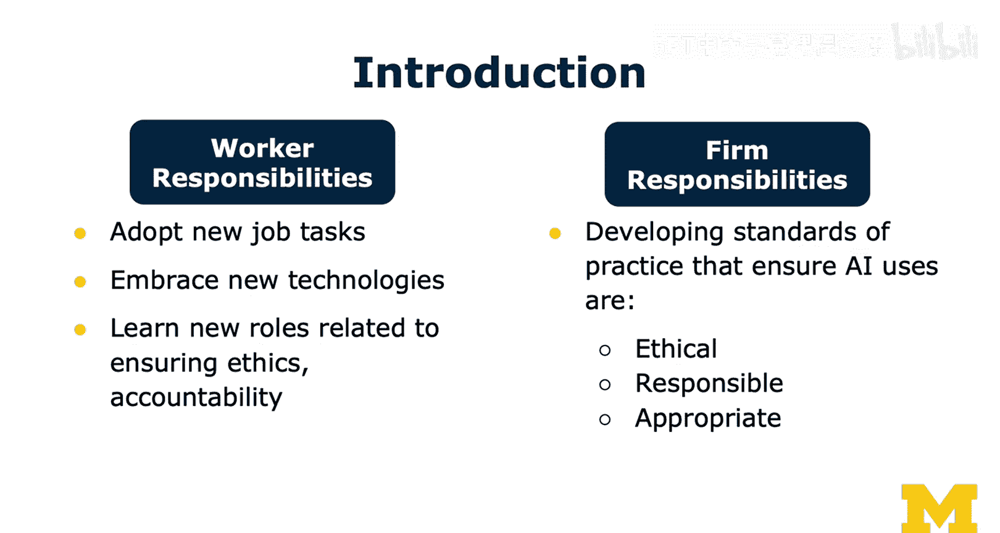
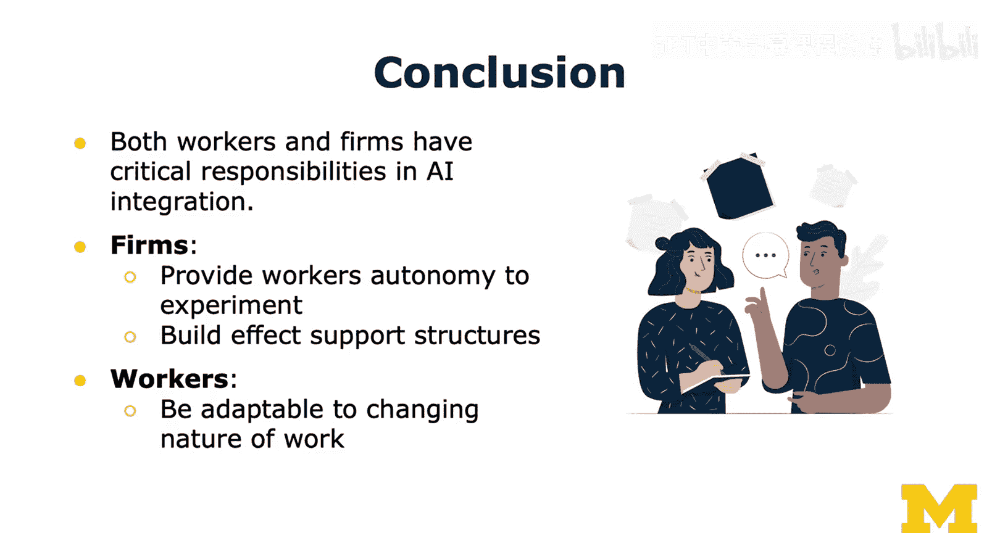
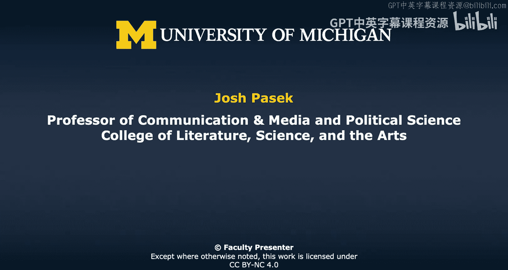

# 应对颠覆：工作场所的生成式人工智能：P34：从业者与企业的责任

## 概述 📋

在本节课中，我们将要学习在人工智能进一步融入劳动力市场的背景下，从业者（员工）与企业各自需要承担的责任。我们将探讨员工如何适应新技术、确保伦理应用，以及企业如何建立支持性的框架和政策，以实现人机协作的最大效益并规避风险。

---

## 员工的责任：适应、学习与评估 🤝

鉴于企业角色和竞争格局可能发生的剧烈变化，随着人工智能进一步融入劳动力市场，思考并阐明员工和企业的责任至关重要。

员工需要承担新的责任并拥抱新技术。他们还需要学会在确保伦理和问责方面扮演关键角色。

上一节我们介绍了责任划分的重要性，本节中我们来看看员工具体需要承担哪些责任。

以下是员工需要履行的核心责任：

*   **学习与互动**：员工的核心责任是学习如何与人工智能互动，并理解它能做什么、不能做什么。涵盖人工智能素养、数据分析等相关技能的课程将为员工打下坚实基础，帮助他们理解人工智能在做什么以及如何将其融入工作。
*   **保持适应性与关注趋势**：随着技术获得更多能力并能够承担更广泛的工作，员工需要保持适应性。知识工作者尤其需要关注行业趋势，了解人工智能应用的能力和潜在风险。
*   **拥抱与实验**：在大多数领域，员工会发现拥抱和实验新技术与工具是有价值的，这有助于识别最能提升生产力的工具，并对人工智能输出的质量形成有意义的认知。
*   **精通指定工具**：当公司为不同领域确定可信赖的人工智能工具时，员工不仅需要接受这些新技术，还需要精通这些工具以保持竞争力。
*   **审慎探索与风险评估**：在许多情况下，员工也应探索其他可能有价值的工具。然而，员工广泛使用各种人工智能工具会带来一些风险。向人工智能工具提供公司数据可能违反公司标准，并使公司、员工和客户面临风险。在许多情况下，未披露的人工智能使用将被视为违反合理实践。许多当代人工智能系统会使用提供的数据来进一步训练其模型。如果未经适当校准，人工智能模型有可能延续各种形式的偏见。员工可能需要主动评估并解决这些可能性。员工有责任评估向人工智能系统提供各类数据是否合适，并主动评估任何新技术应用的风险。
*   **明确问责与适用场景**：随着员工越来越多地与人工智能协作产出工作成果，他们需要认识到这种协作在何时、以何种方式使他们需要对与人工智能合作的产品负责。他们还需要理解在哪些场景下使用人工智能是合适的，哪些是不合适的。

---

## 企业的责任：培训、政策与框架 🏢

从企业的角度来看，则出现了一系列不同的责任。企业需要提供培训和发展机会，帮助员工适应人工智能。

上一节我们探讨了员工的责任，本节我们将转向企业需要构建的支撑体系。

以下是企业需要履行的核心责任：

*   **提供培训与学习环境**：企业需要提供培训和发展机会，帮助员工适应人工智能。在员工间分享最佳实践和鼓励持续教育的体系将有助于提供支持性的学习环境。企业可能还需要激励员工在工作中实验和评估各种人工智能工具。
*   **制定清晰的政策**：在公司鼓励员工采用可能有助于企业的新方法时，必须有明确的政策来阐明员工使用人工智能的哪些行为是合适和可接受的。企业需要为员工提供的不仅是对人工智能使用风险和益处的基本理解，还包括直接评估数据安全风险和人工智能诱发偏见等问题的工具。如果出现人工智能错误，公司在何种情况下会承担责任？员工应知道是否鼓励实验以及在何种情况下进行。为防止各种问题，公司需要明确他们将如何评估人工智能输出的质量以及不当使用特定工具的风险。
*   **高层决策与明确规范**：企业需要在最高层面决定人工智能政策，以确保员工不会因公司政策的缺失而承担责任。企业还需要围绕人工智能何时及如何使用、以及在何种情况下必须向公司和潜在客户披露人工智能使用情况，建立明确的规范和政策。
*   **建立协作与支持框架**：由于员工通常比高层管理者更了解如何完成自己的工作，有效的人工智能整合需要员工与企业之间的协作。那些为理解人工智能的适当和伦理使用提供有效框架，并促进最佳实践分享的企业，很可能从人工智能应用中获益最大。

---

## 协作、问责与企业文化 ⚖️

然而，员工必须理解，何时他们需要对可能由人工智能辅助的产品负责，以及他们在检查最终工作成果方面有何责任。他们还需要理解在工作场所评估和批准人工智能工具及使用的适当工作流程。

未能提供这些框架的工作场所，要么会阻碍员工进行实验，要么会无形中鼓励员工以管理层认为不合适的方式使用人工智能工具。

由于公司可能需要对人工智能的产出负责，未能提供此类框架将是一个重大错误。

当员工实验人工智能时，企业文化变得尤为重要。如果员工不相信在找到更有效使用人工智能的方法时他们的工作会受到保护，他们就不会向雇主披露自己使用人工智能的情况，也不会强调人工智能可能带来新效率的方式。

相反，如果企业为员工提供技能提升的机会并营造支持性环境，一种实验文化可以带来巨大的效益。提供持续学习和晋升的机会可能有助于建立这种工作场所社区。

总而言之，员工和工作场所在人工智能整合中负有重要责任。那些能为员工提供实验自主权、并为实验以及那些工作可能因人工智能而改变的员工建立有效支持结构的企业，很可能看到最大的收益。

---

## 总结与展望 🔮

然而，并非所有工作场所都这样看待问题，许多企业可能会认为，随着人工智能能够复制员工工作的某些方面，员工变得越来越可有可无。

当员工和公司试图在这种不断变化的环境中协商时，其影响不仅存在于单个公司，也存在于整个劳动力市场。

本节课中，我们一起学习了在人工智能时代，员工需要积极学习、评估风险并明确自身责任；而企业则需要建立清晰的培训体系、政策框架和协作文化，以支持员工并规避风险。双方的有效协作是应对颠覆、从人工智能中获益的关键。