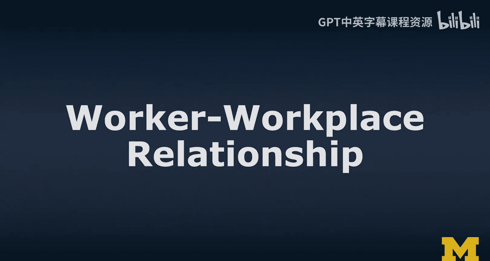
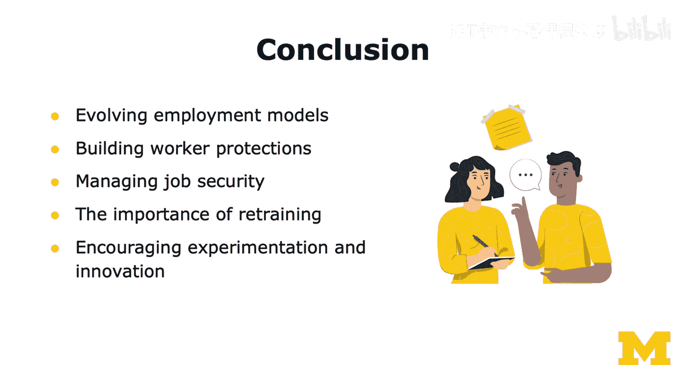
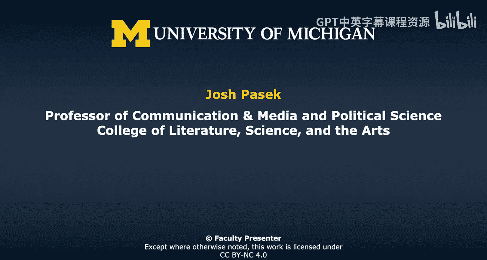

# 应对颠覆：工作场所的生成式人工智能：P35：7_从业者与职场关系

## 概述 📖

在本节课中，我们将探讨人工智能如何影响动态变化的劳动力市场，特别是它如何重塑从业者与职场之间的关系。我们将分析零工经济、远程工作等趋势，并讨论企业应如何管理变革、支持员工，以在AI时代保持竞争力。

---

## 动态变化的劳动力市场背景 📈

人工智能正进入一个本就充满活力的劳动力市场。近几十年来，就业形态持续演变。

以下是劳动力市场的主要变化趋势：

*   **工会影响力减弱**：在许多国家，工会成员占劳动力总数的比例正在缩小。
*   **外包与全球化**：这创造了广泛的国际供应链。
*   **零工经济兴起**：越来越多的劳动力从事由零工经济促成的自由职业和合同工角色。
*   **职业路径多元化**：人们倾向于在一生中从事多份工作，而非遵循单一的职业路径。

---

## AI对职场动态的强化作用 ⚙️

上一节我们介绍了劳动力市场的既有动态，本节中我们来看看AI如何进一步强化这些趋势。思考AI在塑造员工与职场动态中的作用，有助于企业和员工为未来做好准备。

近年来，许多公司的劳动力中，通过合同工和零工经济工作的人员比例不断增长，这取代了传统的雇佣关系。

以下是这类新型工作关系的特点：

*   **按需工作**：从事这些角色的员工通常按需工作。
*   **缺乏保障**：他们缺乏工作保障，与公司建立的是一种可能鼓励探索如何利用AI服务公司利益的关系。
*   **信息披露意愿低**：除非有明确要求，否则他们向雇主披露AI使用情况的可能性较低。
*   **责任归属模糊**：由于这些员工与所服务的公司没有长期关系，公司很难合理地要求他们对可能出现的AI输出问题负责。

**公式：新型工作关系风险 = 低工作保障 + 弱归属感 + 模糊的责任链**

虽然AI工具有助于促进零工的使用，但从长期雇员向零工转变也给公司带来了风险。

---

## AI与工作地点分离趋势 🏠➡️💻

另一个由AI明确增强的劳动力市场趋势，是员工不再需要与他们的工作岗位同处一地。

以下是AI如何推动这一趋势：

*   **促进混合办公**：许多AI工具在促进混合办公方面特别有效。
*   **协调异步工作**：AI允许员工在不同步的工作时间下与他人进行协作。

鉴于AI能力的增长，这一趋势很可能持续。特定公司的现场正式员工比例下降，可能会对公司与员工的关系产生多方面影响，并引发一系列问题：公司如何最好地支持员工？公司可以对员工有何期待？

---

## 管理期望与支持转型 🔄

值得注意的是，AI可能带来对工作保障的不确定性，因此管理员工期望并提供清晰的标准至关重要。这一标准需同时适用于长期雇员和临时雇员。

当AI替代或增强特定工作岗位时，员工会考虑这些转变的影响。公司需要建立标准来帮助员工：

1.  学习使用AI工具。
2.  应对工作中潜在的转变。
3.  如果原有岗位不再需要，识别新的职业前景。

未能解决这些问题或在必要时支持员工，可能会损害员工的工作质量，因为那些对未来感到担忧的员工可能会“身在曹营心汉在”。

相反，那些预见这些转变、与员工有效沟通并提供再培训和技能提升机会的公司，更有可能留住员工。这些员工能在当代就业市场中保持竞争力，并在颠覆性变化中培养出忠诚度。

---

## 鼓励实验与创新的策略 🧪

这种支持性的做法也可能带来直接的竞争优势。感到受支持并被鼓励尝试AI的员工，更有可能发现使公司更具竞争力、并时刻以公司最佳利益为重的策略。

**核心逻辑：如果员工和雇主认为他们“同舟共济”，各方都更有可能蓬勃发展。**

以下是鼓励实验的一些策略：

*   **试点项目**：在工作场所测试AI工具的试点计划。
*   **创新文化**：建立创新文化的新方法，同时为受实验影响的员工提供安全网。
*   **创新实验室**：员工可以在受控环境中测试新工具。

---

## 总结 ✨

在AI驱动的环境中，公司需要认真思考不断演变的员工模型、职场保护、工作保障、再培训以及如何鼓励实验和创新。

本节课中我们一起学习了AI如何深度介入并改变从业者与职场的关系。优先考虑在AI驱动环境中支持员工实践的公司，最能识别AI如何助力整个劳动力队伍中的各个岗位，并建立一种能确保未来竞争力的创新文化。