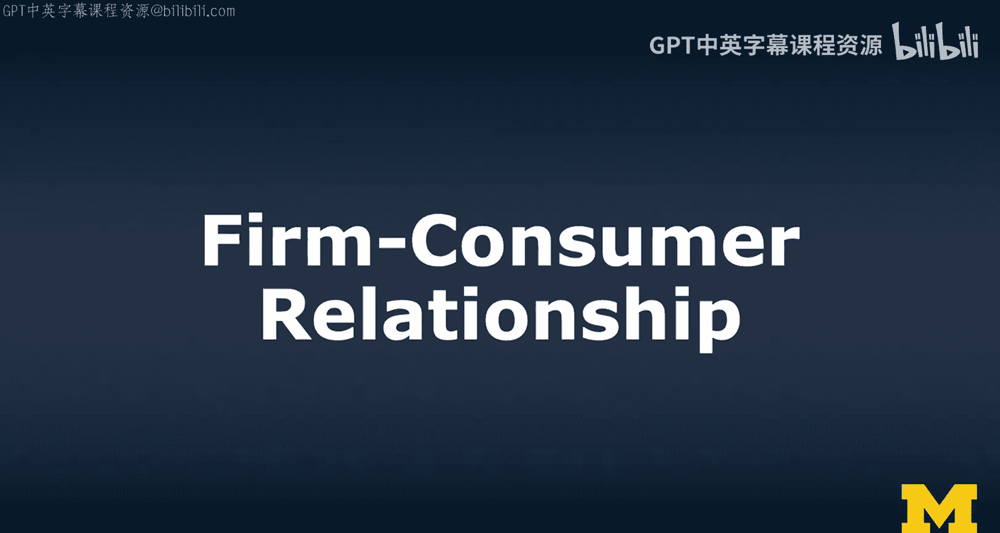
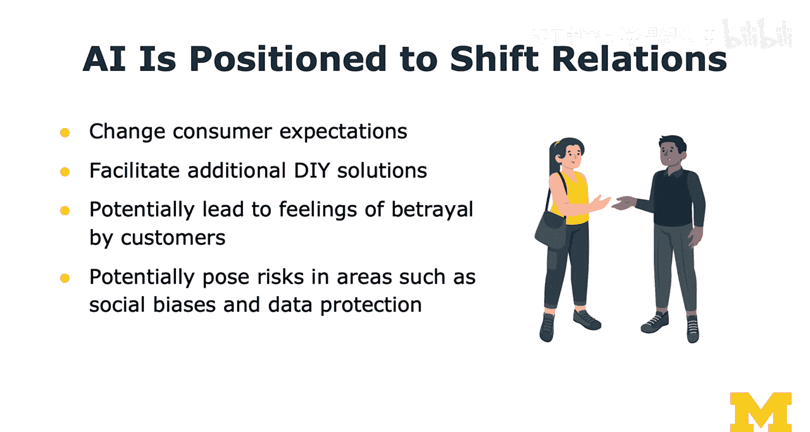
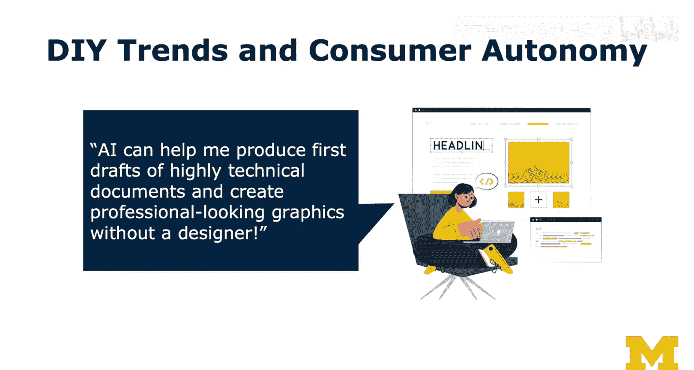
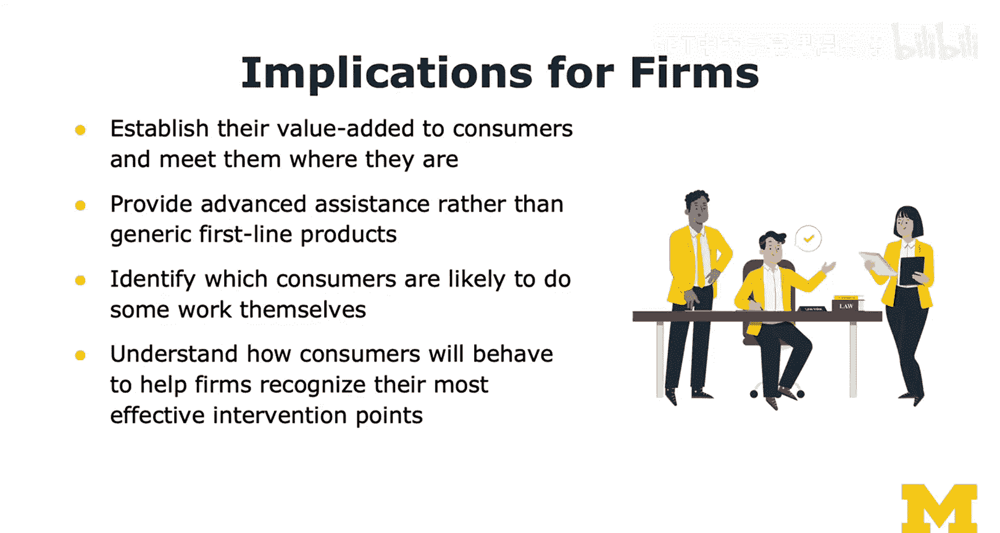
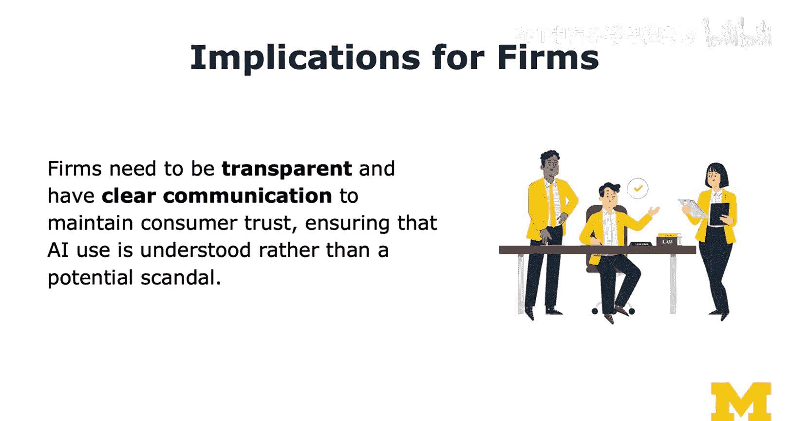
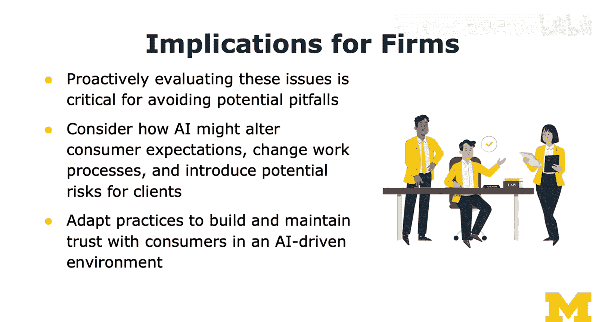
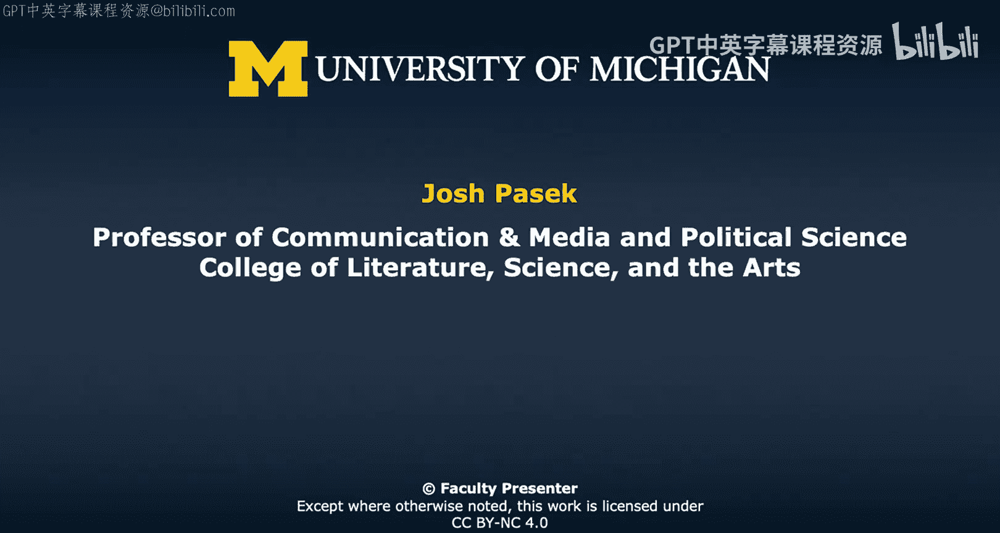

# 应对颠覆：工作场所的生成式人工智能：36：企业与消费者关系 🤖

在本节课中，我们将探讨人工智能如何重塑企业与消费者之间的关系。我们将分析AI如何改变消费者期望、创造新的自助服务模式，并识别其中潜在的风险与挑战。

---

## 人工智能对关系的重塑

人工智能将改变企业与员工、以及企业与服务或产品消费者之间的关系。

AI可能改变消费者期望，促进更多自助解决方案的出现，也可能导致客户产生被背叛的感觉，并在社会偏见和数据保护等领域带来风险。

考虑未来整合AI的企业，不仅需要评估其对内部运营的影响，还需评估其与外部利益相关者关系的影响。

---

## 提升的消费者期望

上一节我们介绍了AI对关系的整体影响，本节中我们来看看它如何具体提升消费者的期望。

人工智能使得为客户提供个性化服务并确保最低程度的无效努力变得前所未有的容易。

当消费者在电子商务平台上体验AI驱动的推荐系统，并从聊天机器人获得个性化帮助时，他们将期望回应能紧密贴合其个人情况。

这些期望可能导致客户对以往被认为是顶尖水平的服务感到失望。

---

## 挑战与自助服务趋势

满足这些提升的期望，同时确保AI系统不构成不必要的风险，对企业而言将是一个挑战。

企业需要管理这些期望，并考虑消费者需求的变化将如何塑造他们提供的服务。

人工智能工具也使消费者能够自己完成以前需要聘请专业人士的工作。

以下是AI赋能消费者的两个例子：
*   AI可以帮助普通人完成高度技术性文档的初稿。
*   AI可以帮助没有设计师的普通人创建具有专业外观的图形。

这种增强消费者自主性的潜力，对那些服务容易被AI工具复制的企业构成了风险。

---

## 企业的应对策略

面对消费者自助服务的趋势，企业需要明确自身的价值定位。

企业需要清晰地向消费者确立其附加价值，并在消费者所在的位置满足他们。

提供高级协助而非通用的初级产品，识别哪些消费者可能自己完成部分工作以及他们将如何行动，将帮助企业找到最有效的干预点。

---

## AI带来的关系风险

除了机遇，人工智能也给企业与客户的关系带来了若干风险。理解客户期望在这种环境中至关重要。

以下是AI可能引发的几种主要风险：

### 透明度与信任风险
一些消费者如果发现他们认为是人类创造的产品实际上是AI生成或严重依赖AI辅助的，可能会感到被背叛。如果企业未能就AI的作用保持透明，这种背叛感可能导致消费者信任度下降，并促使客户转向其他地方寻求服务。这凸显了透明度和清晰沟通对于维持消费者信任的必要性，确保AI的使用被理解，而非成为潜在的丑闻。

### 偏见与公平风险
人工智能系统可能会无意中延续偏见，因为它们从可能本身就有偏见的训练数据中学习。这可能导致不公平或歧视性的结果，例如基于AI生成的数据提供贷款。用于招聘流程的AI算法也可能产生有偏见的结果，可能违反公平劳动标准。这些担忧强调了进行严格测试、监控和缓解策略的必要性，以确保AI工具和应用的公平与公正。

### 数据隐私与安全风险
在许多情况下，AI的使用涉及收集和分析大量消费者数据，引发了重大的隐私担忧以及数据被滥用的潜在风险。当企业进行个性化推荐时，底层数据必须得到谨慎管理。未能实施强有力的数据保护措施可能导致客户信任的丧失，或违反法律和伦理规范。一个特别的挑战是，企业可能无法确切知道特定模型基于什么信息，或者这些信息（如果不是直接收集的）可能被如何使用。AI模型也经常推算信息，这可能成为偏见的来源。企业与客户之间需要进行明确的沟通。主动评估这些问题对于避免潜在陷阱至关重要。

---

## 总结与展望

本节课中，我们一起学习了人工智能如何深刻影响企业与消费者的关系。

在企业和更广泛的社会层面整合AI，要求公司必须考虑AI如何可能改变消费者期望、改变工作流程，并为客户引入潜在风险。公司需要调整其做法，在AI驱动的环境中建立并维持与消费者的信任。